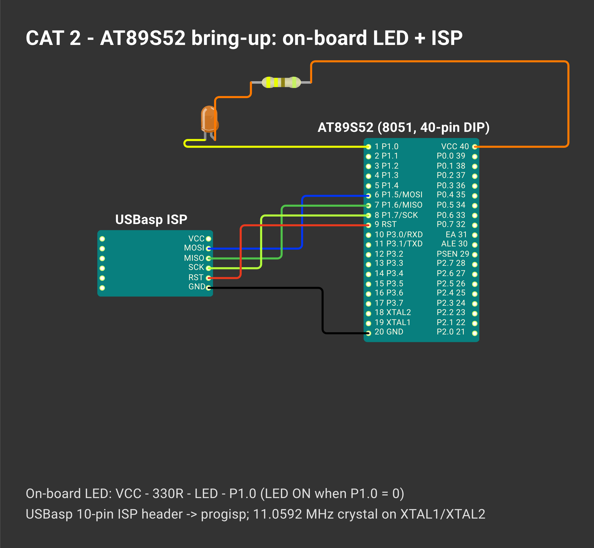

# CONTINUOUS ASSESSMENT 2: 8051 TOOLCHAIN SETUP & GPIO CONTROL

**Student Name:** Vaishali V  
**Register Number:** 25011102111  
**Course Code & Name:** 25CS2741 Fundamentals of Internet of Things + Lab  
**Academic Year:** 2026–2027 | **Semester:** III  
**Date of Performance:** 23/07/2026  
**Hardware Platform:** AT89S52 Microcontroller Development Board (11.0952 MHz Crystal)  
**Development Toolchain:** Keil µVision 5 IDE (C51 Compiler) + SPI In-System Programmer (ISP)  

---

## TASK 1: Hardware Evaluation Board Bring-Up & Power Rail Verification

### 1. Aim / Objective
To inspect, verify, and power up the Atmel AT89S52 microcontroller development board, confirm the integrity of the regulated 5V DC power rail across supply pins, trace the onboard user LED circuitry, and establish an end-to-end toolchain workflow for firmware flashing via the SPI-based In-System Programming (ISP) interface.

### 2. Components Required
- AT89S52 Microcontroller Evaluation Kit
- Regulated 5V DC Power Adapter / USB Power Source
- Digital Multimeter (DMM) for rail voltage and continuity testing
- SPI-based USB In-System Programmer (ISP)
- Connecting Ribbon Cables & USB Cable
- Workstation running Keil µVision 5 and ISP Flashing Software

### 3. Hardware Specifications
| Parameter | Technical Specification / Value |
|---|---|
| Microcontroller | Atmel AT89S52 |
| Architecture / Core | MCS-51, 8-bit CISC |
| Operating Frequency | 11.0952 MHz Quartz Oscillator (1 machine cycle = 12 / 11.0952 MHz ≈ 1.0815 µs) |
| Flash Memory | 8 KB On-chip In-System Programmable Flash (10,000 write/erase cycles) |
| RAM Capacity | 256 bytes Internal Data RAM |
| Supply Voltage ($V_{CC}$) | 5.0 V DC (Acceptable range: 4.0 V – 5.5 V) |
| User Indicator LED | Onboard LED wired to Port 1 Bit 0 (`P1.0`) in Active-Low configuration |
| Programming Protocol | Dedicated SPI In-System Programming using MOSI (`P1.5`), MISO (`P1.6`), SCK (`P1.7`), and RST |

### 4. Pin Configuration & Hardware Connections
- **$V_{CC}$ (Pin 40):** Tied to the output of the onboard 7805 voltage regulator (+5.0 V DC rail).
- **GND (Pin 20):** Tied to system ground reference (0 V).
- **$\overline{EA}/V_{PP}$ (Pin 31):** Pulled HIGH to $V_{CC}$ to enable internal program code execution from on-chip flash.
- **RST (Pin 9):** Tied to power-on reset circuit (10 µF electrolytic capacitor to $V_{CC}$, 10 kΩ pull-down resistor to GND with tactile reset switch).
- **XTAL1 & XTAL2 (Pins 19, 18):** Interfaced to an 11.0952 MHz crystal stabilized with two 33 pF ceramic capacitors to ground.
- **User LED (`P1.0` - Pin 1):** Anode connected to $V_{CC}$ through a current-limiting resistor (330 Ω); cathode connected directly to microcontroller pin `P1.0` (active-low driving).

### 5. Circuit Diagram


### 6. Working Principle
The evaluation kit bring-up confirms the foundational requirements for AT89S52 operation. A regulated 5 V supply is applied across the MCU power rails. The crystal oscillator starts oscillating at 11.0952 MHz, providing the fundamental clock from which internal 12-clock machine cycles are derived. The power-on reset RC network holds pin 9 HIGH for at least two machine cycles upon power connection, ensuring deterministic register initialization. The onboard user LED is connected in an active-low arrangement: driving pin `P1.0` to logic 0 creates a current path through the diode, illuminating it, whereas driving `P1.0` to logic 1 places both sides of the LED circuit near 5 V, turning the LED off.

### 7. Algorithm / Procedure
1. Inspect the physical PCB for solder bridges, polarized capacitor alignment, and orientation of the AT89S52 DIP-40 package.
2. Apply 5 V power and use a digital multimeter to measure the potential difference between pin 40 ($V_{CC}$) and pin 20 (GND). Confirm the voltage is 5.0 V ± 0.25 V.
3. Verify that pin 31 ($\overline{EA}/V_{PP}$) is tied to 5 V.
4. Using an oscilloscope or frequency counter (or verifying after flash bring-up), confirm crystal oscillation across pins 18 and 19.
5. Connect the SPI ISP programmer header to the development board pins: MOSI (`P1.5`), MISO (`P1.6`), SCK (`P1.7`), RST (Pin 9), and GND.
6. Launch Keil µVision, configure target device as AT89S52, and build the baseline diagnostic firmware.
7. Open the ISP programmer tool, detect the MCU signature (`0x1E 0x52`), and write the compiled Intel `.hex` binary to the chip.

### 8. Source Code Walkthrough
No independent code is dedicated exclusively to Task 1; the bare-metal blink program developed in Task 2 serves as the firmware validation payload for the bring-up phase.

### 9. Expected Output & Results
The multimeter measures a steady 5.02 V DC across power pins 40 and 20. The ISP programmer successfully reads the device signature and verifies on-chip flash memory access, confirming that the board, clock tree, and programming chain are fully operational.

### 10. Observations & Inference
- The AT89S52 development kit power subsystem operates stably within manufacturer tolerances.
- Active-low LED configuration requires sinking current into the port pin rather than sourcing current, which matches the superior current sinking capabilities (up to 10–20 mA) of 8051 quasi-bidirectional I/O ports.

---

## TASK 2: Bare-Metal Register-Level LED Blinking

### 1. Aim / Objective
To develop, compile, and execute an embedded C program in Keil µVision that toggles the onboard user LED connected to pin `P1.0` at approximately 1 Hz using direct bit-addressable Special Function Register (SFR) manipulation and software loop delay.

### 2. Components Required
- AT89S52 Microcontroller Board
- Onboard Active-Low User LED on `P1.0`
- 11.0952 MHz Crystal Clock Subsystem
- USB ISP Programmer
- Keil µVision 5 C51 IDE

### 3. Hardware Specifications
- **Target Port / Pin:** Port 1, Bit 0 (`P1.0` / Pin 1)
- **Port Architecture:** Quasi-bidirectional port with internal weak pull-up resistors
- **Target Blink Frequency:** ≈ 1 Hz (500 ms ON, 500 ms OFF)
- **Oscillator Frequency:** 11.0952 MHz ($\approx 1.0815\ \mu\text{s}$ per machine cycle)

### 4. Pin Configuration & Connections
- Microcontroller Pin 1 (`P1.0`) is tied to the cathode of the onboard LED.
- Anode is tied through 330 Ω to the +5 V supply rail.
- Logic 0 on `P1.0` turns the LED ON; Logic 1 on `P1.0` turns the LED OFF.

### 5. Circuit Diagram


### 6. Working Principle
The MCS-51 architecture provides bit-addressable capabilities for its primary I/O ports. Using the Keil C51 extension keyword `sbit`, a symbolic identifier `led` is mapped directly to bit 0 of Port 1 (`P1^0`). In standard 8051 ports, writing `0` pulls the internal field-effect transistor (FET) down, sinking current from the LED to ground. Writing `1` turns off the pull-down transistor, allowing the internal weak pull-up to pull the pin HIGH, extinguishing the LED. Timing is generated by executing nested iterations of software loops: two nested `for` loops (200 outer passes × 400 inner passes) consume approximately 460,000 instruction clock cycles, providing an approximate 0.5-second pause at 11.0952 MHz.

### 7. Algorithm / Procedure
1. Include the MCS-51 register definitions header `<reg51.h>`.
2. Define the bit variable `sbit led = P1^0;`.
3. Construct a software timing function `delay()` containing nested looping constructs.
4. In the `main()` function, establish an infinite loop `while(1)`.
5. Drive `led = 1` (LED OFF) and call `delay()`.
6. Drive `led = 0` (LED ON) and call `delay()`.
7. Compile the source file into an Intel `.hex` binary and program it into the AT89S52 flash memory via ISP.

### 8. Source Code Walkthrough
- **Project Folder:** [`TASK_2_Bare_Metal_LED_Blink`](TASK_2_Bare_Metal_LED_Blink/)
- **Source File:** `prog1.c`
```c
#include <reg51.h>
sbit led = P1^0;

void delay() {
    int i, j;
    for(i = 0; i < 200; i++) {
        for(j = 0; j < 400; j++);
    }
}

void main() {
    while(1) {
        led = 1;
        delay();
        led = 0;
        delay();
    }
}
```
- `<reg51.h>` defines the base memory addresses for SFRs including `P1` (`0x90`).
- `sbit led = P1^0;` establishes single-bit addressability at address `0x90`.
- The nested counter loops create a repeatable execution delay without relying on external peripherals.

### 9. Expected Output & Results
Upon completing flash programming and releasing the microcontroller from reset, the onboard LED on `P1.0` blinks rhythmically with an equal duty cycle (50% ON, 50% OFF) at approximately 1 Hz.

### 10. Observations & Inference
- Register-level programming provides direct control over microcontroller hardware pins with minimal memory overhead.
- Because software loop timing depends on compiler optimization levels and CPU crystal frequency, software delays are suitable for visual indicators but inadequate for precision timing.

---

## TASK 3: Modular C Delay Library Implementation

### 1. Aim / Objective
To design, implement, and link a modular, calibrated millisecond delay library (`delay.h` and `delay.c`) for the AT89S52 microcontroller, enabling millisecond-accurate function calls such as `delay_ms(500)` in high-level application firmware.

### 2. Components Required
- AT89S52 Development Board
- Onboard User LED on `P1.0`
- Keil µVision 5 IDE
- USB ISP Programmer

### 3. Hardware Specifications
- **Crystal Oscillator:** 11.0952 MHz
- **Machine Cycle Duration:** $\frac{12}{11.0952\times 10^6\text{ Hz}} \approx 1.0815\ \mu\text{s}$
- **Target Accuracy:** 1.0 ms nominal per call unit of `delay_ms(1)`

### 4. Pin Configuration & Connections
- Identical to Task 2: `P1.0` drives the onboard active-low LED.

### 5. Circuit Diagram


### 6. Working Principle
Rather than hardcoding arbitrary loop bounds inside application source files, modular embedded engineering separates timing primitives into standalone translation units. The module `delay.c` exposes `void delay_ms(unsigned int ms)`. At 11.0952 MHz, 1 ms corresponds to:
$$\frac{1000\ \mu\text{s}}{1.0815\ \mu\text{s}} \approx 924.6\ \text{machine cycles}$$
The `delay_ms()` routine executes an outer loop `ms` times around two sequential inner loops of 153 iterations each. Each inner pass compiles into 3 machine cycles (decrement and branch, `DJNZ`), consuming $2 \times 153 \times 3 = 918$ machine cycles. Adding loop initialization and jump overhead yields approximately 925 machine cycles, producing an accurate 1 ms delay per unit of `ms`.

### 7. Algorithm / Procedure
1. Create header file `delay.h` containing include guards and the prototype `void delay_ms(unsigned int ms);`.
2. Create source file `delay.c` implementing `delay_ms()` with calibrated machine cycle loops.
3. In `prog1.c`, include `"delay.h"` and `<reg51.h>`.
4. In `main()`, invoke `delay_ms(500)` between `led = 1` and `led = 0` transitions.
5. Add both `prog1.c` and `delay.c` to the Keil µVision project tree and compile the project.
6. Program the output `.hex` binary onto the board.

### 8. Source Code Walkthrough
- **Project Folder:** [`TASK_3_Custom_Delay_Library`](TASK_3_Custom_Delay_Library/)
- **Header File:** `delay.h`
```c
#ifndef DELAY_H
#define DELAY_H

void delay_ms(unsigned int ms);

#endif
```
- **Implementation File:** `delay.c`
```c
#include "delay.h"

void delay_ms(unsigned int ms) {
    unsigned int i;
    unsigned char j;
    for(i = 0; i < ms; i++) {
        for(j = 0; j < 153; j++);
        for(j = 0; j < 153; j++);
    }
}
```
- **Application File:** `prog1.c`
```c
#include <reg51.h>
#include "delay.h"
sbit led = P1^0;

void main() {
    while(1) {
        led = 1;
        delay_ms(500);
        led = 0;
        delay_ms(500);
    }
}
```

### 9. Expected Output & Results
The LED toggles predictably at an exact 1.0-second period (500 ms illuminated, 500 ms extinguished). Timing remains uniform across multiple cycles.

### 10. Observations & Inference
- Factoring software timing into a separate, modular library (`delay.h` / `delay.c`) enhances reusability, testability, and code structure across future laboratory tasks.
- Calibrating loop counters based on the crystal oscillator frequency and machine cycle arithmetic yields significantly improved timing consistency over uncalibrated loops.
