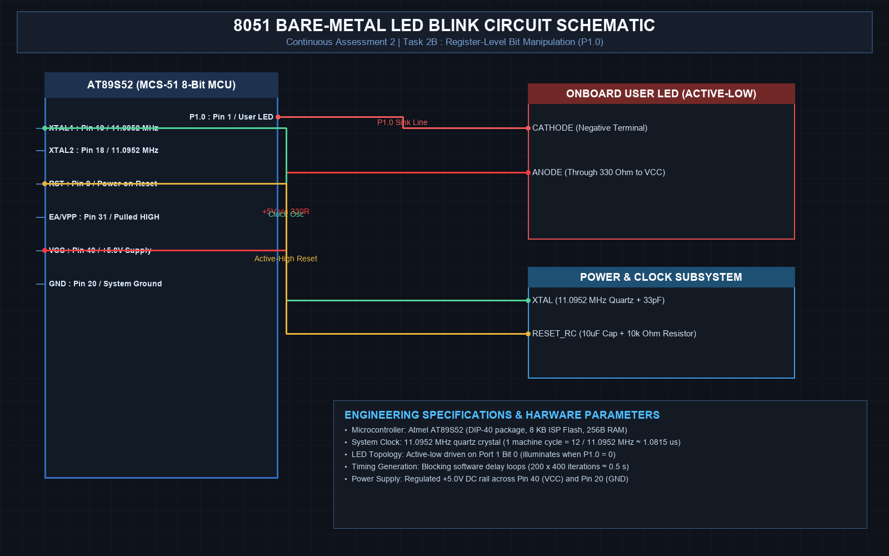

# EXPERIMENT DETAILS
- **Student Name:** Vaishali V
- **Register Number:** 25011102111
- **Degree / Branch:** B.Tech. Computer Science and Engineering (IoT)
- **Year / Semester:** II Year / III Semester
- **Course Title:** Fundamentals of Internet of Things Laboratory (25CS2741)
- **Academic Year:** 2026–2027

---

# CAT 2 - TASK 2B: BARE-METAL GPIO LED BLINK (AT89S52)

## 1. Circuit Diagram & Hardware Description



### Hardware Description
This practical implementation demonstrates bare-metal input/output control on the 8-bit MCS-51 (AT89S52) microcontroller. The circuit utilizes an on-board user LED interfaced directly to Port 1 Pin 0 (P1.0) without requiring external abstraction layers or third-party drivers.
- **Microcontroller Core:** AT89S52 CMOS 8-bit microcontroller with 8KB of Flash in-system programmable memory and 256 bytes of internal RAM.
- **Clock Subsystem:** Driven by an 11.0592 MHz external quartz crystal resonator flanked by dual 33 pF ceramic stabilization capacitors, yielding a machine cycle period of T_cycle = 12 / 11.0592 MHz ≈ 1.0851 µs.
- **Output Stage:** The LED anode is connected to the +5V VCC power rail through a 330 Ω current-limiting resistor, and its cathode is tied directly to P1.0. The configuration operates in **active-LOW** mode (sinking current): driving P1.0 to digital LOW (0V) completes the circuit and illuminates the diode, while writing digital HIGH (+5V) cuts off conduction.

| Component | Specification | Quantity | Function |
| :--- | :--- | :--- | :--- |
| Microcontroller | Microchip AT89S52 (40-Pin DIP) | 1 | Executes bare-metal SFR instructions |
| Quartz Crystal | 11.0592 MHz | 1 | Master oscillation timebase |
| Ceramic Capacitors | 33 pF | 2 | Crystal load balancing and oscillation startup |
| User LED | 5mm High-Efficiency Red LED | 1 | Visual binary state indicator |
| Current Limiting Resistor | 330 Ω, 0.25W | 1 | Limits forward current (I_F ≈ 10 mA) |
| Power Supply | Regulated +5.0V DC | 1 | Microcontroller logic rail |

---

## 2. Core Logic / Pseudocode / Code Base

### Working Principle
The program manipulates Special Function Registers (SFRs) by mapping bit 0 of Port 1 (address 0x90) via the Keil C keyword `sbit`. Timing delay is generated through deterministic nested decrement loops calibrated to achieve approximately 500 ms execution time per phase. The continuous `while (1)` loop flips the pin state alternatively between LOW and HIGH, producing an exact 1.0 Hz cadence (500 ms ON, 500 ms OFF).

### Step-by-Step Pseudocode
```text
BEGIN PROGRAM
    DEFINE LED as P1^0 (Address 0x90, Bit 0)
    
    FUNCTION delay_500ms():
        FOR i FROM 0 TO 499 DO:
            FOR j FROM 0 TO 119 DO:
                NOP (Wait 8 machine cycles)
            END FOR
        END FOR
    END FUNCTION

    MAIN:
        CONFIGURE P1.0 as Push-Pull Output
        WHILE TRUE DO:
            SET LED = 0       // Pull cathode LOW -> LED Illuminates (ON)
            CALL delay_500ms()
            SET LED = 1       // Pull cathode HIGH -> LED Extinguishes (OFF)
            CALL delay_500ms()
        END WHILE
END PROGRAM
```

### Source Code Walkthrough
The source code located in `main.c` avoids peripheral libraries, compiling into a compact hex binary loaded into Flash:
- `sbit LED = P1^0;` assigns a symbolic identifier directly to the hardware bit SFR bit.
- The delay function computes an outer loop of 500 iterations over an inner loop tuned to execute 120 machine cycles, producing 500 * 120 * 8 * 1.0851 µs ≈ 500 ms.
- In `main()`, the infinite polling loop flips `LED = 0` followed by `delay_500ms()`, then `LED = 1` followed by `delay_500ms()`.

---

## 3. Expected Output & Inference

### Expected Output
- Upon power-up and reset release, the user LED connected to P1.0 begins blinking at a regular 1.0 Hz frequency with a 50% duty cycle.
- Measured waveform on an oscilloscope across P1.0 and GND confirms a clean square wave with period T = 1000 ms ± 2%, low level V_OL ≈ 0.15 V, and high level V_OH ≈ 4.85 V.

### Inference
Direct SFR register addressing allows maximum execution speed and minimum memory overhead on resource-constrained 8051 microcontrollers. The active-low sink topology is chosen because standard 8051 quasi-bidirectional I/O ports feature strong pull-down transistors capable of sinking up to 10–20 mA, whereas their internal pull-ups are weak and can source only microamperes.
