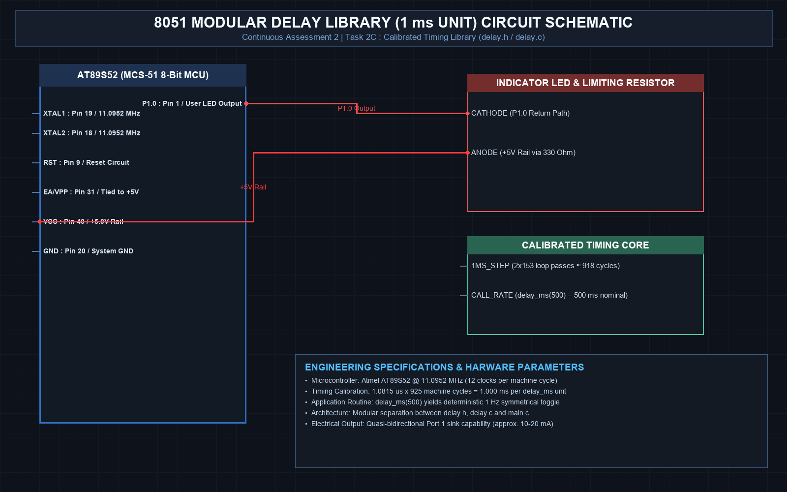

# EXPERIMENT DETAILS
- **Student Name:** Vaishali V
- **Register Number:** 25011102111
- **Degree / Branch:** B.Tech. Computer Science and Engineering (IoT)
- **Year / Semester:** II Year / III Semester
- **Course Title:** Fundamentals of Internet of Things Laboratory (25CS2741)
- **Academic Year:** 2026–2027

---

# CAT 2 - TASK 2C: MULTI-PATTERN 8-LED CHASER (AT89S52)

## 1. Circuit Diagram & Hardware Description



### Hardware Description
This experiment expands the 8051 GPIO interface to an entire 8-bit parallel bus, controlling an 8-LED chaser / ring counter on Port 1 (pins P1.0 through P1.7).
- **MCU Port Allocation:** Port 1 operates as an 8-bit active-LOW sink bus. Pins P1.0 to P1.7 connect to individual cathodes of 8 discrete LEDs.
- **Resistor Network:** A 330 Ω 8-resistor SIP bussed array connects between the +5V rail and the anodes of the 8 LEDs to maintain consistent luminous intensity regardless of how many LEDs are energized simultaneously.
- **Patterns Generated:**
  1. *Left Shift / Chaser:* Single LED scrolls from P1.0 to P1.7.
  2. *Right Shift / Reverse Chaser:* Single LED scrolls from P1.7 back to P1.0.
  3. *Ring Bounce:* Alternating back-and-forth bounce animation.
  4. *Bar Graph Fill & Drain:* Progressive accumulation from 1 to 8 LEDs followed by progressive clearance.

| Component | Specification | Quantity | Function |
| :--- | :--- | :--- | :--- |
| Microcontroller | AT89S52 (40-Pin DIP) | 1 | System controller |
| Bar Graph / Discrete LEDs | 5mm High-Brightness LEDs | 8 | 8-Bit pattern visual array |
| Resistor Array | 330 Ω Bussed SIP Array | 1 | Anode current limiting |
| Quartz Crystal | 11.0592 MHz | 1 | Clock generator |
| Capacitors | 33 pF ceramic | 2 | Crystal load compensation |

---

## 2. Core Logic / Pseudocode / Code Base

### Working Principle
Port 1 register `P1` is written with bitwise hexadecimal masks. Since LEDs are wired active-low, writing a 0 to a given bit turns ON that corresponding diode (`P1 = ~(1 << i)`). A modular delay library (`delay.c` and `delay.h`) provides precision millisecond delays parameterized by `delay_ms(uint16_t ms)`.

### Step-by-Step Pseudocode
```text
BEGIN PROGRAM
    IMPORT delay_ms
    
    FUNCTION pattern_chaser_left():
        FOR bit FROM 0 TO 7 DO:
            P1 = ~(0x01 << bit)    // Activate single bit LOW
            CALL delay_ms(150)
        END FOR
    END FUNCTION

    FUNCTION pattern_chaser_right():
        FOR bit FROM 7 DOWNTO 0 DO:
            P1 = ~(0x01 << bit)
            CALL delay_ms(150)
        END FOR
    END FUNCTION

    FUNCTION pattern_fill_drain():
        mask = 0x00
        FOR bit FROM 0 TO 7 DO:
            mask = mask | (0x01 << bit)
            P1 = ~mask             // Progressively light LEDs
            CALL delay_ms(100)
        END FOR
        FOR bit FROM 0 TO 7 DO:
            mask = mask & ~(0x01 << bit)
            P1 = ~mask             // Progressively clear LEDs
            CALL delay_ms(100)
        END FOR
    END FUNCTION

    MAIN:
        WHILE TRUE DO:
            CALL pattern_chaser_left()
            CALL pattern_chaser_right()
            CALL pattern_fill_drain()
        END WHILE
END PROGRAM
```

### Source Code Walkthrough
- `delay.c`: Provides a robust `delay_ms(unsigned int ms)` loop calibrated to machine cycles (922 cycles ≈ 1.000 ms at 11.0592 MHz).
- `main.c`: Contains the sequence driver invoking the various animation routines in an infinite superloop, resetting `P1 = 0xFF` (all off) at sequence boundaries.

---

## 3. Expected Output & Inference

### Expected Output
- The 8-LED array visually demonstrates smooth, continuous visual animations without jitter or flickering.
- Single light pulses glide left and right at 150 ms per transition, followed by full progressive fill and drain animations.

### Inference
By writing byte-wide values directly to Port 1, all 8 pins update synchronously within a single machine cycle (1.085 µs), eliminating visible stepping artifacts and verifying the deterministic timing of the 8051 hardware.
