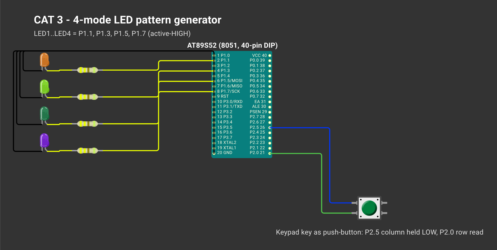

# CONTINUOUS ASSESSMENT 3: MULTI-STATE LED SEQUENCER & SWITCH DEBOUNCING

**Student Name:** Vaishali V  
**Register Number:** 25011102111  
**Course Code & Name:** 25CS2741 Fundamentals of Internet of Things + Lab  
**Academic Year:** 2026–2027 | **Semester:** III  
**Date of Performance:** 30/07/2026  
**Hardware Platform:** AT89S52 Microcontroller Development Board (11.0952 MHz Crystal)  
**Development Toolchain:** Keil µVision 5 IDE (C51 Compiler) + 4 External LEDs + Tactile Switch  

---

## ACTIVITY: Four-Mode LED Pattern Controller with Finite State Machine

### 1. Aim / Objective
To design, implement, and verify a multi-mode LED sequencer using an 8-bit AT89S52 microcontroller, wherein sequential actuations of a tactile push-button transition the system across distinct lighting animations (running chaser, binary up-counter, alternating pairs, and synchronous flashing) using a software-debounced finite state machine (FSM).

### 2. Components Required
- AT89S52 Microcontroller Development Board
- 4 External Light Emitting Diodes (LEDs)
- 4 Current-Limiting Resistors (330 Ω each)
- Onboard Matrix Keypad Button (Row `P2.0`, Column `P2.5`)
- Breadboard & Male-to-Female Jumper Wires
- Keil µVision 5 IDE & USB ISP Programmer

### 3. Hardware Specifications
| Parameter | Description / Operating Range |
|---|---|
| Microcontroller | Atmel AT89S52 (MCS-51 Architecture) |
| System Clock Frequency | 11.0952 MHz ($\approx 1.0815\ \mu\text{s}$ per instruction machine cycle) |
| LED Array Output | 4 Discrete Pins on Port 1 (`P1.1`, `P1.3`, `P1.5`, `P1.7`) |
| LED Configuration | Active-High (Anodes to Port 1 pins via resistors, Cathodes to common GND) |
| Switch Input Interface | Port 2 Matrix Switch: Column `P2.5` (driven LOW), Row `P2.0` (read input) |
| Debounce Filter Duration | ≈ 10 ms software sampling window |
| Step Interval | ≈ 300 ms between animation frames |

### 4. Pin Configuration & Hardware Connections
- **LED1 (Anode):** Connected to pin `P1.1` (Pin 2) via 330 Ω resistor; cathode to GND.
- **LED2 (Anode):** Connected to pin `P1.3` (Pin 4) via 330 Ω resistor; cathode to GND.
- **LED3 (Anode):** Connected to pin `P1.5` (Pin 6) via 330 Ω resistor; cathode to GND.
- **LED4 (Anode):** Connected to pin `P1.7` (Pin 8) via 330 Ω resistor; cathode to GND.
- **Keypad Matrix Column:** Pin `P2.5` (Pin 26) driven to logic 0 to provide a ground return path.
- **Keypad Matrix Row:** Pin `P2.0` (Pin 21) sampled as a digital input with internal pull-up. When the switch is depressed, `P2.0` is pulled LOW through `P2.5`.

### 5. Circuit Diagram

### 6. Working Principle
The system integrates digital input polling with a finite state machine to deliver reliable user interaction:
1. **Switch Interfacing & Debouncing:** Mechanical push-buttons exhibit physical contact bounce lasting 5–15 ms upon actuation. The firmware implements a non-blocking debouncer `btn()`: when `P2.0` reads LOW, the code waits approximately 10 ms and re-evaluates the pin. If `P2.0` remains LOW, a genuine button press is registered, and the function waits until the button is released before returning `1`.
2. **Finite State Machine Architecture:** The system state is maintained by a global integer `mode`. Each valid button trigger increments `mode` sequentially:
   $$\text{Mode } 0 \xrightarrow{\text{press}} 1 \xrightarrow{\text{press}} 2 \xrightarrow{\text{press}} 3 \xrightarrow{\text{press}} 4 \xrightarrow{\text{press}} 1$$
   Transitioning into a new mode resets the internal pattern variables (`pos`, `count`, `alt`, `flash`) so the chosen animation begins from its initial frame.

| Mode Index | State Description | Visual Output Pattern ($L_1\ L_2\ L_3\ L_4$) |
|:---:|---|---|
| **0** | Idle / Power-Up State | All LEDs extinguished (`0000`) |
| **1** | Single-LED Running Chaser | Cyclical shifting: `1000 → 0100 → 0010 → 0001 → 1000` |
| **2** | 4-Bit Binary Up-Counter | Sequential modulo-16 counting: `0000` through `1111` |
| **3** | Alternating Complementary Pairs | Inversion: `1010 ↔ 0101` |
| **4** | Synchronous Flash | Full array blink: `1111 ↔ 0000` |

### 7. Algorithm / Procedure
1. Declare bit-level port assignments using `sbit` for the 4 LED pins on Port 1 and the row/column lines on Port 2.
2. Initialize Port 1 pins to `0` (all LEDs OFF), pull column pin `P2.5` LOW, and set state variable `mode = 0`.
3. Construct the `btn()` polling routine:
   - Check if `row == 0`.
   - If LOW, execute a 10 ms software delay and re-sample `row`.
   - If still LOW, wait until `row == 1` (release verification) and return `1`.
   - If no valid press occurred, return `0`.
4. Construct an animation delay routine `wait()` that executes 300 ms of step delay while periodically polling the button to maintain responsiveness.
5. In the `main()` loop:
   - Check `btn()`. If a press is confirmed, increment `mode = (mode % 4) + 1` and reset pattern counters.
   - Dispatch the pattern execution block corresponding to `mode`:
     - **Mode 1:** Turn ON only the LED at index `pos`, advance `pos = (pos + 1) % 4`.
     - **Mode 2:** Assign bit 0 of `count` to `P1.1`, bit 1 to `P1.3`, bit 2 to `P1.5`, bit 3 to `P1.7`; increment `count = (count + 1) % 16`.
     - **Mode 3:** Invert `alt` flag; display `1010` if `alt == 0`, else `0101`.
     - **Mode 4:** Invert `flash` flag; display `1111` if `flash == 0`, else `0000`.
   - Invoke `wait()` to maintain visual persistence.
6. Compile into `day2.hex` in Keil µVision and program onto the AT89S52 via ISP.

### 8. Source Code Walkthrough
- **Workspace Location:** [`CAT3/`](./)
- **Source File:** `day2.c`
- **Pre-Compiled Hex Binary:** [`Objects/day2.hex`](Objects/day2.hex)
- Key architectural elements in `day2.c`:
  - `sbit row = P2^0;` and `sbit col = P2^5;` map the matrix switch.
  - `sbit led1 = P1^1; sbit led2 = P1^3; sbit led3 = P1^5; sbit led4 = P1^7;` map active-high outputs.
  - Dedicated helper functions `btn()`, `wait()`, and conditional pattern updates ensure decoupling between input processing and output rendering.

### 9. Expected Output & Results
- At boot, all four LEDs remain off (Mode 0).
- Press 1: The LEDs sequence individually from left to right at ~300 ms per step.
- Press 2: The LEDs display binary numbers from 0 to 15, advancing once every 300 ms.
- Press 3: Odd LEDs (`L1, L3`) and even LEDs (`L2, L4`) flash alternately.
- Press 4: All four LEDs toggle simultaneously in unison.
- Press 5: Wraps back to Mode 1 (running chaser).
- Spurious double-triggers from mechanical switch bounce are completely eliminated.

### 10. Observations & Inference
- Software debouncing prevents contact bounce noise from generating erroneous state transitions.
- Structuring multi-function embedded firmwares as finite state machines enables modular state transitions without requiring operating systems or complex threading.
