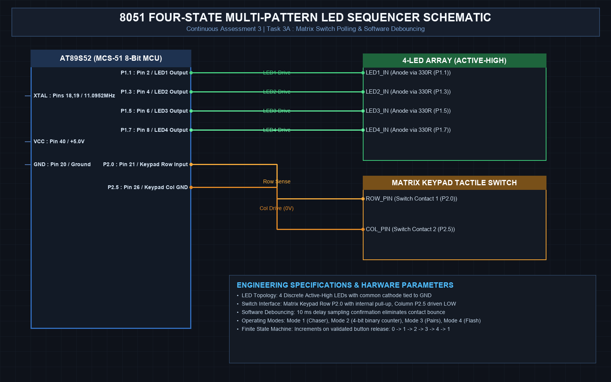

# EXPERIMENT DETAILS
- **Student Name:** Vaishali V
- **Register Number:** 25011102111
- **Degree / Branch:** B.Tech. Computer Science and Engineering (IoT)
- **Year / Semester:** II Year / III Semester
- **Course Title:** Fundamentals of Internet of Things Laboratory (25CS2741)
- **Academic Year:** 2026–2027

---

# CAT 3 - TASK 3A: 4-BIT BINARY COUNTER (AT89S52)

## 1. Circuit Diagram & Hardware Description



### Hardware Description
This experiment implements an automated 4-bit binary up-counter displaying numeric values from 0000_2 (0_10) to 1111_2 (15_10) on Port 1 pins P1.0 through P1.3.
- **Microcontroller:** AT89S52 clocked with an 11.0592 MHz crystal.
- **Display Stage:** 4 discrete red LEDs representing bits 2^0 (P1.0 - LSB), 2^1 (P1.1), 2^2 (P1.2), and 2^3 (P1.3 - MSB).
- **Polarity:** Active-LOW sinking configuration. When bit k of the counter is 1, the corresponding pin is driven to 0 (LOW), causing current to flow through the 330 Ω resistor and illuminating that LED.

| Pin | Connection | Logic Level for '1' | Function |
| :--- | :--- | :--- | :--- |
| P1.0 | LED 0 (LSB) Cathode | LOW (0V) | Bit 0 (2^0) weight = 1 |
| P1.1 | LED 1 Cathode | LOW (0V) | Bit 1 (2^1) weight = 2 |
| P1.2 | LED 2 Cathode | LOW (0V) | Bit 2 (2^2) weight = 4 |
| P1.3 | LED 3 (MSB) Cathode | LOW (0V) | Bit 3 (2^3) weight = 8 |

---

## 2. Core Logic / Pseudocode / Code Base

### Working Principle
An unsigned 8-bit integer accumulator variable `count` increments from 0 to 15. On each iteration, the lower 4 bits are inverted and applied to Port 1 while preserving the upper nibble (P1.4–P1.7). A calibrated 500 ms delay provides human-readable visual transitions. When the count exceeds 15, it rolls over automatically to 0.

### Step-by-Step Pseudocode
```text
BEGIN PROGRAM
    INITIALIZE count = 0
    
    MAIN:
        WHILE TRUE DO:
            // Extract lower nibble and invert for active-low LEDs
            masked_val = count & 0x0F
            port_val = (P1 & 0xF0) | (~masked_val & 0x0F)
            P1 = port_val
            
            CALL delay_ms(500)
            
            count = count + 1
            IF count > 15 THEN:
                count = 0
            END IF
        END WHILE
END PROGRAM
```

### Source Code Walkthrough
- `main.c`: Uses bitwise masking `(count & 0x0F)` to confine the numeric state strictly to a 4-bit range.
- `P1 = ~count;`: Inverts bits so a binary '1' results in pin LOW (LED ON), giving an intuitive binary representation where lighted LEDs correspond directly to set bits.
- `delay_ms(500)`: Suspends execution for half a second between count steps.

---

## 3. Expected Output & Inference

### Expected Output
- The 4 LEDs cycle continuously through all 16 binary states (0000 to 1111).
- Each step remains visible for exactly 500 ms, completing a full counting cycle every 8.0 seconds before rolling over smoothly.

### Inference
Bitwise manipulation and inversion allow straightforward translation of mathematical integer variables into hardware control lines, verifying both arithmetic operations and bitwise masking on the 8051.
