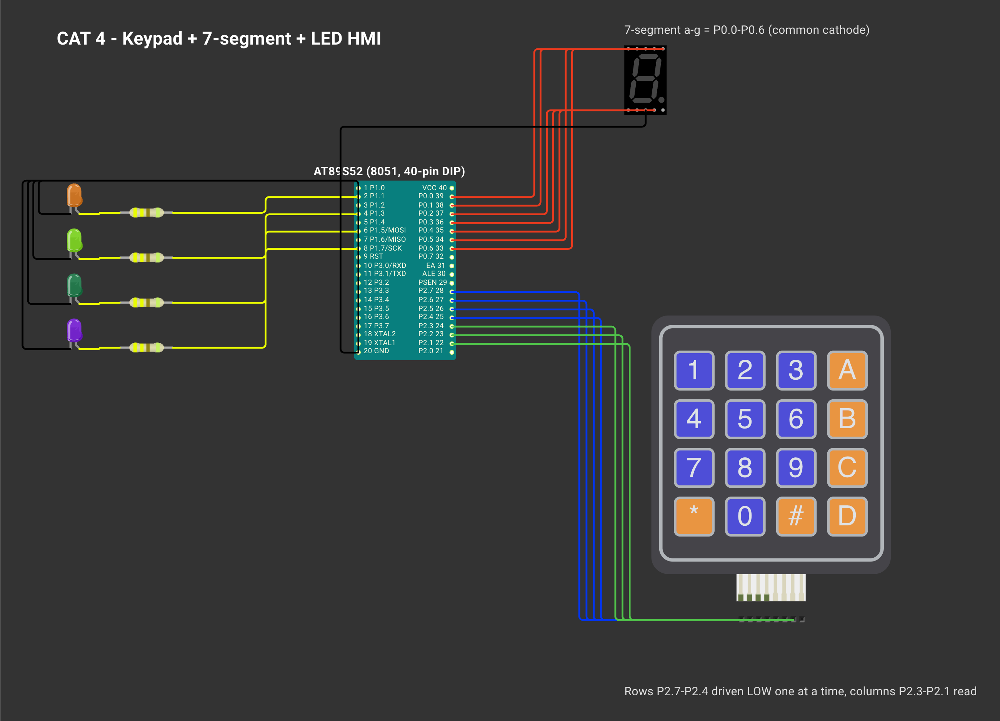

# CONTINUOUS ASSESSMENT 4: HUMAN-MACHINE INTERFACE (KEYPAD, 7-SEGMENT & LEDS)

**Student Name:** Vaishali V  
**Register Number:** 25011102111  
**Course Code & Name:** 25CS2741 Fundamentals of Internet of Things + Lab  
**Academic Year:** 2026–2027 | **Semester:** III  
**Date of Performance:** 06/08/2026  
**Hardware Platform:** AT89S52 Microcontroller Development Board (11.0952 MHz Crystal)  
**Development Toolchain:** Keil µVision 5 IDE (C51 Compiler) + 4×4 Matrix Keypad + 7-Segment Display + 4 LEDs  

---

## TASK: Interactive HMI System with Matrix Keypad Multiplexing & Segment Decoding

### 1. Aim / Objective
To design and construct an interactive embedded Human-Machine Interface (HMI) using the AT89S52 microcontroller, integrating matrix keypad row-column scanning, a common-cathode 7-segment numeric display, and an array of 4 discrete LEDs to dynamically decode key inputs and trigger corresponding visual patterns.

### 2. Components Required
- AT89S52 Microcontroller Development Kit
- 4×4 Matrix Keypad (integrated into development board)
- Single-Digit Common-Cathode 7-Segment LED Display
- 4 External Active-High LEDs with 330 Ω Current-Limiting Resistors
- Pull-Up Resistor Array (10 kΩ SIL pack for Port 0 open-drain outputs)
- Keil µVision 5 IDE & USB ISP Programmer

### 3. Hardware Specifications
| Subsystem | Hardware Specification |
|---|---|
| Microcontroller | Atmel AT89S52 (8-bit CISC, 11.0952 MHz) |
| Display Output Port | Port 0 (`P0.0`–`P0.6`) driving segments `a` through `g` (Open-drain with external pull-ups) |
| Keypad Matrix Interface | Port 2: Rows on `P2.7`–`P2.4` (outputs), Columns on `P2.3`–`P2.1` (inputs) |
| LED Array Interface | Port 1: `P1.1`, `P1.3`, `P1.5`, `P1.7` (Push-pull / quasi-bidirectional outputs) |
| Display Configuration | Common-Cathode (Active-High segment drive: logic 1 illuminates segment) |
| Scan Cycle Timing | ~10 ms debounce verification per pressed key |

### 4. Pin Configuration & Connections
- **Port 0 (`P0.0` to `P0.6`):** Connected to 7-segment display anodes (`a, b, c, d, e, f, g`) through a 10 kΩ pull-up network and current-limiting resistors. Display cathode is tied to GND.
- **Port 2 (`P2.7`, `P2.6`, `P2.5`, `P2.4`):** Matrix Keypad Rows 1 through 4 (driven LOW sequentially during scan).
- **Port 2 (`P2.3`, `P2.2`, `P2.1`):** Matrix Keypad Columns 1 through 3 (sampled with internal pull-ups).
- **Port 1 (`P1.1`, `P1.3`, `P1.5`, `P1.7`):** Wired to anodes of LED1, LED2, LED3, and LED4; cathodes tied to common GND.

### 5. Circuit Diagram

### 6. Working Principle
The HMI system demonstrates two core embedded multiplexing concepts:
1. **Keypad Matrix Scanning:** Rather than dedicating individual microcontroller pins to each switch, the 4×3 matrix uses 7 I/O pins. The MCU pulls one row LOW at a time (`P2.7 → P2.6 → P2.5 → P2.4`) while keeping other rows HIGH. If a key is pressed, it shorts the active row to that key's column pin, pulling the column input LOW. The MCU detects which column went LOW, computes the key value (`0`–`9`), applies a 10 ms debounce check, and waits for key release.
2. **7-Segment Display Encoding:** In a common-cathode display, each segment illuminates when driven with logic 1. A precomputed lookup table maps decimal values `0`–`9` into corresponding 7-bit segment hex codes:

$$\text{Display Code Map: } \{0: \text{0x3F},\ 1: \text{0x06},\ 2: \text{0x5B},\ 3: \text{0x4F},\ 4: \text{0x66},\ 5: \text{0x6D},\ 6: \text{0x7D},\ 7: \text{0x07},\ 8: \text{0x7F},\ 9: \text{0x6F}\}$$

| Key Pressed | 7-Seg Character | Hex Code | Controlled LED Action |
|:---:|:---:|:---:|---|
| **1** | `1` | `0x06` | Turn ON LED1 only |
| **2** | `2` | `0x5B` | Turn ON LED2 only |
| **3** | `3` | `0x4F` | Turn ON LED3 only |
| **4** | `4` | `0x66` | Turn ON LED4 only |
| **5** | `5` | `0x6D` | Start Running Chaser animation across all 4 LEDs |
| **6** | `6` | `0x7D` | Start Alternating Complementary Pairs pattern (`1010 ↔ 0101`) |
| **7** | `7` | `0x07` | Start 4-Bit Binary Counter mode (`0000` to `1111`) |
| **8** | `8` | `0x7F` | Start Synchronous Array Flashing mode (`1111 ↔ 0000`) |
| **9** | `9` | `0x6F` | Extinguish all LEDs |
| **0** | `0` | `0x3F` | System Reset: clear all active modes, blank LEDs |

### 7. Algorithm / Procedure
1. Initialize Port 0 to `0x00` (blank 7-segment display) and Port 1 to `0x00` (all LEDs OFF).
2. Set mode animation flags (`runningLed`, `altLed`, `binLed`, `blinkLed`) to `0`.
3. In the main polling loop, invoke `btn()`:
   - Sequentially drive rows `row1` through `row4` LOW.
   - For each active row, inspect columns `col1`, `col2`, `col3`.
   - When a LOW column is found, wait 10 ms for contact stabilization.
   - If still LOW, wait until released and return the decoded decimal digit (`0`–`9`).
4. If a valid digit is returned:
   - Call `displayNumber(key)` to output the corresponding 7-segment bitmask on `P0`.
   - If `key` is 1, 2, 3, or 4: clear animation flags and illuminate the single requested LED.
   - If `key == 5`: set `runningLed = 1` and clear other mode flags.
   - If `key == 6`: set `altLed = 1` and clear other mode flags.
   - If `key == 7`: set `binLed = 1` and clear other mode flags.
   - If `key == 8`: set `blinkLed = 1` and clear other mode flags.
   - If `key == 9`: clear all flags and switch off all LEDs.
   - If `key == 0`: reset display and extinguish all LEDs.
5. If any animation flag is set, execute one step of the animation (`glowLed()`, `glowPair()`, `glowBinary()`, or `glowAll()`).
6. Repeat the loop continuously.

### 8. Source Code Walkthrough
- **Workspace Location:** [`CAT4/`](./)
- **Source File:** `sevensg.c`
- **Pre-Compiled Hex Binary:** [`Objects/sevenseg.hex`](Objects/sevenseg.hex)
- Key functions in `sevensg.c`:
  - `displayNumber(int num)` maps `num` to `lookup[num]` and writes directly to `P0`.
  - `btn()` scans the 4×3 matrix and returns the decoded key index.
  - Pattern drivers `glowLed()`, `glowPair()`, `glowBinary()`, and `glowAll()` handle continuous LED animation updates.

### 9. Expected Output & Results
Pressing keys `0` through `9` instantly renders the corresponding numeral on the 7-segment display. Keys `1`–`4` isolate individual LEDs, while keys `5`–`8` engage continuous multi-LED animation routines. Pressing `9` turns the LEDs off while preserving the displayed digit, and `0` performs a complete visual reset.

### 10. Observations & Inference
- Matrix scanning significantly conserves microcontroller GPIO pins, enabling 12 keys to be read using only 7 pins.
- Port 0 on the AT89S52 possesses open-drain outputs, mandating an external pull-up resistor network (e.g. 10 kΩ SIL resistor pack) to source current into common-cathode display segments.
