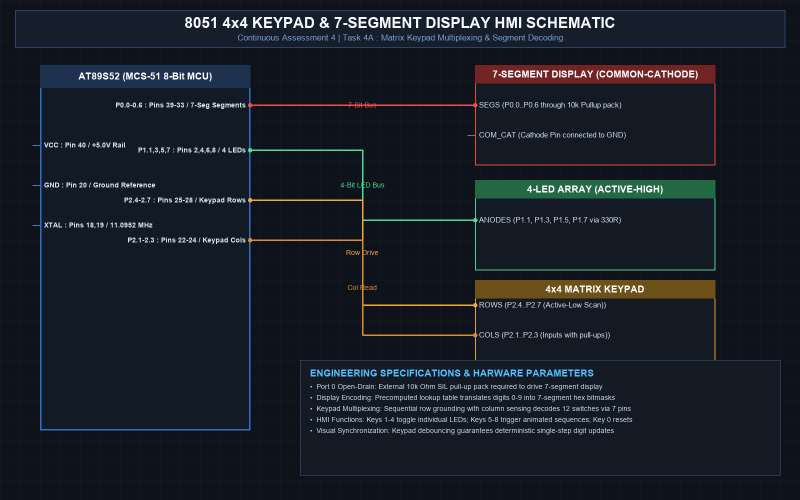

# EXPERIMENT DETAILS
- **Student Name:** Vaishali V
- **Register Number:** 25011102111
- **Degree / Branch:** B.Tech. Computer Science and Engineering (IoT)
- **Year / Semester:** II Year / III Semester
- **Course Title:** Fundamentals of Internet of Things Laboratory (25CS2741)
- **Academic Year:** 2026–2027

---

# CAT 4 - TASK 4A: 8-BIT BUTTON-CONTROLLED BINARY COUNTER (AT89S52)

## 1. Circuit Diagram & Hardware Description



### Hardware Description
This laboratory experiment combines digital input sensing and parallel bus actuation. An active-low push-button switch connected to Port 3 Pin 2 (P3.2 / INT0) drives an 8-bit binary up-counter displayed across all 8 pins of Port 1 (P1.0 through P1.7).
- **Push-Button Interface:** Tactile momentary switch connected between P3.2 and GND. P3.2 is maintained HIGH by an internal pull-up resistor. Pressing the button pulls P3.2 to ground (0V).
- **LED Display Bus:** Port 1 drives 8 discrete LEDs through an 8-channel 330 Ω current-limiting resistor array in active-LOW sink configuration.
- **Debouncing:** Mechanical switch contacts exhibit bounce noise for 10–30 ms after closing. Software debouncing filters out contact chatter to ensure exactly one count increment per physical button press.

| Pin | Peripheral | Configuration | Notes |
| :--- | :--- | :--- | :--- |
| P3.2 | Tactile Push-Button | Digital Input with Pull-Up | Normally HIGH; pulls LOW on press |
| P1.0..P1.7 | 8-LED Bar Display | Active-LOW Push-Pull Sink | Displays 8-bit binary value (0x00..0xFF) |

---

## 2. Core Logic / Pseudocode / Code Base

### Working Principle
The MCU monitors P3.2 in a non-blocking or edge-polling loop. When a falling edge is detected (`P3.2 == 0`), a 30 ms debouncing delay is executed. If the pin remains LOW, the state is confirmed as a valid press. The counter increments by 1, and the program enters a hold loop waiting for the button to be released (`while (P3.2 == 0)`) before permitting subsequent increments.

### Step-by-Step Pseudocode
```text
BEGIN PROGRAM
    DEFINE BUTTON as P3^2
    INITIALIZE count = 0
    P1 = 0xFF                  // All LEDs OFF initially
    BUTTON = 1                 // Configure P3.2 as input

    MAIN:
        WHILE TRUE DO:
            IF BUTTON == 0 THEN:               // Falling edge detected
                CALL delay_ms(30)              // Debounce delay
                IF BUTTON == 0 THEN:           // Confirmed press
                    count = count + 1          // Increment 8-bit counter
                    P1 = ~count                // Invert and output to LEDs
                    WHILE BUTTON == 0 DO:      // Await key release
                        NOP
                    END WHILE
                    CALL delay_ms(30)          // Release debounce
                END IF
            END IF
        END WHILE
END PROGRAM
```

### Source Code Walkthrough
- `sbit BUTTON = P3^2;` defines the input line.
- The dual-sample debounce filter ensures spurious transitions do not increment the counter multiple times during a single mechanical closure.
- The blocking release check ensures the counter does not free-run while the user holds the switch.

---

## 3. Expected Output & Inference

### Expected Output
- Starting at 0x00 (all LEDs extinguished), each physical press of the button reliably increments the binary value on Port 1 by 1.
- Pressing 5 times produces binary 00000101_2 (LEDs 0 and 2 illuminated).
- After reaching 255 (0xFF), the next press resets the count to 0 (0x00).

### Inference
Mechanical switch contacts introduce severe electrical noise that must be filtered out either in hardware (RC low-pass filter) or software. Software debouncing with state-holding logic provides a zero-cost, highly reliable solution for user input handling.
