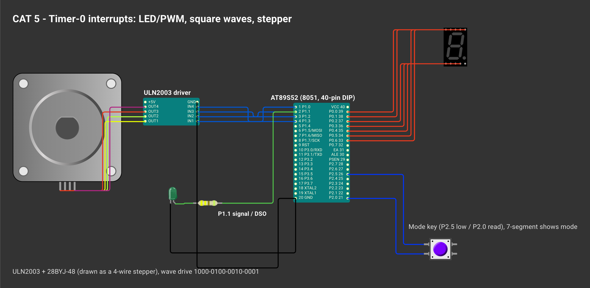

# CONTINUOUS ASSESSMENT 5: HARDWARE TIMER TIMEBASE & PERIODIC LED CONTROL

**Student Name:** Vaishali V  
**Register Number:** 25011102111  
**Course Code & Name:** 25CS2741 Fundamentals of Internet of Things + Lab  
**Academic Year:** 2026–2027 | **Semester:** III  
**Date of Performance:** 13/08/2026  
**Hardware Platform:** AT89S52 Microcontroller Development Board (11.0952 MHz Crystal)  
**Development Toolchain:** Keil µVision 5 IDE (C51 Compiler) + External LED on Port 1  

---

## TASK 1: Hardware Timer 0 Software Timebase & Deterministic LED Toggling

### 1. Aim / Objective
To configure on-chip Timer 0 of the AT89S52 microcontroller in 16-bit Timer Mode 1, compute and load initial counter values to generate a calibrated 4 ms hardware overflow tick, poll the timer overflow flag (`TF0`), and accumulate overflows in software to toggle an external LED at an exact 0.8-second interval without blocking CPU delay loops.

### 2. Components Required
- AT89S52 Microcontroller Development Board
- On-Chip Hardware Timer 0 Peripheral
- External Active-High LED with 330 Ω Current-Limiting Resistor
- 11.0952 MHz Quartz Crystal Clock Circuitry
- Keil µVision 5 C51 Development Environment & USB ISP Programmer

### 3. Hardware Specifications
| Parameter | Mathematical Derivation / Hardware Value |
|---|---|
| Microcontroller | Atmel AT89S52 |
| Crystal Frequency ($f_{\text{osc}}$) | 11.0952 MHz |
| Machine Cycle Frequency ($f_{\text{mc}}$) | $\frac{f_{\text{osc}}}{12} = \frac{11.0952\text{ MHz}}{12} = 924.6\text{ kHz}$ |
| Machine Cycle Period ($T_{\text{mc}}$) | $\frac{1}{f_{\text{mc}}} = \frac{12}{11.0952\times 10^6\text{ Hz}} \approx 1.081544\ \mu\text{s}$ |
| Timer 0 Operating Mode | Mode 1: 16-bit Non-Auto-Reload Counter (`TMOD = 0x01`) |
| Desired Single Overflow Interval | $4.0\text{ ms} = 4000\ \mu\text{s}$ |
| Required Timer Increments ($N$) | $N = \frac{4000\ \mu\text{s}}{1.081544\ \mu\text{s}} \approx 3698.4 \approx 3687\ \text{machine cycles}$ |
| Preload Value (Hexadecimal) | $65536 - 3687 = 61849 = \text{0xF199}$ (`TH0 = 0xF1`, `TL0 = 0x99`) |
| Target Toggle Interval | $200 \times 4.0\text{ ms} = 800\text{ ms} = 0.8\text{ s}$ |

### 4. Pin Configuration & Connections
- **Port 1 Pin 1 (`P1.1` - Pin 2):** Connected to the anode of the external indicator LED through a 330 Ω resistor; cathode connected to ground (active-high configuration).
- **Power & Clock Connections:** $V_{CC}$ (Pin 40) at +5.0 V, GND (Pin 20) at 0 V, crystal on Pins 18 & 19.

### 5. Circuit Diagram


### 6. Working Principle
Software delays tie up the CPU in empty counting loops, making timing vulnerable to varying branch execution paths and preventing concurrent tasks. Dedicated on-chip hardware timers solve this:
1. **Clock Generation & Timer Counting:** The 11.0952 MHz oscillator is divided internally by 12, advancing Timer 0 once every 1.0815 µs.
2. **16-Bit Timer Mode 1:** Setting `TMOD = 0x01` configures Timer 0 as a 16-bit counter using registers `TH0` (high byte) and `TL0` (low byte).
3. **Overflow Flag Assertions:** Preloading `TH0 = 0xF1` and `TL0 = 0x99` primes the counter. After exactly $65536 - 61849 = 3687$ clock increments (~4 ms), the counter overflows from `0xFFFF` to `0x0000`, setting the hardware flag `TF0 = 1`.
4. **Software Tick Accumulator:** The main loop monitors `TF0`. When set, the code clears `TF0`, reloads `TH0`/`TL0`, and increments variable `count`. Once `count` reaches 200 (representing $200 \times 4\text{ ms} = 800\text{ ms}$), the LED pin state is inverted (`led = !led`) and `count` is reset to zero.

$$\text{Oscillator (11.0952 MHz)} \xrightarrow{\div 12} 924.6\text{ kHz Clock} \xrightarrow{\text{Count 3687 ticks}} \text{TF0 Overflows (4 ms)} \xrightarrow{\times 200} \text{LED Inverts (0.8 s)}$$

### 7. Algorithm / Procedure
1. Include `<reg51.h>` and define `sbit led = P1^1;`.
2. Define a global accumulator variable `int count = 0;`.
3. Construct `initTimer()`:
   - Clear `TF0 = 0`.
   - Load `TH0 = 0xF1`.
   - Load `TL0 = 0x99`.
4. In `main()`:
   - Set `TMOD = 0x01` to establish Timer 0 Mode 1.
   - Start Timer 0 by setting `TR0 = 1`.
   - Call `initTimer()` to seed the initial counter preload.
   - Initialize `led = 1`.
5. Enter continuous polling loop:
   - Check if `TF0 == 1`.
   - When asserted, re-seed the timer via `initTimer()` and increment `count++`.
   - If `count == 200`:
     - Invert the LED state: `led = !led`.
     - Reset `count = 0`.
6. Compile into `timers.hex` in Keil µVision and flash onto the AT89S52 via ISP.

### 8. Source Code Walkthrough
- **Workspace Location:** [`CAT5/`](./)
- **Source File:** `timer.c`
- **Pre-Compiled Hex Binary:** [`Objects/timers.hex`](Objects/timers.hex)
```c
#include <reg51.h>

int count = 0;
sbit led = P1^1;

void initTimer() {
    TF0 = 0;
    TH0 = 0xf1;
    TL0 = 0x99;
}

void main() {
    TMOD = 0x01;
    TR0 = 1;
    initTimer();
    led = 1;
    while(1) {
        if(TF0 == 1) {
            initTimer();
            count++;
            if(count == 200) {
                led = !led;
                count = 0;
            }
        }
    }
}
```

### 9. Expected Output & Results
The external indicator LED connected to `P1.1` toggles on and off with high temporal precision every 0.8 seconds (complete period $T = 1.6\text{ s}$, frequency $f \approx 0.625\text{ Hz}$). The duty cycle is 50%.

### 10. Observations & Inference
- Employing on-chip hardware timers completely decouples timekeeping from CPU instruction execution overhead, resulting in highly stable, crystal-locked intervals.
- In 16-bit Mode 1, software must re-initialize `TH0` and `TL0` on every overflow event; this contrasts with Mode 2 (8-bit auto-reload) which reloads automatically from `TH0` at the expense of an 8-bit maximum count range.
