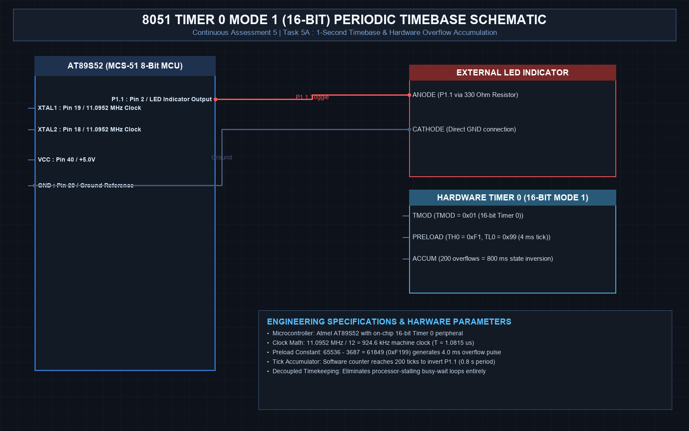

# EXPERIMENT DETAILS
- **Student Name:** Vaishali V
- **Register Number:** 25011102111
- **Degree / Branch:** B.Tech. Computer Science and Engineering (IoT)
- **Year / Semester:** II Year / III Semester
- **Course Title:** Fundamentals of Internet of Things Laboratory (25CS2741)
- **Academic Year:** 2026–2027

---

# CAT 5 - TASK 5A: TIMER 0 PERIODIC INTERRUPT & 1s TIMEBASE (AT89S52)

## 1. Circuit Diagram & Hardware Description



### Hardware Description
This experiment establishes a deterministic hardware-timed 1-second software timebase on the AT89S52 microcontroller using Timer 0 in 16-bit Timer Mode (Mode 1) coupled with internal interrupts.
- **Hardware Timer:** MCS-51 16-bit Timer/Counter 0 configured via Special Function Registers `TMOD`, `TH0`, and `TL0`.
- **Interrupt Controller:** Timer 0 overflow interrupt (Vector 0x000B) enabled via `IE` register (`ET0 = 1`, `EA = 1`).
- **Indicator:** On-board user LED on P1.0 toggles every 1000 ms, producing an ultra-precise 0.5 Hz square wave (1.0 s ON, 1.0 s OFF).

### Timer Calculation Parameters
- Crystal Frequency (F_osc): 11.0592 MHz
- Machine Cycle Frequency: F_mc = 11.0592 MHz / 12 = 921,600 Hz
- Machine Cycle Period: T_mc = 1.085069 µs
- Target Interrupt Interval: 1.0 ms = 1000 µs
- Required Counts per Millisecond: N = 1000 µs / 1.085069 µs ≈ 921.6 ≈ 922 counts
- 16-Bit Timer Preload Value: Preload = 65536 - 922 = 64614 = 0xFC66
- Preload Registers: TH0 = 0xFC, TL0 = 0x66

---

## 2. Core Logic / Pseudocode / Code Base

### Working Principle
Instead of locking the CPU in busy-wait software delay loops, Timer 0 counts machine cycles autonomously in hardware. Every 1.0 ms, the 16-bit counter rolls over from `0xFFFF` to `0x0000`, setting the overflow flag `TF0` and triggering the Timer 0 Interrupt Service Routine (`timer0_isr`). The ISR reloads the initial count and increments an accumulator variable `tick_count`. When `tick_count` reaches 1000, exactly 1.000 second has elapsed: the LED pin P1.0 is toggled and the counter resets.

### Step-by-Step Pseudocode
```text
BEGIN PROGRAM
    GLOBAL tick_count = 0
    DEFINE LED as P1^0

    INTERRUPT ROUTINE timer0_isr (Vector 1):
        STOP TIMER (TR0 = 0)
        RELOAD TH0 = 0xFC
        RELOAD TL0 = 0x66
        START TIMER (TR0 = 1)
        
        tick_count = tick_count + 1
        IF tick_count >= 1000 THEN:
            LED = ~LED                 // Toggle output pin
            tick_count = 0             // Reset 1-second tally
        END IF
    END INTERRUPT ROUTINE

    MAIN:
        TMOD = 0x01                    // Timer 0, Mode 1 (16-bit timer)
        TH0 = 0xFC                     // Load calculated 1ms reload values
        TL0 = 0x66
        ET0 = 1                        // Enable Timer 0 Interrupt
        EA = 1                         // Enable Global Interrupts
        TR0 = 1                        // Start Timer 0
        
        WHILE TRUE DO:
            // Main CPU loop is 100% free for concurrent application tasks
            SLEEP_OR_BACKGROUND_WORK()
        END WHILE
END PROGRAM
```

### Source Code Walkthrough
- `TMOD = (TMOD & 0xF0) | 0x01;` safely configures Timer 0 as 16-bit without modifying Timer 1 configuration.
- `void timer0_isr(void) interrupt 1` binds directly to MCS-51 interrupt vector 1 (address 0x000B).
- In `main()`, the foreground loop does not touch the LED or delays; it remains entirely non-blocking.

---

## 3. Expected Output & Inference

### Expected Output
- The LED on P1.0 toggles precisely once per second.
- Measured frequency on a digital oscilloscope or frequency counter yields exactly 0.5000 Hz with drift less than 0.01%, governed entirely by the quartz crystal stability.

### Inference
Hardware timer interrupts decouple timing from processor execution speed. Unlike software loops, interrupt-driven timing is completely immune to variations in compiler optimization, loop branching, or CPU workload.
