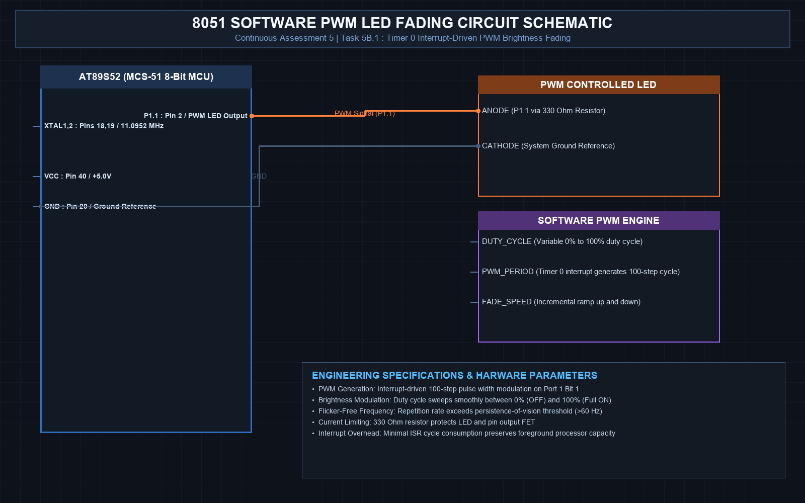

# EXPERIMENT DETAILS
- **Student Name:** Vaishali V
- **Register Number:** 25011102111
- **Degree / Branch:** B.Tech. Computer Science and Engineering (IoT)
- **Year / Semester:** II Year / III Semester
- **Course Title:** Fundamentals of Internet of Things Laboratory (25CS2741)
- **Academic Year:** 2026–2027

---

# CAT 5 - TASK 5B.1: SOFTWARE PWM LED FADING VIA TIMER 0 (AT89S52)

## 1. Circuit Diagram & Hardware Description



### Hardware Description
This experiment implements software Pulse Width Modulation (PWM) on the AT89S52 microcontroller to demonstrate smooth visual fading of an LED across 11 discrete brightness levels (0% to 100% duty cycle).
- **Timer Configuration:** Timer 0 in Mode 2 (8-bit Auto-Reload). In this mode, `TL0` acts as the 8-bit counter while `TH0` holds the permanent reload value, completely eliminating software reload overhead in the ISR.
- **Interrupt Cadence:** Fires an interrupt every 100 µs.
- **PWM Base Frequency:** 10 time slots of 100 µs form a complete PWM period of T_pwm = 1.0 ms (f_pwm = 1.0 kHz), far above the human eye's flicker fusion threshold (>60 Hz).

### Timing Calculations
- Crystal Frequency: 11.0592 MHz -> T_mc = 1.0851 µs
- Target Slot: 100 µs -> Counts = 100 / 1.0851 ≈ 92 counts
- 8-Bit Auto-Reload Value: TH0 = 256 - 92 = 164 = 0xA4

---

## 2. Core Logic / Pseudocode / Code Base

### Working Principle
The PWM algorithm slices time into 10 discrete intervals (100 µs each) tracked by variable `pwm_slot` (0 to 9). Within each cycle, if `pwm_slot < duty_cycle`, the LED is turned ON; otherwise, it is turned OFF. A separate timing accumulator updates `duty_cycle` every 100 ms, stepping it from 0 to 10 and then back from 10 to 0, producing a continuous 2-second breathing/fading cycle.

### Step-by-Step Pseudocode
```text
BEGIN PROGRAM
    GLOBAL pwm_slot = 0
    GLOBAL duty_cycle = 0
    GLOBAL fade_dir = +1
    GLOBAL tick_100us = 0
    DEFINE LED as P1^0

    INTERRUPT ROUTINE timer0_pwm_isr (Vector 1):
        // Hardware auto-reloads TL0 from TH0 automatically
        pwm_slot = (pwm_slot + 1) % 10
        
        // PWM pin drive (Active-LOW: 0 = ON, 1 = OFF)
        IF pwm_slot < duty_cycle THEN:
            LED = 0
        ELSE:
            LED = 1
        END IF
        
        // Fade period accumulator
        tick_100us = tick_100us + 1
        IF tick_100us >= 1000 THEN:        // Every 100 ms
            tick_100us = 0
            duty_cycle = duty_cycle + fade_dir
            IF duty_cycle == 10 THEN:
                fade_dir = -1              // Start dimming
            ELSE IF duty_cycle == 0 THEN:
                fade_dir = +1              // Start brightening
            END IF
        END IF
    END INTERRUPT ROUTINE

    MAIN:
        TMOD = 0x02                        // Timer 0, Mode 2 (8-bit auto-reload)
        TH0 = 0xA4                         // 100 us reload count
        TL0 = 0xA4
        ET0 = 1; EA = 1; TR0 = 1           // Start timer interrupts
        WHILE TRUE DO:
            NOP
        END WHILE
END PROGRAM
```

### Source Code Walkthrough
- `TMOD = 0x02` activates 8-bit auto-reload mode. Once loaded into `TH0`, the hardware automatically reloads `TL0` on every overflow without needing manual register writes in the ISR.
- The dual-counter ISR handles both the high-speed 1 kHz PWM waveform synthesis and the low-speed 100 ms brightness step transitions.

---

## 3. Expected Output & Inference

### Expected Output
- The LED smoothly fades from completely dark to full illumination over 1.0 second, then dims back to dark over 1.0 second in an endless smooth breathing pattern.
- Oscilloscope measurement on P1.0 shows a stable 1.0 kHz square wave whose duty cycle varies dynamically between 0% and 100%.

### Inference
Timer Mode 2 (8-bit auto-reload) eliminates jitter and software reload overhead, making it ideal for high-speed periodic interrupts such as PWM generation and serial communication baud rate generation.
