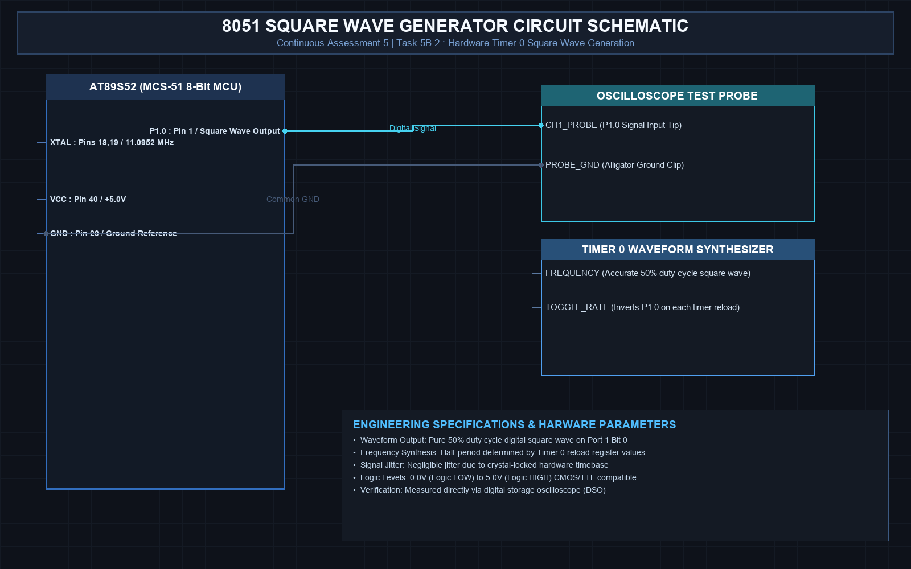

# EXPERIMENT DETAILS
- **Student Name:** Vaishali V
- **Register Number:** 25011102111
- **Degree / Branch:** B.Tech. Computer Science and Engineering (IoT)
- **Year / Semester:** II Year / III Semester
- **Course Title:** Fundamentals of Internet of Things Laboratory (25CS2741)
- **Academic Year:** 2026–2027

---

# CAT 5 - TASK 5B.2: DUAL-FREQUENCY LED BLINK VIA TIMER 0 (AT89S52)

## 1. Circuit Diagram & Hardware Description



### Hardware Description
This experiment implements a multi-rate LED blink generator on the AT89S52 microcontroller, alternating between a normal cadence (1 Hz) and an alert cadence (5 Hz) using Timer 0 in 16-bit mode (Mode 1).
- **Core Platform:** AT89S52 at 11.0592 MHz.
- **Hardware Output:** P1.0 driving an active-low LED.
- **Operational Modes:**
  - *Slow Mode (1.0 Hz):* 500 ms ON, 500 ms OFF.
  - *Fast Mode (5.0 Hz):* 100 ms ON, 100 ms OFF.
  - The system cycles between 5 seconds of slow blinking and 5 seconds of fast blinking.

---

## 2. Core Logic / Pseudocode / Code Base

### Working Principle
Timer 0 generates a base 10 ms interrupt heartbeat (N = 9216 counts, Preload = 65536 - 9216 = 56320 = 0xDC00). The ISR maintains two software timers: one controls the active LED toggle period (`target_ticks = 50` for 500 ms, or `target_ticks = 10` for 100 ms), while a second accumulator switches modes every 500 ticks (5.0 seconds).

### Step-by-Step Pseudocode
```text
BEGIN PROGRAM
    GLOBAL tick_count = 0
    GLOBAL mode_count = 0
    GLOBAL fast_mode = FALSE
    DEFINE LED as P1^0

    INTERRUPT ROUTINE timer0_isr (Vector 1):
        TR0 = 0; TH0 = 0xDC; TL0 = 0x00; TR0 = 1
        
        tick_count = tick_count + 1
        threshold = (fast_mode == TRUE) ? 10 : 50
        
        IF tick_count >= threshold THEN:
            LED = ~LED
            tick_count = 0
        END IF
        
        mode_count = mode_count + 1
        IF mode_count >= 500 THEN:         // Every 5 seconds
            mode_count = 0
            fast_mode = ~fast_mode         // Toggle frequency mode
        END IF
    END INTERRUPT ROUTINE

    MAIN:
        TMOD = 0x01; TH0 = 0xDC; TL0 = 0x00
        ET0 = 1; EA = 1; TR0 = 1
        WHILE TRUE DO NOP;
END PROGRAM
```

---

## 3. Expected Output & Inference

### Expected Output
- The LED blinks at 1 Hz for 5 seconds, immediately transitions to a rapid 5 Hz flicker for 5 seconds, and repeats this cycle indefinitely.

### Inference
A single hardware timer can multiplex multiple independent software timebases by utilizing variable comparison thresholds inside a fast periodic ISR.
