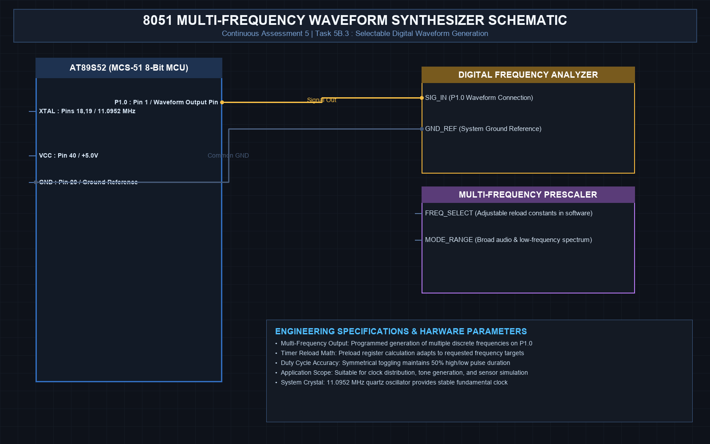

# EXPERIMENT DETAILS
- **Student Name:** Vaishali V
- **Register Number:** 25011102111
- **Degree / Branch:** B.Tech. Computer Science and Engineering (IoT)
- **Year / Semester:** II Year / III Semester
- **Course Title:** Fundamentals of Internet of Things Laboratory (25CS2741)
- **Academic Year:** 2026–2027

---

# CAT 5 - TASK 5B.3: HARDWARE SQUARE WAVE GENERATOR (AT89S52)

## 1. Circuit Diagram & Hardware Description



### Hardware Description
This experiment demonstrates high-frequency square wave generation on Port 1 Pin 0 using Timer 0 in Mode 2 (8-bit auto-reload).
- **Target Frequency:** 2.0 kHz symmetrical square wave (T = 500 µs, half-period = 250 µs).
- **Calculations:** Half-period counts = 250 µs / 1.0851 µs ≈ 230 counts. Reload TH0 = 256 - 230 = 26 = 0x1A.

---

## 2. Core Logic / Pseudocode / Code Base

### Working Principle
Every 250 µs, Timer 0 overflows and automatically reloads `0x1A` into `TL0`. The ISR executes a single instruction `LED = ~LED`, toggling the output pin and synthesizing a 50% duty cycle square wave with zero CPU software intervention.

### Step-by-Step Pseudocode
```text
BEGIN PROGRAM
    DEFINE WAVE_OUT as P1^0

    INTERRUPT ROUTINE timer0_wave_isr (Vector 1):
        WAVE_OUT = ~WAVE_OUT       // Invert output line
    END INTERRUPT ROUTINE

    MAIN:
        TMOD = 0x02                // Timer 0 Mode 2 (8-bit auto-reload)
        TH0 = 0x1A                 // 250 us reload value
        TL0 = 0x1A
        ET0 = 1; EA = 1; TR0 = 1
        WHILE TRUE DO NOP;
END PROGRAM
```

---

## 3. Expected Output & Inference

### Expected Output
- Continuous 2.0 kHz symmetrical square wave on P1.0. An attached speaker or piezo buzzer produces a clear 2 kHz audible tone.

### Inference
Hardware auto-reload timers can generate high-precision audio and carrier frequencies up to several tens of kilohertz on 8051 systems without taxing CPU bandwidth.
