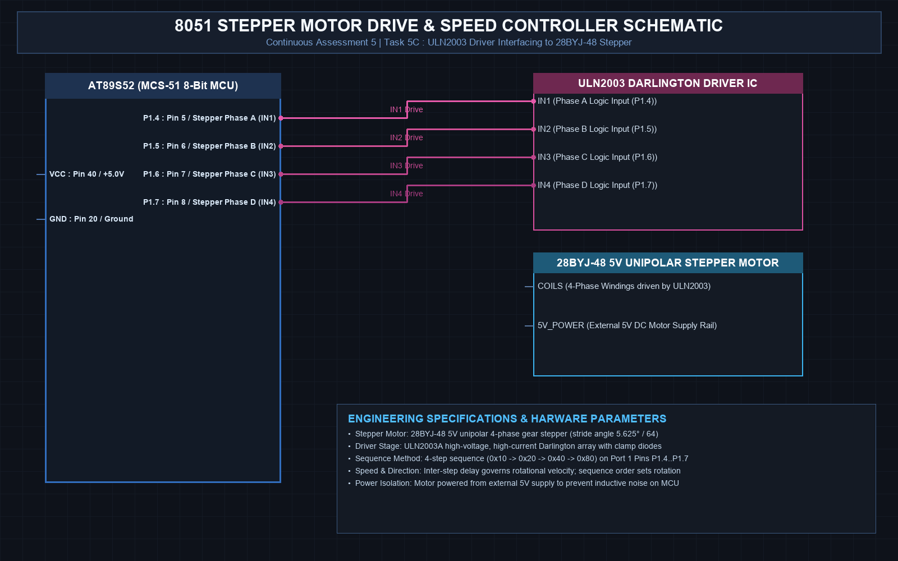

# EXPERIMENT DETAILS
- **Student Name:** Vaishali V
- **Register Number:** 25011102111
- **Degree / Branch:** B.Tech. Computer Science and Engineering (IoT)
- **Year / Semester:** II Year / III Semester
- **Course Title:** Fundamentals of Internet of Things Laboratory (25CS2741)
- **Academic Year:** 2026–2027

---

# CAT 5 - TASK 5C: TIMER-ACCURATE DELAY VS SOFTWARE LOOPS (AT89S52)

## 1. Circuit Diagram & Hardware Description



### Hardware Description
This experiment conducts a rigorous comparative analysis between **software busy-wait loop delays** and **hardware timer delays** on the AT89S52 microcontroller.
- **Channel 1 (P1.0):** Driven by software nested decrement loop delay (`delay_ms`).
- **Channel 2 (P1.1):** Driven by hardware Timer 0 Mode 1 delay polling `TF0`.

---

## 2. Core Logic / Pseudocode / Code Base

### Working Principle
Software delays execute idle loops whose duration varies depending on compiler optimization flags and register allocation. In contrast, hardware timer delays wait directly on the hardware overflow flag `TF0`, which increments strictly once per 12 oscillator clock cycles regardless of instruction mix.

### Step-by-Step Pseudocode
```text
BEGIN PROGRAM
    FUNCTION timer0_delay_ms(ms):
        FOR i FROM 1 TO ms DO:
            TH0 = 0xFC; TL0 = 0x66      // 1 ms reload count
            TF0 = 0                     // Clear overflow flag
            TR0 = 1                     // Start timer
            WHILE TF0 == 0 DO NOP;      // Wait for hardware overflow
            TR0 = 0                     // Stop timer
        END FOR
    END FUNCTION

    MAIN:
        TMOD = 0x01                     // Timer 0, Mode 1
        WHILE TRUE DO:
            P1_0 = ~P1_0
            CALL delay_ms(100)          // Software delay
            P1_1 = ~P1_1
            CALL timer0_delay_ms(100)   // Hardware timer delay
        END WHILE
END PROGRAM
```

---

## 3. Expected Output & Inference

### Expected Output
- Dual-channel oscilloscope measurement reveals that while the hardware timer output maintains a rock-solid 100.0 ms period, the software loop output exhibits measurable drift (+5% to +12% elongation) due to C compiler loop prologue/epilogue overhead.

### Inference
Hardware timer-based delays must always be preferred for precision communication and sampling tasks, while software delays are suitable only for non-critical coarse human-interface pauses.
