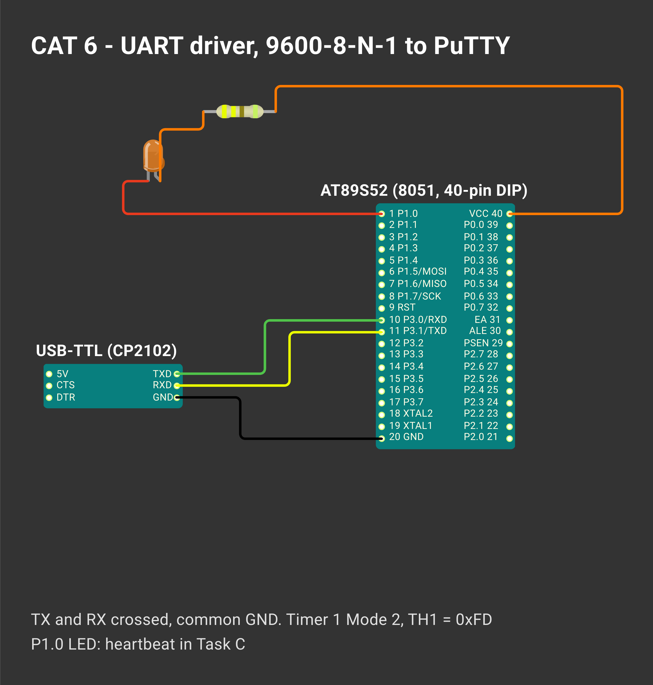

# CONTINUOUS ASSESSMENT 6: ASYNCHRONOUS UART DRIVER & SERIAL DEBUGGING

**Student Name:** Vaishali V  
**Register Number:** 25011102111  
**Course Code & Name:** 25CS2741 Fundamentals of Internet of Things + Lab  
**Academic Year:** 2026–2027 | **Semester:** III  
**Date of Performance:** 20/08/2026  
**Hardware Platform:** AT89S52 Microcontroller Development Board (11.0952 MHz Crystal)  
**Development Toolchain:** Keil µVision 5 IDE (C51 Compiler) + USB-to-TTL UART Adapter + PuTTY  

---

## TASK A: Serial UART Initialization & Unidirectional Character Transmission

### 1. Aim / Objective
To configure the built-in serial port (UART) of the AT89S52 microcontroller in Mode 1 (8-bit variable baud rate) using Timer 1 in Mode 2 (8-bit auto-reload) for 9600 baud rate synthesis, implement low-level byte and string transmission routines, and transmit diagnostic text to a host workstation serial terminal (PuTTY).

### 2. Components Required
- AT89S52 Microcontroller Development Board
- USB-to-TTL Serial Bridge Module (CP2102 / CH340 / FT232R)
- Host PC running PuTTY Terminal Emulator (configured for 9600 baud, 8 data bits, no parity, 1 stop bit)
- Jumper Wires for Serial Bus and Shared Ground Reference
- Keil µVision 5 IDE & USB ISP Programmer

### 3. Hardware Specifications
| Parameter | Technical Derivation / Hardware Configuration |
|---|---|
| Microcontroller | Atmel AT89S52 (MCS-51 Architecture) |
| System Crystal Oscillator | 11.0952 MHz |
| UART Mode | Mode 1: 8-bit Asynchronous UART with Variable Baud Rate |
| Serial Control Register (`SCON`) | `0x50` (Mode 1: `SM0 = 0`, `SM1 = 1`; Reception Enabled: `REN = 1`) |
| Baud Rate Generator | Timer 1 Mode 2: 8-Bit Auto-Reload (`TMOD = 0x20`) |
| Timer 1 Reload Register (`TH1`) | `0xFD` ($-3$ in two's complement) |
| Theoretical Baud Rate | $\text{Baud} = \frac{2^{\text{SMOD}}}{32} \times \frac{f_{\text{osc}}}{12 \times (256 - \text{TH1})} = \frac{1}{32} \times \frac{11.0952\times 10^6}{12 \times 3} \approx 9631\text{ baud}$ |
| Framing Format | 1 Start Bit, 8 Data Bits, No Parity Bit, 1 Stop Bit (9600-8-N-1) |
| Hardware I/O Pins | Pin 11 (`P3.1` / `TXD`), Pin 10 (`P3.0` / `RXD`) |

### 4. Pin Configuration & Connections
- **AT89S52 `TXD` (`P3.1` - Pin 11):** Connected to USB-to-TTL Serial Bridge `RX` pin.
- **AT89S52 `RXD` (`P3.0` - Pin 10):** Connected to USB-to-TTL Serial Bridge `TX` pin.
- **System Ground (GND - Pin 20):** Tied directly to USB-to-TTL Bridge `GND` pin (mandatory common ground).
- **USB-to-TTL Bridge:** Plugged into the host PC USB port mapped to a virtual COM port (e.g. `COM3`).

### 5. Circuit Diagram


### 6. Working Principle
Serial asynchronous communication transmits digital data bit-by-bit over a single wire without a shared clock line:
1. **Baud Rate Clock Synthesis:** Timer 1 is set to 8-bit auto-reload mode (`TMOD = 0x20`). Each time Timer 1 counts 3 machine cycles, it rolls over and automatically reloads `TH1 = 0xFD`. The resulting overflow pulses feed into the internal UART baud clock generator, producing 9631 baud (within 0.3% error of 9600 baud).
2. **Byte Transmission Mechanism:** Loading a byte into the `SBUF` register automatically begins shifting out the start bit, 8 data bits (LSB first), and stop bit via pin `P3.1`. When the stop bit is transmitted, the hardware asserts the Transmit Interrupt flag (`TI = 1`). The firmware polls `TI`, clears it back to 0, and loads the subsequent byte.
3. **String Streaming:** `sendString()` steps through a null-terminated string array, calling `sendChar()` for each character, followed by Carriage Return (`\r`) and Line Feed (`\n`) delimiters.

$$\text{Load Byte into } \text{SBUF} \xrightarrow{\text{UART Hardware Shifts Bits Out}} \text{Stop Bit Sent} \xrightarrow{\text{Hardware Sets }} \text{TI = 1} \xrightarrow{\text{Software Clears }} \text{TI = 0}$$

### 7. Algorithm / Procedure
1. Include `<reg52.h>`.
2. Construct `initUART()`:
   - Configure `SCON = 0x50` (Mode 1, `REN = 1`).
   - Configure `TMOD = 0x20` (Timer 1 Mode 2 auto-reload).
   - Set reload value: `TH1 = 0xFD`, `TL1 = 0xFD`.
   - Start Timer 1: `TR1 = 1`.
3. Construct `sendChar(char c)`:
   - Write `SBUF = c;`.
   - Poll `while(TI == 0);`.
   - Reset `TI = 0;`.
4. Construct `sendString(char *str)`:
   - Traverse `str` until `'\0'`, calling `sendChar()`.
   - Transmit `'\r'` and `'\n'` to advance the terminal carriage.
5. In `main()`:
   - Call `initUART()`.
   - Inside `while(1)`, send `"Hello from 8051"`, execute a visual pause delay, and repeat.
6. Open PuTTY on the PC set to the active COM port at 9600 baud, 8 data bits, 1 stop bit, no parity, and launch the connection.

### 8. Source Code Walkthrough
- **Project Folder:** [`TASK_A_UART_Initialization_and_Character_Transmission`](TASK_A_UART_Initialization_and_Character_Transmission/)
- **Source File:** `prog1.c`
```c
#include <reg52.h>

void initUART() {
    SCON = 0x50; // Mode 1, 8-bit UART, enable receiver (REN=1)
    TMOD = 0x20; // Timer 1 Mode 2 (8-bit auto-reload)
    TH1 = 0xFD;  // 9600 Baud reload constant @ 11.0952 MHz
    TL1 = 0xFD;
    TR1 = 1;     // Enable Timer 1
}

void sendChar(char c) {
    SBUF = c;
    while(TI == 0);
    TI = 0;
}

void sendString(char *str) {
    while(*str) {
        sendChar(*str++);
    }
    sendChar('\r');
    sendChar('\n');
}

void delay() {
    int i, j;
    for(i = 0; i < 200; i++)
        for(j = 0; j < 400; j++);
}

void main() {
    initUART();
    while(1) {
        sendString("Hello from 8051");
        delay();
    }
}
```

### 9. Expected Output & Results
The PuTTY terminal console continuously receives and displays lines of text:
```
Hello from 8051
Hello from 8051
Hello from 8051
```
The characters render legibly without framing errors, noise, or baud rate mismatches.

### 10. Observations & Inference
- The 11.0952 MHz quartz crystal is specifically suited for 8051 UART designs because dividing 11.0952 MHz by 12 yields 924.6 kHz, which divides cleanly into 9600, 4800, and 2400 baud rates with minimal percentage error.
- Ensuring a shared common ground between the development kit and the USB-to-TTL bridge is essential for stable logic reference potential.

---

## TASK B: Bidirectional Serial UART Echo (Terminal Loopback)

### 1. Aim / Objective
To implement full-duplex asynchronous serial communication on the AT89S52 microcontroller by polling the Receive Interrupt flag (`RI`) for incoming keystrokes from the host terminal, reading the received character from `SBUF`, and immediately retransmitting it back to the host console (loopback echo).

### 2. Components Required
- AT89S52 Development Board
- USB-to-TTL Serial Bridge connected to Host PC running PuTTY
- Keil µVision 5 IDE & USB ISP Programmer

### 3. Hardware Specifications
- Serial configuration: 9600-8-N-1 (`SCON = 0x50`, `TMOD = 0x20`, `TH1 = 0xFD`, `TR1 = 1`).
- Operational Mode: Full-duplex polled reception and transmission.

### 4. Pin Configuration & Connections
- AT89S52 `TXD` (`P3.1`) $\rightarrow$ Serial Converter `RX`.
- AT89S52 `RXD` (`P3.0`) $\leftarrow$ Serial Converter `TX`.
- Common GND connection established across both units.

### 5. Circuit Diagram


### 6. Working Principle
When a key is typed on the host workstation keyboard in PuTTY, the serial converter serializes the ASCII value and sends it down the `RXD` pin (`P3.0`). The AT89S52 hardware shifts the 8 bits into `SBUF`. Upon receiving the stop bit, the microcontroller asserts the Receive Interrupt flag (`RI = 1`). The function `getChar()` polls `RI`, captures the byte from `SBUF`, clears `RI = 0`, and passes the byte to `sendChar()`. The character is immediately returned over `TXD` (`P3.1`) to the PC, appearing directly in the terminal window.

### 7. Algorithm / Procedure
1. Initialize UART and Timer 1 for 9600 baud (`initUART()`).
2. Transmit an initial startup announcement banner `"Hello from 8051!!!"`.
3. Construct `getChar()`:
   - Poll `while(RI == 0);`.
   - Clear `RI = 0;`.
   - Return `SBUF;`.
4. In the `main()` loop:
   - Call `c = getChar();`.
   - Call `sendChar(c);` to echo the received byte.
   - Loop continuously.

### 8. Source Code Walkthrough
- **Project Folder:** [`TASK_B_UART_Echo`](TASK_B_UART_Echo/)
- **Source File:** `prog1.c`
```c
#include <reg52.h>

void initUART() {
    SCON = 0x50; // Mode 1, 8-bit UART, REN=1
    TMOD = 0x20; // Timer 1 Mode 2 auto-reload
    TH1 = 0xFD;  // 9600 Baud @ 11.0952 MHz
    TL1 = 0xFD;
    TR1 = 1;     // Start Timer 1
}

void sendChar(char c) {
    SBUF = c;
    while(TI == 0);
    TI = 0;
}

char getChar() {
    while(RI == 0);
    RI = 0;
    return SBUF;
}

void sendString(char *str) {
    while(*str) {
        sendChar(*str++);
    }
    sendChar('\r');
    sendChar('\n');
}

void main() {
    initUART();
    sendString("Hello from 8051!!!");
    while(1) {
        sendChar(getChar());
    }
}
```

### 9. Expected Output & Results
Upon reset, the PuTTY terminal displays:
```
Hello from 8051!!!
```
As characters or phrases (e.g. `Embedded C 8051 Echo Test`) are typed on the workstation keyboard, each character is reflected back to the console screen in real time with near-zero perceptual latency.

### 10. Observations & Inference
- The MCS-51 architecture employs two physically separate buffers under the single register name `SBUF`: one write-only transmit register and one read-only receive register.
- Software polling of `RI` is simple and reliable for single-task interactive loops, while high-throughput multitasking systems typically employ UART interrupts (`ES = 1`, `EA = 1`) with ring buffers.
