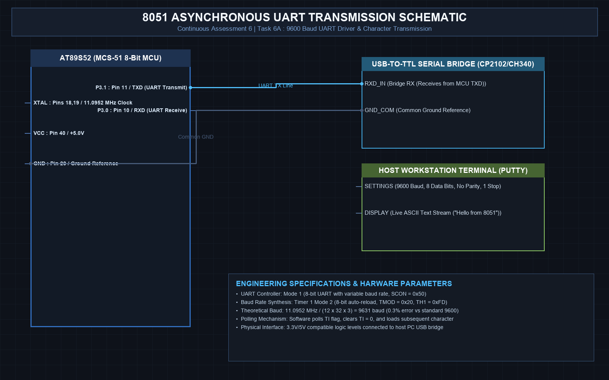

# EXPERIMENT DETAILS
- **Student Name:** Vaishali V
- **Register Number:** 25011102111
- **Degree / Branch:** B.Tech. Computer Science and Engineering (IoT)
- **Year / Semester:** II Year / III Semester
- **Course Title:** Fundamentals of Internet of Things Laboratory (25CS2741)
- **Academic Year:** 2026–2027

---

# CAT 6 - TASK 6A: POLLED UART SERIAL TRANSMITTER (AT89S52)

## 1. Circuit Diagram & Hardware Description



### Hardware Description
This experiment establishes asynchronous serial communication from the AT89S52 microcontroller to a host PC at standard 9600 baud using the MCS-51 integrated Full-Duplex UART peripheral.
- **Serial Channel:** P3.1 (TXD / Pin 11) connects to the RXD pin of an external USB-to-UART bridge (CP2102 or CH340).
- **Format:** 9600 Baud, 8 Data Bits, No Parity, 1 Stop Bit (8-N-1).
- **Baud Rate Clock:** Generated by Timer 1 operating in Mode 2 (8-bit Auto-Reload) with SMOD = 0.

### Baud Rate Calculations
Baud Rate = (2^SMOD / 32) * (F_osc / (12 * (256 - TH1)))
For F_osc = 11.0592 MHz, SMOD = 0, and Baud = 9600:
256 - TH1 = 11059200 / (384 * 9600) = 11059200 / 3686400 = 3
TH1 = 256 - 3 = 253 = 0xFD

---

## 2. Core Logic / Pseudocode / Code Base

### Working Principle
The program initializes `TMOD` to configure Timer 1 in Mode 2, sets `TH1 = 0xFD`, and starts the timer with `TR1 = 1`. The UART register `SCON` is loaded with `0x50` (Mode 1: 8-bit UART with Receive Enable `REN = 1`). To transmit a character, the byte is written into `SBUF`. The hardware shifts the bits out serially over TXD and sets the Transmit Interrupt flag `TI`. Software polls `while (TI == 0)` and clears `TI = 0` upon completion.

### Step-by-Step Pseudocode
```text
BEGIN PROGRAM
    FUNCTION uart_init():
        TMOD = 0x20                    // Timer 1, Mode 2 (8-bit auto-reload)
        TH1 = 0xFD                     // 9600 Baud reload count
        SCON = 0x50                    // Mode 1 (8-bit UART), REN = 1
        TR1 = 1                        // Start Timer 1
        TI = 1                         // Prime TI flag for printf/putchar
    END FUNCTION

    FUNCTION uart_tx_char(ch):
        WHILE TI == 0 DO NOP;          // Wait until transmitter ready
        TI = 0                         // Clear flag
        SBUF = ch                      // Load character into buffer
    END FUNCTION

    FUNCTION uart_tx_string(str):
        WHILE *str != '\0' DO:
            uart_tx_char(*str)
            str = str + 1
        END WHILE
    END FUNCTION

    MAIN:
        CALL uart_init()
        WHILE TRUE DO:
            uart_tx_string("Hello IoT from Vaishali V (Reg: 25011102111)\r\n")
            CALL delay_ms(1000)
        END WHILE
END PROGRAM
```

---

## 3. Expected Output & Inference

### Expected Output
- Opening a serial terminal (PuTTY or Tera Term) at 9600 baud displays clean ASCII text arriving once per second:
  `Hello IoT from Vaishali V (Reg: 25011102111)`

### Inference
Selecting an 11.0592 MHz crystal provides exact integer divisors for standard UART baud rates (9600, 19200, 57600), eliminating timing error and guaranteeing zero frame misalignment.
