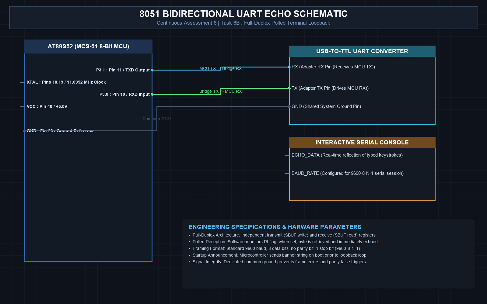

# EXPERIMENT DETAILS
- **Student Name:** Vaishali V
- **Register Number:** 25011102111
- **Degree / Branch:** B.Tech. Computer Science and Engineering (IoT)
- **Year / Semester:** II Year / III Semester
- **Course Title:** Fundamentals of Internet of Things Laboratory (25CS2741)
- **Academic Year:** 2026–2027

---

# CAT 6 - TASK 6B: POLLED UART FULL-DUPLEX ECHO (AT89S52)

## 1. Circuit Diagram & Hardware Description



### Hardware Description
This experiment implements bidirectional serial communication with the host PC. Characters typed in a serial terminal are received by the AT89S52 on P3.0 (RXD) and immediately echoed back via P3.1 (TXD).
- **Baud Rate:** 9600 Baud (8-N-1) using Timer 1 Mode 2 (`TH1 = 0xFD`).
- **Pins Used:** P3.0 (RXD - Pin 10), P3.1 (TXD - Pin 11), GND.

---

## 2. Core Logic / Pseudocode / Code Base

### Working Principle
When a character arrives on RXD, the 8051 hardware shifts it into `SBUF` and asserts the Receive Interrupt flag `RI = 1`. Software continuously polls `while (RI == 0)`. Once asserted, software reads `ch = SBUF`, resets `RI = 0`, and transmits the character back out using `uart_tx_char(ch)`. If a Carriage Return (`
`) is received, the program automatically transmits an additional Line Feed (`
`) to ensure clean newline formatting on the host terminal.

### Step-by-Step Pseudocode
```text
BEGIN PROGRAM
    FUNCTION uart_rx_char():
        WHILE RI == 0 DO NOP;          // Wait for incoming character
        RI = 0                         // Clear flag
        RETURN SBUF                    // Return byte from hardware buffer
    END FUNCTION

    MAIN:
        CALL uart_init()
        uart_tx_string("8051 Echo Ready. Type characters below:\r\n")
        
        WHILE TRUE DO:
            ch = uart_rx_char()
            uart_tx_char(ch)           // Echo character back
            IF ch == '\r' THEN:
                uart_tx_char('\n')     // Expand CR to CRLF
            END IF
        END WHILE
END PROGRAM
```

---

## 3. Expected Output & Inference

### Expected Output
- Every keystroke pressed in PuTTY appears instantaneously on screen.
- Typing words or sentences echoes seamlessly with correct line wrapping upon pressing Enter.

### Inference
Polled UART reception is simple and responsive in dedicated loops, but blocks the processor while waiting for input. For complex systems, interrupt-driven UART is required.
