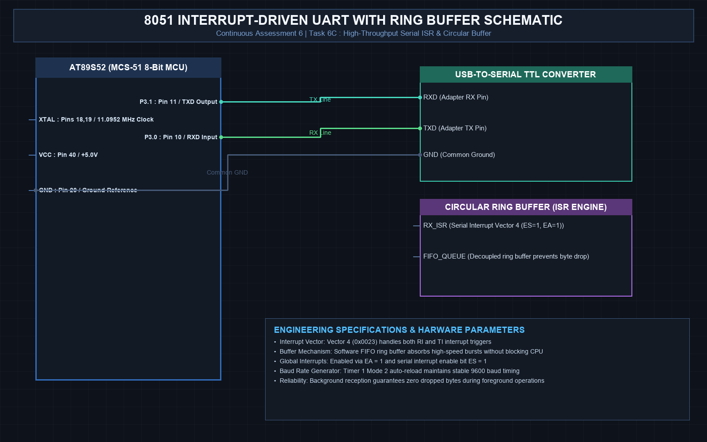

# EXPERIMENT DETAILS
- **Student Name:** Vaishali V
- **Register Number:** 25011102111
- **Degree / Branch:** B.Tech. Computer Science and Engineering (IoT)
- **Year / Semester:** II Year / III Semester
- **Course Title:** Fundamentals of Internet of Things Laboratory (25CS2741)
- **Academic Year:** 2026–2027

---

# CAT 6 - TASK 6C: INTERRUPT-DRIVEN UART WITH CIRCULAR FIFO (AT89S52)

## 1. Circuit Diagram & Hardware Description



### Hardware Description
This advanced serial communications project implements a fully interrupt-driven UART driver on the AT89S52, featuring a 16-byte circular ring buffer (FIFO) to capture asynchronous incoming bytes in the background without dropping characters.
- **Hardware:** AT89S52 at 11.0592 MHz, 9600 Baud 8-N-1.
- **Interrupt:** Serial Interrupt Vector 4 (Address 0x0023) enabled via `ES = 1`, `EA = 1`.

---

## 2. Core Logic / Pseudocode / Code Base

### Working Principle
Whenever `RI` or `TI` is set by hardware, the CPU suspends foreground execution and jumps to `serial_isr()`. The ISR checks `RI`: if set, it reads `SBUF` into a 16-byte circular FIFO managed by `head` and `tail` pointers and clears `RI`. The main foreground loop consumes bytes from the ring buffer at leisure. When the user hits Enter, the accumulated line and its character count are reported back.

### Step-by-Step Pseudocode
```text
BEGIN PROGRAM
    GLOBAL ring_buffer[16]
    GLOBAL rx_head = 0, rx_tail = 0

    INTERRUPT ROUTINE serial_isr (Vector 4):
        IF RI == 1 THEN:
            RI = 0
            next_head = (rx_head + 1) % 16
            IF next_head != rx_tail THEN:     // Check buffer not full
                ring_buffer[rx_head] = SBUF
                rx_head = next_head
            END IF
        END IF
        IF TI == 1 THEN:
            TI = 0                            // Handle transmit completion
        END IF
    END INTERRUPT ROUTINE

    FUNCTION fifo_pop(byte_ptr):
        IF rx_head == rx_tail THEN RETURN FALSE // Buffer empty
        *byte_ptr = ring_buffer[rx_tail]
        rx_tail = (rx_tail + 1) % 16
        RETURN TRUE
    END FUNCTION

    MAIN:
        CALL uart_init_interrupt()
        WHILE TRUE DO:
            IF fifo_pop(&ch) THEN:
                // Process character in foreground without missing bytes
                accumulate_line(ch)
            END IF
        END WHILE
END PROGRAM
```

---

## 3. Expected Output & Inference

### Expected Output
- Rapid typing or pasting text blocks up to 16 bytes into the terminal causes zero dropped characters.
- Pressing Enter returns:
  `> Received 12 chars: Hello World!`

### Inference
Circular ring buffers decoupled via hardware interrupts solve the classic producer-consumer timing mismatch in embedded communications, allowing robust serial handling even while the CPU executes lengthy background calculations.
