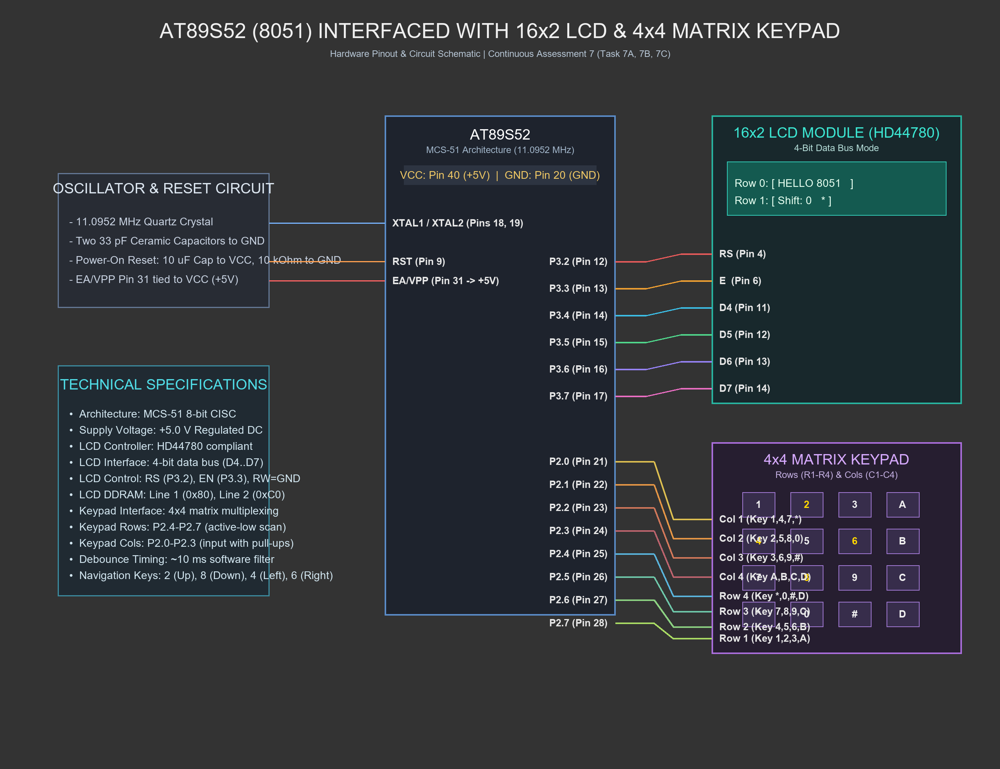

# CONTINUOUS ASSESSMENT 7: 16×2 LCD DRIVER & KEYPAD INTERACTION

**Student Name:** Vaishali V  
**Register Number:** 25011102111  
**Course Code & Name:** 25CS2741 Fundamentals of Internet of Things + Lab  
**Academic Year:** 2026–2027 | **Semester:** III  
**Date of Performance:** 27/08/2026  
**Hardware Platform:** AT89S52 Microcontroller Development Board (11.0952 MHz Crystal)  
**Development Toolchain:** Keil µVision 5 IDE (C51 Compiler) + 16×2 HD44780 LCD + 4×4 Matrix Keypad  

---

## TASK 7A: 16×2 Alphanumeric LCD 4-Bit Driver Initialization & Text Rendering

### 1. Aim / Objective
To design and implement a low-level device driver for the Hitachi HD44780-compatible 16×2 alphanumeric LCD module using the 4-bit data bus interface on the AT89S52 microcontroller, execute power-on reset command sequences, and display individual characters and text strings across both display rows.

### 2. Components Required
- AT89S52 Microcontroller Development Board
- 16×2 Alphanumeric Character LCD Module (HD44780 Controller)
- Contrast Potentiometer (10 kΩ trimmer)
- Breadboard & Jumper Wire Interconnects
- Keil µVision 5 IDE & USB ISP Programmer

### 3. Hardware Specifications
| Parameter | Technical Details |
|---|---|
| Microcontroller | Atmel AT89S52 (MCS-51 Architecture, 11.0952 MHz) |
| Display Controller | Hitachi HD44780 or equivalent (ST7066U / KS0066U) |
| Display Dimensions | 16 Characters × 2 Lines, 5×8 dot matrix font |
| Interface Mode | 4-Bit Parallel Bus (`D4` through `D7`) |
| Control Pins | Register Select (`RS`), Enable (`E`), Read/Write (`R/W` tied to GND for write-only) |
| Display RAM Memory | Line 1 DDRAM Start Address: `0x80`; Line 2 DDRAM Start Address: `0xC0` |
| Operating Voltage | 5.0 V DC ($V_{DD}$ / $V_{CC}$) |

### 4. Pin Configuration & Connections
- **`RS` (Register Select - Pin 4 of LCD):** Connected to `P3.2` (Pin 12 of AT89S52). Logic 0 selects Command Register; Logic 1 selects Data Register.
- **`E` (Enable - Pin 6 of LCD):** Connected to `P3.3` (Pin 13 of AT89S52). A falling edge latch strobes data into the LCD.
- **`R/W` (Read/Write - Pin 5 of LCD):** Hardwired to GND (Logic 0) for write-only operation.
- **`D4`–`D7` (Data Lines - Pins 11–14 of LCD):** Connected to `P3.4`, `P3.5`, `P3.6`, `P3.7` (Pins 14–17 of AT89S52).
- **Power & Contrast:** Pin 1 ($V_{SS}$) to GND; Pin 2 ($V_{DD}$) to +5 V; Pin 3 ($V_0$) to wiper of 10 kΩ contrast pot; Pin 15 (Backlight Anode) to +5 V via 220 Ω; Pin 16 (Backlight Cathode) to GND.

### 5. Circuit Diagram


### 6. Working Principle
The HD44780 controller supports both 8-bit and 4-bit data interfaces. The 4-bit mode halves the required GPIO pins from 8 to 4, leaving remaining microcontroller pins free for peripherals:
1. **Power-On Reset Sequence:** Because the LCD boots in 8-bit mode by default, the microcontroller must force it into 4-bit mode by sending initialization nibbles (`0x03` three times with appropriate millisecond delays, followed by `0x02` to engage 4-bit mode).
2. **Nibble Splitting & Latching:** Every 8-bit byte (command or data) is split into its higher nibble (`byte >> 4`) and lower nibble (`byte & 0x0F`). Each nibble is placed on `P3.4`–`P3.7`, and pin `E` (`P3.3`) is pulsed HIGH then LOW ($>450\text{ ns}$ hold) to latch the bits into the display controller.
3. **Core Command Sequences:**
   - `0x28`: Function Set (4-bit bus, 2 display lines, 5×8 font).
   - `0x0C`: Display ON/OFF Control (Display ON, Cursor OFF, Blinking OFF).
   - `0x06`: Entry Mode Set (Auto-increment DDRAM address cursor to the right).
   - `0x01`: Clear Display memory and return cursor to home.

### 7. Algorithm / Procedure
1. Define control and data bit mappings on Port 3 using `sbit`.
2. Construct `send_nibble(char n)`: extract bits 0..3 of `n`, assign to `P3.4`..`P3.7`, set `E = 1`, delay briefly, and clear `E = 0`.
3. Construct `lcd_write(char val, bit rs)`: set `RS = rs`, send high nibble, send low nibble.
4. Construct `lcd_cmd(char cmd)` (calls `lcd_write(cmd, 0)`) and `lcd_data(char d)` (calls `lcd_write(d, 1)`).
5. Implement `lcd_init()`: execute the 4-bit software reset and configuration commands.
6. In `main()`:
   - Call `lcd_init()`.
   - Issue `lcd_cmd(0x80)` (Line 1, Column 0) and send character `'A'`.
   - Issue `lcd_cmd(0x82)` (Line 1, Column 2) and send string `"HELLO"`.
   - Issue `lcd_cmd(0xC0)` (Line 2, Column 0) and send string `"8051 LCD DRIVER"`.
7. Compile in Keil µVision, generate `.hex`, and flash via ISP.

### 8. Source Code Walkthrough
- **Project Folder:** [`TASK_7A_LCD_Initialization_and_Character_String_Display`](TASK_7A_LCD_Initialization_and_Character_String_Display/)
- **Source File:** `lcd.c`
- **Key Functions:**
  - `send_nibble()` drives `P3.4` through `P3.7` and strobes `LCD_EN`.
  - `lcd_write()` decomposes 8-bit payloads into two 4-bit transactions.
  - `lcd_string()` streams null-terminated character strings.

### 9. Expected Output & Results
The LCD screen clearly renders:
- Line 1: `A HELLO`
- Line 2: `8051 LCD DRIVER`
Characters are crisp, positioned cleanly on their designated row coordinates without artifacting.

### 10. Observations & Inference
- The 4-bit interface requires two strobe cycles per byte, doubling transfer operations but saving 4 critical microcontroller I/O pins.
- Adhering to manufacturer timing requirements (e.g. ~2 ms delay following Clear Display command `0x01`) prevents missed initialization instructions.

---

## TASK 7B: Cursor Coordinate Positioning & Dynamic Viewport Scrolling

### 1. Aim / Objective
To expand the 4-bit LCD driver with coordinate-based positioning (`lcd_goto(row, col)`), numeric string formatting (`lcd_print_number()`), and dynamic viewport scrolling using the HD44780 display shift command (`0x1C`).

### 2. Components Required
- AT89S52 Development Kit
- 16×2 HD44780 Alphanumeric LCD Module
- Keil µVision 5 IDE & USB ISP Programmer

### 3. Hardware Specifications
- **DDRAM Addressing:** Line 0: `0x80 + col`; Line 1: `0xC0 + col`.
- **Shift Command:** `0x1C` shifts the entire display viewport rightward by one column.
- **Return Home:** `0x02` resets the viewport shift and returns cursor to `(0, 0)`.

### 4. Pin Configuration & Connections
- Identical to Task 7A (`P3.2`–`P3.7` interfacing the 16×2 LCD).

### 5. Circuit Diagram


### 6. Working Principle
The HD44780 features internal Display Data RAM (DDRAM) holding up to 80 bytes (40 characters per line), with a 16-character visible window:
1. **Coordinate Addressing:** `lcd_goto(row, col)` calculates the DDRAM memory pointer:
   $$\text{Address} = \begin{cases} \text{0x80} + \text{col}, & \text{if } \text{row} = 0 \\ \text{0xC0} + \text{col}, & \text{if } \text{row} = 1 \end{cases}$$
2. **Dynamic Number Formatting:** `lcd_print_number(int val)` extracts individual digits using integer division and modulo (`% 10`), formats them as ASCII by adding `'0'` (`0x30`), and prints them in sequence.
3. **Viewport Shift & Reset:** Issuing `0x1C` shifts the viewable display window one position to the right on each cycle. When the shift counter reaches 22, the code issues Return Home command `0x02` to reset the display back to its origin.

### 7. Algorithm / Procedure
1. Implement `lcd_goto(row, col)`: send `(row == 0 ? 0x80 : 0xC0) + col`.
2. Implement `lcd_print_number(val)`: convert positive integers into ASCII and send via `lcd_data()`.
3. In `main()`:
   - Call `lcd_init()`.
   - Print static label `"HI DA"` at `(0, 0)` and `"Shift:"` at `(1, 0)`.
   - In a loop, position cursor at `(1, 7)`, overwrite with blank spaces, and print the current shift count.
   - If shift count reaches 22, send Return Home (`0x02`) and reset counter to 0.
   - Otherwise, issue command `0x1C` to scroll the screen right and increment counter.
   - Delay 200 ms and repeat.

### 8. Source Code Walkthrough
- **Project Folder:** [`TASK_7B_Cursor_Positioning_and_Dynamic_Value_Update`](TASK_7B_Cursor_Positioning_and_Dynamic_Value_Update/)
- **Source File:** `lcd.c`
- **Key Routine:**
```c
void lcd_goto(unsigned char row, unsigned char col) {
    if (row == 0)
        lcd_cmd(0x80 + col);
    else
        lcd_cmd(0xC0 + col);
}
```

### 9. Expected Output & Results
Line 0 displays `"HI DA"` and Line 1 displays `"Shift: <n>"`. As `<n>` increments from 0 to 21, the entire text shifts smoothly across the LCD screen to the right, resetting back to the origin upon reaching 22.

### 10. Observations & Inference
- Overwriting specific character coordinates in place avoids the full screen flicker associated with repeated Clear Display (`0x01`) commands.

---

## TASK 7C: 4×4 Matrix Keypad Directional Cursor Control

### 1. Aim / Objective
To integrate a 4×4 matrix keypad with the 16×2 LCD on the AT89S52 microcontroller, enabling real-time interactive 2D navigation of a sprite character (`*`) across the 16×2 coordinate grid using directional keys (`2` = Up, `8` = Down, `4` = Left, `6` = Right).

### 2. Components Required
- AT89S52 Development Board
- 16×2 Character LCD Module on Port 3
- 4×4 Matrix Keypad on Port 2
- Keil µVision 5 IDE & USB ISP Programmer

### 3. Hardware Specifications
| Peripheral | Pin Interface | Role |
|---|---|---|
| LCD Module | Port 3 (`P3.2`–`P3.7`) | Display rendering (HD44780 4-bit mode) |
| Keypad Rows | `P2.7`, `P2.6`, `P2.5`, `P2.4` | Row scanning outputs (active-low) |
| Keypad Columns | `P2.3`, `P2.2`, `P2.1`, `P2.0` | Column sampling inputs |
| Boundary Constraints | Row $\in [0, 1]$, Column $\in [0, 15]$ | Coordinate clamping |

### 4. Pin Configuration & Connections
- LCD data and control lines on `P3.2`–`P3.7` as defined in Task 7A.
- Keypad Row 1–4 on `P2.7`–`P2.4`; Keypad Column 1–4 on `P2.3`–`P2.0`.

### 5. Circuit Diagram


### 6. Working Principle
The application implements an interactive embedded graphical user interface:
1. **Coordinate State Tracking:** Variables `row` (0 or 1) and `col` (0 to 15) store the position of the sprite character `'*'`.
2. **Keypad Directional Mapping:**
   - Key `'2'` (Row 1, Col 2): Move **UP** $\rightarrow$ `row = 0`.
   - Key `'8'` (Row 3, Col 2): Move **DOWN** $\rightarrow$ `row = 1`.
   - Key `'4'` (Row 2, Col 1): Move **LEFT** $\rightarrow$ `col = max(0, col - 1)`.
   - Key `'6'` (Row 2, Col 3): Move **RIGHT** $\rightarrow$ `col = min(15, col + 1)`.
3. **Screen Erasure & Redraw:** Before modifying coordinates, the current location is erased by writing an ASCII space `' '`. Once new valid coordinates are computed, `lcd_goto(row, col)` positions the cursor and writes `'*'`. Waiting for key release ensures deterministic, single-step movement per press.

### 7. Algorithm / Procedure
1. Initialize the LCD and place `'*'` at starting location `(row = 0, col = 0)`.
2. In the main loop, continuously poll the matrix keypad using `btn()`.
3. When a directional key (`2`, `4`, `6`, or `8`) is registered:
   - Move to current `(row, col)` and write `' '` (blank out old position).
   - Update `row` or `col` according to the pressed directional key, enforcing screen limits.
   - Move to new `(row, col)` and write `'*'`.
   - Wait until the key is released before resuming polling.
4. Repeat continuously.

### 8. Source Code Walkthrough
- **Project Folder:** [`TASK_7C_Keypad_Based_Character_Movement`](TASK_7C_Keypad_Based_Character_Movement/)
- **Source File:** `lcd.c`
- **Directional Mapping Logic:**
```c
if(key == 2) { row = 0; }
if(key == 8) { row = 1; }
if(key == 4 && col > 0) { col--; }
if(key == 6 && col < 15) { col++; }
```

### 9. Expected Output & Results
The asterisk sprite `'*'` moves responsively around the 16×2 grid in direct response to keypad presses. Pressing key `2` moves it to the top row, key `8` to the bottom row, and keys `4` and `6` shift it left and right without exceeding the display boundary.

### 10. Observations & Inference
- Combining selective DDRAM character updates with software-debounced keypad scanning creates a responsive embedded user interface without display flicker.
- Enforcing boundary constraints in firmware prevents memory writes outside valid DDRAM ranges.
