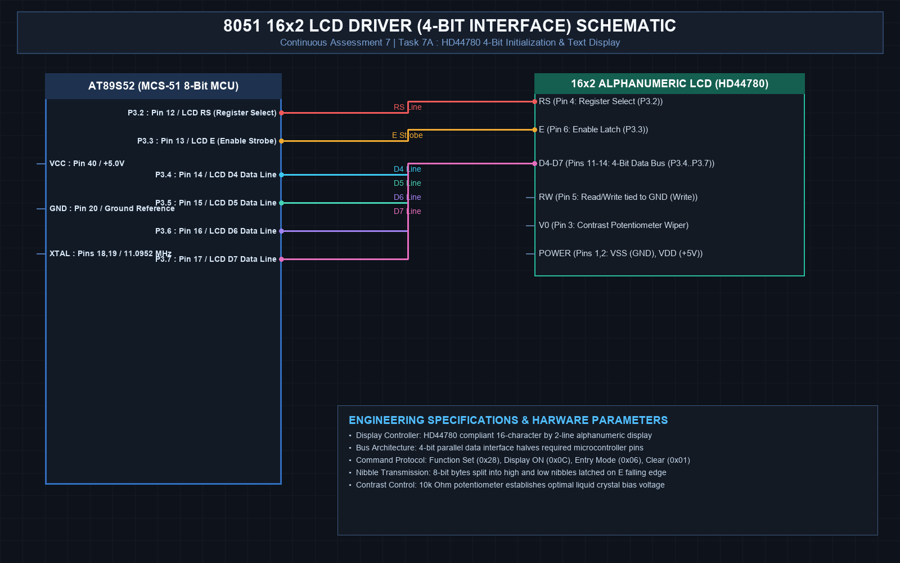

# EXPERIMENT DETAILS
- **Student Name:** Vaishali V
- **Register Number:** 25011102111
- **Degree / Branch:** B.Tech. Computer Science and Engineering (IoT)
- **Year / Semester:** II Year / III Semester
- **Course Title:** Fundamentals of Internet of Things Laboratory (25CS2741)
- **Academic Year:** 2026–2027

---

# CAT 7 - TASK 7A: 16x2 ALPHANUMERIC LCD INTERFACING (AT89S52)

## 1. Circuit Diagram & Hardware Description



### Hardware Description
This experiment interfaces an industry-standard HD44780-compatible 16x2 alphanumeric liquid crystal display (LCD) to the AT89S52 microcontroller using 4-bit nibble mode to conserve GPIO pins.
- **LCD Controller:** Hitachi HD44780 or equivalent with 16 characters x 2 display lines.
- **Interface Bus (Port 3):**
  - `P3.2` -> Register Select (`RS`): 0 = Command Register, 1 = Data Register.
  - `P3.3` -> Enable (`EN`): High-to-Low strobe latches data into LCD controller.
  - `P3.4` -> Data Line 4 (`D4`)
  - `P3.5` -> Data Line 5 (`D5`)
  - `P3.6` -> Data Line 6 (`D6`)
  - `P3.7` -> Data Line 7 (`D7`)
  - `RW` pin of LCD is hardwired directly to GND (Write-only mode).
  - Pin 3 (`V0`) connects to a 10k potentiometer wiper for contrast adjustment.

---

## 2. Core Logic / Pseudocode / Code Base

### Working Principle
In 4-bit mode, every 8-bit command or ASCII byte is transmitted as two sequential 4-bit nibbles: high nibble first, then low nibble. Each nibble is placed on pins P3.4–P3.7, followed by an Enable pulse (`EN = 1; delay_us(); EN = 0`). The LCD initialization routine issues the standard reset sequence: `0x02` (4-bit return home), `0x28` (4-bit mode, 2-line, 5x8 font), `0x0C` (display ON, cursor OFF), `0x06` (auto-increment cursor), and `0x01` (clear display).

### Step-by-Step Pseudocode
```text
BEGIN PROGRAM
    FUNCTION lcd_send_nibble(nibble):
        P3 = (P3 & 0x0F) | (nibble & 0xF0) // Place high nibble on P3.4-P3.7
        EN = 1; CALL delay_us(5); EN = 0   // Latch data with EN strobe
    END FUNCTION

    FUNCTION lcd_send_byte(byte, is_data):
        RS = is_data                       // 0 = Command, 1 = Data
        lcd_send_nibble(byte & 0xF0)       // Send Upper Nibble
        lcd_send_nibble((byte << 4) & 0xF0)// Send Lower Nibble
        CALL delay_ms(2)
    END FUNCTION

    FUNCTION lcd_init():
        CALL delay_ms(20)                  // Power-on delay
        lcd_send_nibble(0x30); CALL delay_ms(5)
        lcd_send_nibble(0x30); CALL delay_ms(1)
        lcd_send_nibble(0x30); CALL delay_ms(1)
        lcd_send_nibble(0x20)              // Set 4-bit mode
        lcd_send_byte(0x28, 0)             // 2 lines, 5x8 matrix
        lcd_send_byte(0x0C, 0)             // Display ON, cursor OFF
        lcd_send_byte(0x06, 0)             // Increment cursor
        lcd_send_byte(0x01, 0)             // Clear screen
    END FUNCTION

    MAIN:
        CALL lcd_init()
        lcd_set_cursor(0, 0)               // Line 1
        lcd_print("Vaishali V")
        lcd_set_cursor(1, 0)               // Line 2
        lcd_print("Reg: 25011102111")
        WHILE TRUE DO NOP;
END PROGRAM
```

---

## 3. Expected Output & Inference

### Expected Output
- The 16x2 LCD illuminates clearly showing:
  - Line 1: `Vaishali V`
  - Line 2: `Reg: 25011102111`
- Display text is crisp, stable, and completely free of ghosting or corruption.

### Inference
4-bit mode halves the required data bus wires from 8 down to 4 with negligible execution penalty, saving vital MCU I/O pins for sensors and actuators.
