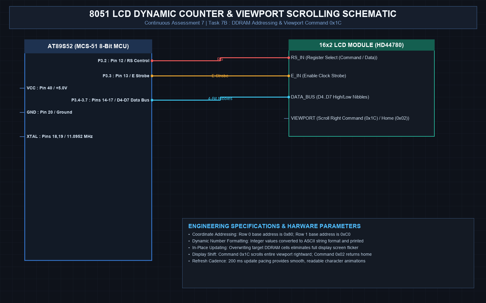

# EXPERIMENT DETAILS
- **Student Name:** Vaishali V
- **Register Number:** 25011102111
- **Degree / Branch:** B.Tech. Computer Science and Engineering (IoT)
- **Year / Semester:** II Year / III Semester
- **Course Title:** Fundamentals of Internet of Things Laboratory (25CS2741)
- **Academic Year:** 2026–2027

---

# CAT 7 - TASK 7B: 4x4 MATRIX KEYPAD INTERFACING WITH LCD (AT89S52)

## 1. Circuit Diagram & Hardware Description



### Hardware Description
This experiment interfaces a 16-key matrix keypad (4 rows x 4 columns) to Port 2 of the AT89S52 microcontroller and displays pressed keys in real-time on a 16x2 character LCD.
- **Keypad Wiring (Port 2):**
  - Rows R1–R4 connect to pins `P2.4`, `P2.5`, `P2.6`, and `P2.7` (Driven as Outputs).
  - Columns C1–C4 connect to pins `P2.0`, `P2.1`, `P2.2`, and `P2.3` (Configured as Inputs with pull-ups).
- **LCD Display (Port 3):** Standard 4-bit mode interface displaying the decoded character.

| Keypad Matrix | Col 1 (P2.0) | Col 2 (P2.1) | Col 3 (P2.2) | Col 4 (P2.3) |
| :---: | :---: | :---: | :---: | :---: |
| **Row 1 (P2.4)** | '1' | '2' | '3' | 'A' |
| **Row 2 (P2.5)** | '4' | '5' | '6' | 'B' |
| **Row 3 (P2.6)** | '7' | '8' | '9' | 'C' |
| **Row 4 (P2.7)** | '*' | '0' | '#' | 'D' |

---

## 2. Core Logic / Pseudocode / Code Base

### Working Principle
The scanning algorithm drives one row LOW at a time (`0`) while driving the remaining three rows HIGH (`1`). It then reads the 4 column pins. If a column pin is pulled LOW, the intersection between the active row and the grounded column identifies the exact pressed key. After debouncing and waiting for key release, the decoded ASCII key is rendered on the LCD.

### Step-by-Step Pseudocode
```text
BEGIN PROGRAM
    GLOBAL key_map[4][4] = {
        {'1', '2', '3', 'A'},
        {'4', '5', '6', 'B'},
        {'7', '8', '9', 'C'},
        {'*', '0', '#', 'D'}
    }

    FUNCTION keypad_scan():
        FOR row FROM 0 TO 3 DO:
            // Drive active row LOW, others HIGH
            P2 = ~(0x10 << row) | 0x0F
            
            // Read columns
            col_data = P2 & 0x0F
            IF col_data != 0x0F THEN:          // A key is pressed
                CALL delay_ms(20)              // Debounce
                col_data = P2 & 0x0F
                IF col_data != 0x0F THEN:
                    FOR col FROM 0 TO 3 DO:
                        IF (col_data & (1 << col)) == 0 THEN:
                            // Wait for key release
                            WHILE (P2 & 0x0F) != 0x0F DO NOP;
                            RETURN key_map[row][col]
                        END IF
                    END FOR
                END IF
            END IF
        END FOR
        RETURN 0                               // No key pressed
    END FUNCTION

    MAIN:
        CALL lcd_init()
        lcd_print("Press Any Key:")
        WHILE TRUE DO:
            k = keypad_scan()
            IF k != 0 THEN:
                lcd_set_cursor(1, 0)
                lcd_print("Key Pressed: ")
                lcd_send_byte(k, 1)            // Print character
            END IF
        END WHILE
END PROGRAM
```

---

## 3. Expected Output & Inference

### Expected Output
- Pressing any key immediately updates the LCD second line to show `Key Pressed: <KEY>`.
- Releasing and pressing again works smoothly without key bounce or double-registration.

### Inference
Matrix scanning reduces pin count from 16 dedicated lines down to 8 lines (4+4), demonstrating multiplexed input capture on resource-constrained embedded systems.
