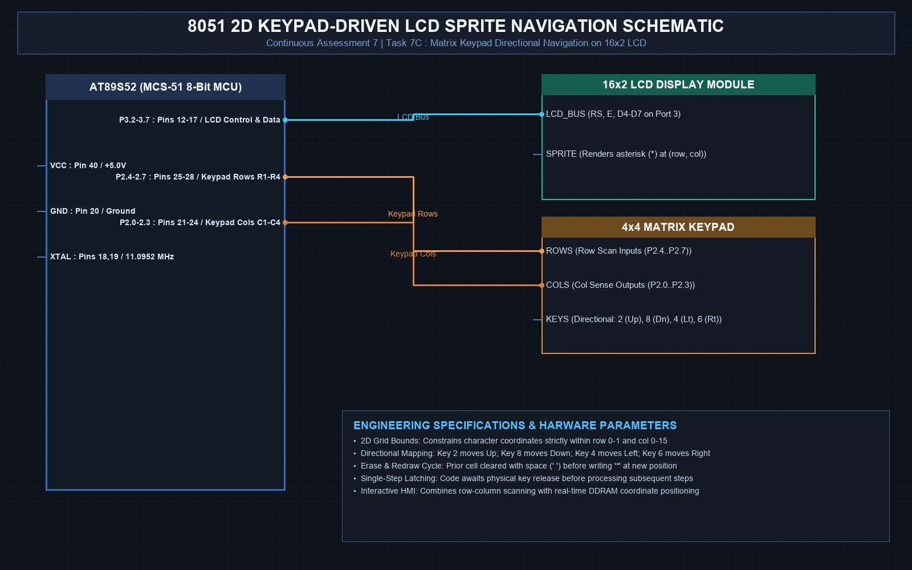

# EXPERIMENT DETAILS
- **Student Name:** Vaishali V
- **Register Number:** 25011102111
- **Degree / Branch:** B.Tech. Computer Science and Engineering (IoT)
- **Year / Semester:** II Year / III Semester
- **Course Title:** Fundamentals of Internet of Things Laboratory (25CS2741)
- **Academic Year:** 2026–2027

---

# CAT 7 - TASK 7C: 2D KEYPAD-DRIVEN LCD SPRITE NAVIGATION (AT89S52)

## 1. Circuit Diagram & Hardware Description



### Hardware Description
This interactive capstone experiment combines 4x4 matrix keypad input and 16x2 alphanumeric LCD output into a real-time 2D sprite navigation application.
- **Navigation Controls:**
  - Key `2`: Move UP (Row 1 -> Row 0)
  - Key `8`: Move DOWN (Row 0 -> Row 1)
  - Key `4`: Move LEFT (Col C -> C-1)
  - Key `6`: Move RIGHT (Col C -> C+1)
- **Sprite:** Asterisk character (`*`) navigating across a 2-row x 16-column grid with strict boundary clipping.
- **Hardware Bus:** Matrix keypad on Port 2 (P2.0–P2.7), LCD 4-bit bus on Port 3 (P3.2–P3.7).

---

## 2. Core Logic / Pseudocode / Code Base

### Working Principle
The sprite position is tracked by state variables `pos_row` (0 or 1) and `pos_col` (0 to 15). When a directional key is detected, the old character position is cleared with a space (`' '`), the coordinate is updated with strict boundary clamping (0 <= col <= 15 and 0 <= row <= 1), and the sprite `'*'` is rendered at the new DDRAM address.

### Step-by-Step Pseudocode
```text
BEGIN PROGRAM
    GLOBAL pos_row = 0, pos_col = 0

    MAIN:
        CALL lcd_init()
        lcd_set_cursor(pos_row, pos_col)
        lcd_send_byte('*', 1)                 // Render initial sprite
        
        WHILE TRUE DO:
            key = keypad_scan()
            IF key != 0 THEN:
                // Erase old sprite
                lcd_set_cursor(pos_row, pos_col)
                lcd_send_byte(' ', 1)
                
                // Process directional navigation
                IF key == '2' AND pos_row > 0 THEN pos_row = pos_row - 1 // UP
                ELSE IF key == '8' AND pos_row < 1 THEN pos_row = pos_row + 1 // DOWN
                ELSE IF key == '4' AND pos_col > 0 THEN pos_col = pos_col - 1 // LEFT
                ELSE IF key == '6' AND pos_col < 15 THEN pos_col = pos_col + 1 // RIGHT
                
                // Draw new sprite
                lcd_set_cursor(pos_row, pos_col)
                lcd_send_byte('*', 1)
            END IF
        END WHILE
END PROGRAM
```

---

## 3. Expected Output & Inference

### Expected Output
- The asterisk sprite moves smoothly across both lines of the LCD display in response to keypad presses.
- Reaching edges (e.g. column 0 or 15, row 0 or 1) clips motion cleanly without overflowing or corrupting display RAM.

### Inference
Combining matrix input decoding, DDRAM coordinate mapping, and stateful graphics manipulation demonstrates full human-machine interface (HMI) design on classical 8051 microcontrollers.
