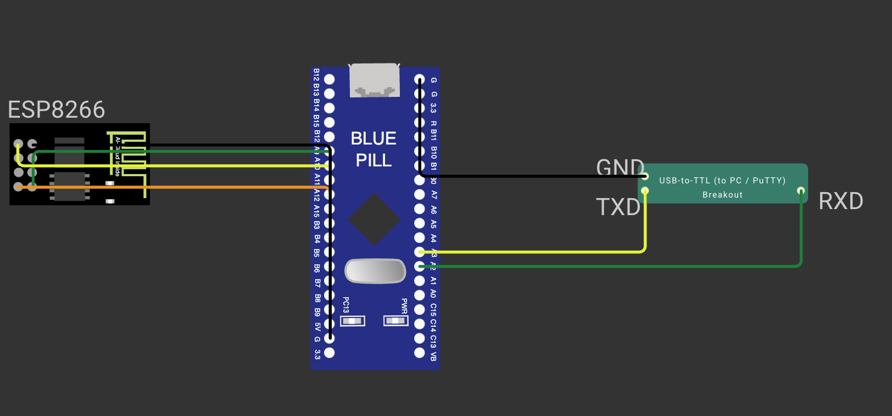

# CONTINUOUS ASSESSMENT 10: STM32 TO ESP8266 WI-FI MODEM INTERFACING VIA AT COMMANDS

**Student Name:** Vaishali V  
**Register Number:** 25011102111  
**Course Code & Name:** 25CS2741 Fundamentals of Internet of Things + Lab  
**Academic Year:** 2026–2027 | **Semester:** III  
**Date of Performance:** 08/10/2026  
**Hardware Platform:** STM32 "Blue Pill" Development Board (STM32F103C8T6, ARM Cortex-M3 @ 72 MHz) + Wemos D1 Mini (ESP8266)  
**Development Toolchain:** STM32CubeMX + STM32CubeIDE (HAL Drivers) + USB-to-TTL Serial Bridge + PuTTY  

---

## TASK 9A: Dual-UART Architecture & Baseline Modem Communication

### 1. Aim / Objective
To configure two independent asynchronous serial peripherals on the STM32F103C8T6 microcontroller (`USART1` for Wemos D1 Mini modem communication and `USART2` for PC diagnostic logging) at 115200 baud, establish an AT command protocol parser, and verify modem responsiveness by issuing the `AT` ping command and capturing the `OK` status response.

### 2. Components Required
- STM32 "Blue Pill" Development Board (STM32F103C8T6)
- Wemos D1 Mini (ESP8266 Wi-Fi Module) flashed with Espressif AT firmware
- 3.3V USB-to-TTL Serial Bridge (CP2102 / FTDI)
- Breadboard & Jumper Wire Interconnects
- ST-LINK V2 Debugger & Workstation running PuTTY

### 3. Hardware Specifications
| Parameter | Technical Details |
|---|---|
| Host Microcontroller | STM32F103C8T6 (32-bit ARM Cortex-M3 @ 72 MHz, 64 KB Flash) |
| Wireless Transceiver | Wemos D1 Mini (Espressif ESP8266 SoC, 2.4 GHz 802.11 b/g/n) |
| Firmware on Modem | Standard Espressif Non-OS AT Command Firmware (v1.7.x / v2.x) |
| `USART1` (Modem Channel) | `PA9` (`TX`) $\rightarrow$ Wemos `RX`; `PA10` (`RX`) $\leftarrow$ Wemos `TX` @ 115200-8-N-1 |
| `USART2` (Debug Console) | `PA2` (`TX`) $\rightarrow$ Bridge `RX`; `PA3` (`RX`) $\leftarrow$ Bridge `TX` @ 115200-8-N-1 |
| Power Supply Distribution | STM32 powered via 3.3V/5V ST-LINK; Wemos powered via 5V rail; common GND across all devices |

### 4. Pin Configuration & Connections
- **STM32 `USART1` Link to Wemos:** `PA9` $\rightarrow$ Wemos `RX`; `PA10` $\leftarrow$ Wemos `TX`.
- **STM32 `USART2` Link to Host PC:** `PA2` $\rightarrow$ USB-to-TTL `RX`; `PA3` $\leftarrow$ USB-to-TTL `TX`.
- **Power & Common Ground:** Wemos `5V` pin connected to external 5V DC supply rail; all ground pins (STM32 `GND`, Wemos `GND`, USB-to-TTL `GND`) tied to a single common ground bus.

### 5. Circuit Diagram


### 6. Working Principle
The dual-UART bridge decouples modem traffic from operator diagnostics:
1. **Asynchronous Command Transmission:** The STM32 transmits formatted AT command strings terminated by `\r\n` over `USART1` to the ESP8266.
2. **Line-by-Line Response Extraction:** `recieveUART()` accumulates incoming bytes from `USART1` until a Carriage Return (`\r`) / Line Feed (`\n`) sequence is detected.
3. **Status Token Validation:** `sendATCommand()` checks incoming lines for completion tokens:
   - Returning `1` if an `"OK"` line is encountered.
   - Returning `0` if an `"ERROR"` or `"FAIL"` line is encountered.
4. **Diagnostic Mirroring:** Function `showATCommand()` mirrors the outgoing command (prefixed with `>> `) and every received response line (prefixed with `<< `) over `USART2` to PuTTY.

### 7. Algorithm / Procedure
1. Configure `USART1` and `USART2` for 115200-8-N-1 in STM32CubeMX.
2. Construct utility routines:
   - `sendUART(huart, str)`: Transmit `str` followed by `\r\n`.
   - `recieveUART(huart, buf, maxlen)`: Read characters until `\r\n` or buffer full.
   - `sendATCommand(cmd, resbuf)`: Dispatch `cmd`, accumulate responses, and detect `OK`/`ERROR`.
   - `showATCommand(cmd)`: Output diagnostics to `USART2`.
3. In `main()`:
   - Output banner `"STM32-WiFi MODEM TEST"` to `USART2`.
   - Wait 2 seconds for ESP8266 boot stabilization.
   - Clear any UART overrun flags.
   - Issue `"ATE0"` to disable command echo.
   - Issue `"AT"` and log response lines to `USART2`.
4. Flash the Blue Pill and monitor results in PuTTY.

### 8. Source Code Walkthrough
- **Project Folder:** [`TASK_9A_Establish_STM32_Wemos_UART_Communication`](TASK_9A_Establish_STM32_Wemos_UART_Communication/)
- **Source File:** `Core/Src/main.c`
- Execution sequence:
```c
sendUART(&huart2, "STM32-WiFi MODEM TEST");
HAL_Delay(2000);
__HAL_UART_CLEAR_OREFLAG(&huart1);
sendATCommand("ATE0", res);
showATCommand("AT");
```

### 9. Expected Output & Results
In PuTTY:
```
STM32-WiFi MODEM TEST
>> AT
<< OK
```
The modem returns `OK`, validating bidirectional communication between the STM32 and Wemos D1 Mini.

### 10. Observations & Inference
- The ESP8266 modem requires a brief (~2 s) startup delay following power application to stabilize its internal bootloader and RF calibration before accepting UART commands.
- Clearing the Overrun Error flag (`__HAL_UART_CLEAR_OREFLAG`) prevents UART receiver lockups caused by modem startup boot messages.

---

## TASK 9B: Exploration of the ESP8266 AT Command Protocol

### 1. Aim / Objective
To systematically explore and query the Espressif ESP8266 AT command interface from the STM32 microcontroller, querying firmware revision strings, configuring operating modes, and inspecting modem capabilities.

### 2. Components Required
- Hardware setup identical to Task 9A (STM32 Blue Pill, Wemos D1 Mini, USB-to-TTL Bridge, ST-LINK).

### 3. Hardware Specifications
| AT Command | Functional Scope | Typical Response |
|---|---|---|
| `AT` | Test modem attention / readiness | `OK` |
| `ATE0` | Disable command echo back to host | `OK` |
| `AT+GMR` | Query AT version, SDK version, and build timestamp | Multiple version strings followed by `OK` |
| `AT+CWMODE=1` | Set Wi-Fi mode to Station (client) | `OK` |
| `AT+CWLAP` | Scan and list available Wi-Fi access points in range | List of `+CWLAP:(ecn,ssid,rssi,mac,ch)` |
| `AT+CIFSR` | Query local IP and MAC addresses | `+CIFSR:STAIP,"..."` and `+CIFSR:STAMAC,"..."` |

### 4. Pin Configuration & Connections
- Identical to Task 9A.

### 5. Circuit Diagram


### 6. Working Principle
The ESP8266 AT protocol operates as a request-response protocol. The STM32 sends formatted ASCII text, and the ESP8266 responds with informational data lines followed by a terminal status keyword (`OK`, `ERROR`, or `FAIL`). By issuing `AT+GMR`, the STM32 retrieves the Espressif SDK build details, validating the capability of the onboard firmware to handle networking operations.

### 7. Algorithm / Procedure
1. Initialize system peripherals and wait 2 seconds for modem boot.
2. Issue `ATE0` to disable command echo.
3. Call `showATCommand("AT")` to confirm connectivity.
4. Call `showATCommand("AT+GMR")` to query firmware versions.
5. Call `showATCommand("AT+CWMODE=1")` to configure Station mode.
6. Display all output via `USART2` to the workstation.

### 8. Source Code Walkthrough
- **Project Folder:** [`TASK_9B_Explore_ESP8266_AT_Command_Interface`](TASK_9B_Explore_ESP8266_AT_Command_Interface/)
- **Source File:** `Core/Src/main.c`

### 9. Expected Output & Results
```
STM32-WiFi MODEM TEST
>> AT
<< OK
>> AT+GMR
<< AT version:1.7.4.0
<< SDK version:3.0.4
<< compile time:May 27 2021 17:34:02
<< OK
>> AT+CWMODE=1
<< OK
```

### 10. Observations & Inference
- Disabling command echo (`ATE0`) eliminates redundant outgoing strings from incoming response buffers, simplifying string parsing logic.

---

## TASK 9C: Associating Wemos ESP8266 with Wi-Fi & Dynamic IP Retrieval

### 1. Aim / Objective
To automate the connection of the Wemos D1 Mini to a local 2.4 GHz Wi-Fi Access Point using the `AT+CWJAP` command dispatched by the STM32 microcontroller, query network assignment using `AT+CIFSR`, and display the allocated local IP and MAC addresses on the serial console.

### 2. Components Required
- Hardware configuration identical to Task 9A and Task 9B.
- Active 2.4 GHz Wi-Fi Access Point (SSID and WPA2 Password).

### 3. Hardware Specifications
- Station Mode: `AT+CWMODE=1`.
- Access Point Association: `AT+CWJAP="<SSID>","<PASSWORD>"`.
- IP/MAC Retrieval: `AT+CIFSR`.

### 4. Pin Configuration & Connections
- Identical to Task 9A.

### 5. Circuit Diagram


### 6. Working Principle
Wi-Fi connection requires multi-step handshaking across RF layers:
1. **Station Mode Setup:** `AT+CWMODE=1` configures the ESP8266 as a client station.
2. **Access Point Association:** `AT+CWJAP="<ssid>","<pass>"` commands the modem to associate with the access point, execute WPA2 authentication, and request an IP lease via DHCP. Because RF association requires several seconds, `sendATCommand()` accommodates multiple response lines (`WIFI CONNECTED`, `WIFI GOT IP`, and final `OK`).
3. **Address Query:** Once joined, `AT+CIFSR` is issued to query the station IP address (`STAIP`) and physical MAC address (`STAMAC`).

### 7. Algorithm / Procedure
1. Initialize STM32 clock and UART channels.
2. Wait 2 seconds and issue `ATE0`.
3. Set Station mode via `showATCommand("AT+CWMODE=1")`.
4. Construct connection string: `AT+CWJAP="<ssid>","<password>"`.
5. Issue connection command and await `WIFI GOT IP` and `OK`.
6. Issue `showATCommand("AT+CIFSR")` to read the acquired IP and MAC.
7. Output all responses over `USART2` to PuTTY.

### 8. Source Code Walkthrough
- **Project Folder:** [`TASK_9C_Connect_Wemos_to_WiFi`](TASK_9C_Connect_Wemos_to_WiFi/)
- **Source File:** `Core/Src/main.c`
```c
showATCommand("AT+CWMODE=1");
showATCommand("AT+CWJAP=\"WiFi_SSID\",\"WiFi_Password\"");
showATCommand("AT+CIFSR");
```

### 9. Expected Output & Results
```
STM32-WiFi MODEM TEST
>> AT
<< OK
>> AT+CWMODE=1
<< OK
>> AT+CWJAP="SNUC_IoT_Lab","Lab@2026"
<< WIFI CONNECTED
<< WIFI GOT IP
<< OK
>> AT+CIFSR
<< +CIFSR:STAIP,"192.168.1.142"
<< +CIFSR:STAMAC,"50:02:91:8a:c4:7e"
<< OK
```

### 10. Observations & Inference
- The ESP8266 retains network association parameters in non-volatile flash; however, issuing explicit commands in firmware guarantees deterministic connection behavior on every system boot.
- The allocated IP address (e.g. `192.168.1.142`) confirms that the microcontroller has successfully joined the IP network, preparing the hardware for higher-level HTTP and MQTT client operations.
