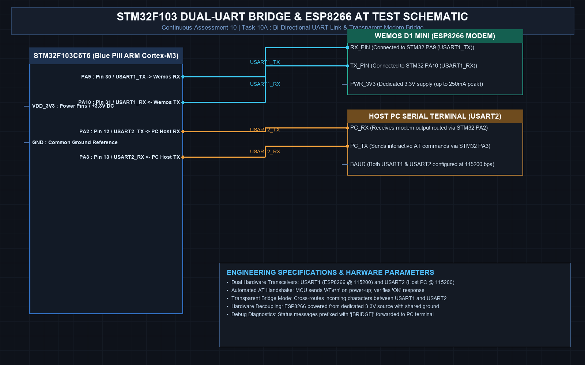

# EXPERIMENT DETAILS
- **Student Name:** Vaishali V
- **Register Number:** 25011102111
- **Degree / Branch:** B.Tech. Computer Science and Engineering (IoT)
- **Year / Semester:** II Year / III Semester
- **Course Title:** Fundamentals of Internet of Things Laboratory (25CS2741)
- **Academic Year:** 2026–2027

---

# CAT 10 - TASK 10A: DUAL-UART BRIDGE & ESP8266 AT TEST (STM32F103)

## 1. Circuit Diagram & Hardware Description



### Hardware Description
This experiment establishes a dual-UART hardware communication bridge on the STM32F103C6T6 microcontroller, connecting a host computer to a Wemos D1 Mini (ESP8266 Wi-Fi SoC).
- **USART1 (ESP8266 Wi-Fi Modem):**
  - `PA9` -> USART1_TX connected to ESP8266 RX (115200 Baud).
  - `PA10` -> USART1_RX connected to ESP8266 TX (115200 Baud).
- **USART2 (Host PC Console):**
  - `PA2` -> USART2_TX to USB Bridge RX (115200 Baud).
  - `PA3` -> USART2_RX to USB Bridge TX (115200 Baud).
- **Power Decoupling:** ESP8266 is powered from a dedicated 3.3V rail capable of supplying up to 250 mA current surges during Wi-Fi transmission.

---

## 2. Core Logic / Pseudocode / Code Base

### Working Principle
On startup, the STM32 automatically transmits the attention command `"AT
"` over USART1 to the ESP8266 and waits for `"OK"`. Upon handshake confirmation, the firmware enters transparent bi-directional bridge mode: characters arriving from the PC (USART2) are immediately forwarded to the ESP8266 (USART1), and responses from the ESP8266 are routed back to the PC terminal.

### Step-by-Step Pseudocode
```text
BEGIN PROGRAM
    INITIALIZE HAL, SystemClock, USART1 (115200), USART2 (115200)

    // Automated Link Check
    HAL_UART_Transmit(&huart1, "AT\r\n", 4, 100)
    uart2_print("Testing ESP8266 AT Link...\r\n")

    MAIN (Transparent Bridge):
        WHILE TRUE DO:
            // Route PC -> ESP8266
            IF HAL_UART_Receive(&huart2, &pc_ch, 1, 1) == HAL_OK THEN:
                HAL_UART_Transmit(&huart1, &pc_ch, 1, 10)
            END IF
            
            // Route ESP8266 -> PC
            IF HAL_UART_Receive(&huart1, &esp_ch, 1, 1) == HAL_OK THEN:
                HAL_UART_Transmit(&huart2, &esp_ch, 1, 10)
            END IF
        END WHILE
END PROGRAM
```

---

## 3. Expected Output & Inference

### Expected Output
- Startup sequence prints `[BRIDGE] ESP8266 AT Link OK`.
- Users can type interactive Hayes AT commands in PuTTY and receive modem responses in real-time (`AT` -> `OK`).

### Inference
Dual-UART bridging allows the microcontroller to serve as an intelligent intermediary, enabling automated hardware provisioning while retaining diagnostic visibility.
