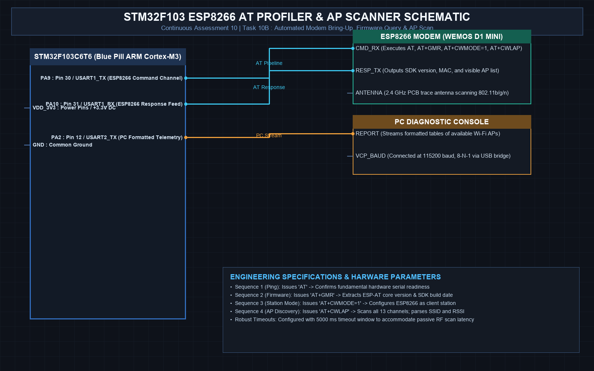

# EXPERIMENT DETAILS
- **Student Name:** Vaishali V
- **Register Number:** 25011102111
- **Degree / Branch:** B.Tech. Computer Science and Engineering (IoT)
- **Year / Semester:** II Year / III Semester
- **Course Title:** Fundamentals of Internet of Things Laboratory (25CS2741)
- **Academic Year:** 2026–2027

---

# CAT 10 - TASK 10B: ESP8266 AT PROFILER & AP SCANNER (STM32F103)

## 1. Circuit Diagram & Hardware Description



### Hardware Description
This experiment implements automated Wi-Fi diagnostic profiling and 2.4 GHz RF scanning on the STM32F103C6T6 interfacing with an ESP8266 module over USART1 (PA9 TX / PA10 RX) and logging to the PC via USART2 (PA2 TX / PA3 RX).

---

## 2. Core Logic / Pseudocode / Code Base

### Working Principle
The STM32 firmware executes a sequential state machine executing standard AT commands and formatting the responses for the user:
1. `AT`: Verifies modem presence and baud synchronization.
2. `AT+GMR`: Queries core ESP-AT firmware and SDK version.
3. `AT+CWMODE=1`: Sets Wi-Fi operating mode to Station (client).
4. `AT+CWLAP`: Scans all available IEEE 802.11b/g/n Access Points, returning SSID, RSSI, and MAC parameters.

### Step-by-Step Pseudocode
```text
BEGIN PROGRAM
    FUNCTION send_and_expect(cmd, timeout_ms):
        uart1_send(cmd)
        uart2_print("\r\n--> Sending: ")
        uart2_print(cmd)
        capture_response_and_print_to_uart2(timeout_ms)
    END FUNCTION

    MAIN:
        CALL send_and_expect("AT\r\n", 1000)
        CALL send_and_expect("AT+GMR\r\n", 2000)
        CALL send_and_expect("AT+CWMODE=1\r\n", 1000)
        CALL send_and_expect("AT+CWLAP\r\n", 6000)
        WHILE TRUE DO NOP;
END PROGRAM
```

---

## 3. Expected Output & Inference

### Expected Output
- Terminal logs full diagnostic table:
  - `AT` -> `OK`
  - `AT+GMR` -> `AT version: 1.7.4.0, SDK version: 3.0.4`
  - `AT+CWLAP` -> List of surrounding Wi-Fi networks with signal strengths.

### Inference
Automated diagnostic scripts verify radio functionality, antenna matching, and firmware compatibility before deploying IoT nodes into production environments.
