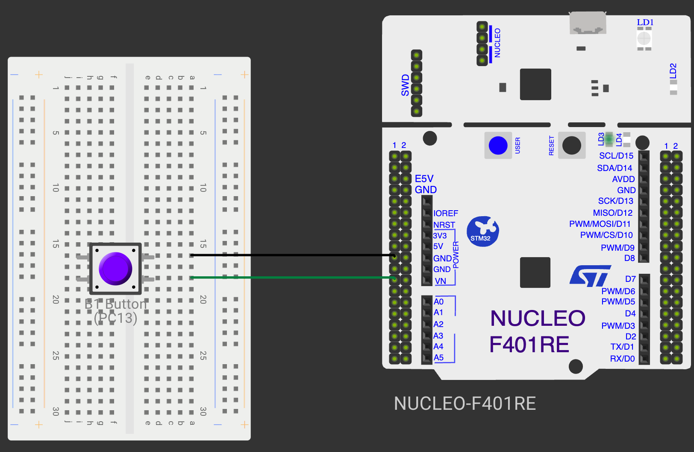

# CONTINUOUS ASSESSMENT 11: CORTEX-M4 GPIO PROGRAMMING & MULTI-MODE INPUT CONTROL

**Student Name:** Vaishali V  
**Register Number:** 25011102111  
**Course Code & Name:** 25CS2741 Fundamentals of Internet of Things + Lab  
**Academic Year:** 2026–2027 | **Semester:** III  
**Date of Performance:** 15/10/2026  
**Hardware Platform:** STM32 NUCLEO-F401RE Development Board (STM32F401RET6, ARM Cortex-M4 @ 84 MHz)  
**Development Toolchain:** STM32CubeMX + STM32CubeIDE (HAL Drivers) + Onboard ST-LINK V2-1  

---

## TASK 1: Onboard User LED Bring-Up & Non-Blocking Periodic Blinking

### 1. Aim / Objective
To configure the clock distribution network and GPIO subsystem of the STM32F401RET6 ARM Cortex-M4 microcontroller on the NUCLEO-F401RE development board, configuring the 84 MHz Phase-Locked Loop (PLL) from an 8 MHz HSE-bypass reference clock and toggling the onboard green user LED (`LD2`) on pin `PA5` at a 200 ms non-blocking interval using `HAL_GetTick()`.

### 2. Components Required
- STM32 NUCLEO-F401RE Development Board
- Integrated Onboard ST-LINK V2-1 Debugger (USB Type-B Mini Cable)
- Workstation running STM32CubeIDE & STM32CubeMX

### 3. Hardware Specifications
| Parameter | Technical Details |
|---|---|
| Microcontroller | STM32F401RET6 (High-performance ARM Cortex-M4 with hardware FPU) |
| System Clock Source | 8 MHz MCO Clock from ST-LINK in **HSE Bypass Mode** |
| PLL Multipliers | `PLLM = 4`, `PLLN = 84`, `PLLP = 2` $\rightarrow f_{\text{sysclk}} = \frac{8\text{ MHz}}{4} \times 84 \div 2 = 84\text{ MHz}$ |
| Flash Memory & SRAM | 512 KB Flash with ART Accelerator, 96 KB SRAM |
| User LED (`LD2`) | Onboard Green LED wired to pin `PA5` (Active-High configuration) |
| User Switch (`B1`) | Onboard Blue Push-Button wired to pin `PC13` (Active-Low configuration) |
| Supply Rails | 5.0 V USB power stepped down to 3.3 V via onboard LDO regulator |

### 4. Pin Configuration & Connections
- **`PA5` (Port A Pin 5):** Configured as GPIO Output, Push-Pull, No pull-up/pull-down, Low speed. Directly drives the anode of onboard green LED `LD2` (cathode to GND via resistor; active-high).
- **`PC13` (Port C Pin 13):** Configured as GPIO Input with internal pull-up enabled. Wired to the onboard blue user tactile switch `B1`.
- **ST-LINK Debug Link:** Connected internally via SWD lines and Virtual COM Port on `USART2`.

### 5. Circuit Diagram


### 6. Working Principle
The STM32F401RE on the Nucleo board differs from standard crystals in that the 8 MHz external clock is provided directly by the ST-LINK microcontroller's Master Clock Output (MCO):
1. **Clock Configuration:** Selecting HSE Bypass allows the 8 MHz input to feed into the main PLL. With division by 4 ($2\text{ MHz}$ reference), multiplication by 84 ($168\text{ MHz}$ VCO), and post-division by 2, the core runs at its maximum certified speed of 84 MHz.
2. **Active-High LED Driving:** Driving pin `PA5` HIGH (`GPIO_PIN_SET`) sources current to illuminate `LD2`. Driving `PA5` LOW (`GPIO_PIN_RESET`) turns it off.
3. **Non-Blocking Scheduling:** Comparing current timestamps via `HAL_GetTick()` against an accumulator `blink_t` flips the LED every 200 ms without wasting CPU cycles in `HAL_Delay()`.

### 7. Algorithm / Procedure
1. Create a Nucleo-F401RE project in STM32CubeIDE.
2. In RCC settings, set `High Speed Clock (HSE)` to **Bypass Clock Source**.
3. In Clock Configuration, configure PLL to achieve 84 MHz `SYSCLK` and 42 MHz `APB1` clock.
4. Set `PA5` as `GPIO_Output` and `PC13` as `GPIO_Input` with internal pull-up.
5. In `main.c`, declare `uint32_t blink_t = 0;`.
6. Inside `while(1)`:
   - Check if `now - blink_t >= 200`.
   - If true, call `HAL_GPIO_TogglePin(GPIOA, GPIO_PIN_5)` and set `blink_t = now`.
7. Flash the Nucleo board and observe `LD2`.

### 8. Source Code Walkthrough
- **Workspace Location:** [`STM32/CAT11/`](./)
- **Source File:** `Core/Src/main.c`
```c
/* USER CODE BEGIN 2 */
uint32_t blink_t = 0;
/* USER CODE END 2 */

/* USER CODE BEGIN WHILE */
while (1)
{
    /* USER CODE END WHILE */

    /* USER CODE BEGIN 3 */
    uint32_t now = HAL_GetTick();
    if (now - blink_t >= 200)
    {
        blink_t = now;
        HAL_GPIO_TogglePin(GPIOA, GPIO_PIN_5);
    }
}
/* USER CODE END 3 */
```

### 9. Expected Output & Results
The green user LED `LD2` blinks rapidly and steadily with a 400 ms period (200 ms ON, 200 ms OFF, $f = 2.5\text{ Hz}$).

### 10. Observations & Inference
- The HSE Bypass mode utilizes the clock output from the ST-LINK MCU, eliminating the need for an external crystal on the Nucleo board.
- Non-blocking execution ensures that adding other peripheral routines will not degrade timing precision.

---

## TASK 2: Switch State Remembrance & Edge-Triggered Latching

### 1. Aim / Objective
To monitor the onboard blue user button `B1` on pin `PC13` using falling and rising edge detection, debouncing contact transitions over a 30 ms window, and toggling and latching the state of green LED `LD2` so that its state persists after button release.

### 2. Components Required
- STM32 NUCLEO-F401RE Development Board & USB Cable.

### 3. Hardware Specifications
- Onboard Button `B1`: Wired to `PC13`, pulls to GND when pressed (Active-Low).
- Onboard LED `LD2`: Wired to `PA5`, illuminates on logic HIGH (Active-High).
- Debounce Period: 30 ms threshold.

### 4. Pin Configuration & Connections
- Identical to Task 1.

### 5. Circuit Diagram


### 6. Working Principle
Unlike momentary push-action circuits that reset when the button is released, state remembrance latches the state:
1. **Falling Edge:** Depressing button `B1` transitions `PC13` from HIGH to LOW, storing the press timestamp in `press_t = HAL_GetTick()`.
2. **Rising Edge:** Releasing button `B1` transitions `PC13` from LOW to HIGH. If the elapsed hold time $\text{duration} = \text{now} - \text{press\_t} \ge 30\text{ ms}$, the event is accepted as a valid press.
3. **Latching Output:** Calling `HAL_GPIO_TogglePin(GPIOA, GPIO_PIN_5)` flips `LD2`. Since no updates occur while idle, `LD2` remembers its newly toggled state indefinitely until the next validated press.

### 7. Algorithm / Procedure
1. Initialize variables `uint8_t prev = 1;` and `uint32_t press_t = 0;`.
2. In the main loop:
   - Sample `curr = HAL_GPIO_ReadPin(GPIOC, GPIO_PIN_13)`.
   - If `prev == 1 && curr == 0`: record `press_t = now`.
   - If `prev == 0 && curr == 1`:
     - If `now - press_t >= 30`: toggle `PA5` via `HAL_GPIO_TogglePin()`.
   - Update `prev = curr`.
3. Program and verify operation.

### 8. Source Code Walkthrough
- **Source File:** `Core/Src/main.c`
```c
/* USER CODE BEGIN 2 */
uint8_t prev = 1;
uint32_t press_t = 0;
/* USER CODE END 2 */

/* USER CODE BEGIN WHILE */
while (1)
{
    /* USER CODE END WHILE */

    /* USER CODE BEGIN 3 */
    uint8_t curr = HAL_GPIO_ReadPin(GPIOC, GPIO_PIN_13);
    uint32_t now = HAL_GetTick();

    if (prev == 1 && curr == 0)
    {
        press_t = now;
    }
    else if (prev == 0 && curr == 1)
    {
        if ((now - press_t) >= 30)
        {
            HAL_GPIO_TogglePin(GPIOA, GPIO_PIN_5);
        }
    }
    prev = curr;
}
/* USER CODE END 3 */
```

### 9. Expected Output & Results
Pressing and releasing the blue button once turns `LD2` ON. The LED remains solidly illuminated after release. Pressing and releasing the button a second time turns `LD2` OFF.

### 10. Observations & Inference
- State remembrance turns a momentary tactile switch into a toggle switch through software edge latching.

---

## TASK 3: Short-Press vs. Long-Press Multi-Function Controller

### 1. Aim / Objective
To implement duration-based press discrimination on the Cortex-M4 processor, configuring a short press (< 1 s) to toggle the static state of `LD2` and a long press (≥ 1 s) to toggle continuous 200 ms non-blocking blinking mode.

### 2. Components Required
- STM32 NUCLEO-F401RE Development Board & USB Cable.

### 3. Hardware Specifications
| User Input Gesture | Press Duration | Action on `LD2` |
|---|---|---|
| Brief Tap | $30\text{ ms} \le \Delta t < 1000\text{ ms}$ | Toggle static LED ON / OFF (or cancel blink mode) |
| Sustained Hold | $\Delta t \ge 1000\text{ ms}$ | Toggle continuous 200 ms periodic blinking mode |
| Switch Bounce | $\Delta t < 30\text{ ms}$ | Filtered / Ignored |

### 4. Pin Configuration & Connections
- Identical to Task 1 and Task 2.

### 5. Circuit Diagram


### 6. Working Principle
The application integrates hold-duration evaluation with an asynchronous blink timer:
1. When button `B1` is released, $\Delta t = \text{now} - \text{press\_t}$ is computed.
2. If $\Delta t \ge 1000\text{ ms}$ (Long Press): The boolean mode flag `blink` is toggled (`blink = !blink`).
3. If $30\text{ ms} \le \Delta t < 1000\text{ ms}$ (Short Press):
   - If `blink` is active, it cancels blinking (`blink = 0`).
   - If `blink` is inactive, `LD2` toggles once statically.
4. Independent Timer: When `blink == 1`, an independent comparison `now - blink_t >= 200` toggles `PA5` every 200 ms.

### 7. Algorithm / Procedure
1. Declare state variables `prev = 1`, `press_t = 0`, `blink = 0`, `blink_t = 0`.
2. In `while(1)`:
   - On button release (`prev == 0 && curr == 1`):
     - Compute duration.
     - If $\ge 1000\text{ ms}$: invert `blink`.
     - Else if $\ge 30\text{ ms}$: toggle static LED or clear `blink`.
   - Update `prev = curr`.
   - If `blink && (now - blink_t >= 200)`: toggle `PA5` and update `blink_t = now`.
3. Flash and verify system behavior.

### 8. Source Code Walkthrough
- **Source File:** `Core/Src/main.c`
```c
/* USER CODE BEGIN 2 */
uint8_t prev = 1;
uint32_t press_t = 0;
uint8_t blink = 0;
uint32_t blink_t = 0;
/* USER CODE END 2 */

/* USER CODE BEGIN WHILE */
while (1)
{
    /* USER CODE END WHILE */

    /* USER CODE BEGIN 3 */
    uint8_t curr = HAL_GPIO_ReadPin(GPIOC, GPIO_PIN_13);
    uint32_t now = HAL_GetTick();

    if (prev == 1 && curr == 0)
    {
        press_t = now;
    }
    else if (prev == 0 && curr == 1)
    {
        uint32_t duration = now - press_t;
        if (duration >= 1000)
        {
            blink = !blink;
        }
        else if (duration >= 30)
        {
            if (blink)
                blink = 0;
            else
                HAL_GPIO_TogglePin(GPIOA, GPIO_PIN_5);
        }
    }
    prev = curr;

    if (blink && (now - blink_t >= 200))
    {
        blink_t = now;
        HAL_GPIO_TogglePin(GPIOA, GPIO_PIN_5);
    }
}
/* USER CODE END 3 */
```

### 9. Expected Output & Results
- A brief click toggles the green LED on or off.
- Holding the blue button down for 1 second or longer causes the LED to begin blinking at 200 ms intervals.
- A subsequent quick tap halts the blinking mode immediately.

### 10. Observations & Inference
- The ARM Cortex-M4 processor easily manages multiple concurrent software timing tasks with low power and high execution predictability.
- Software-based press classification provides versatile multi-function control over a single physical button.
