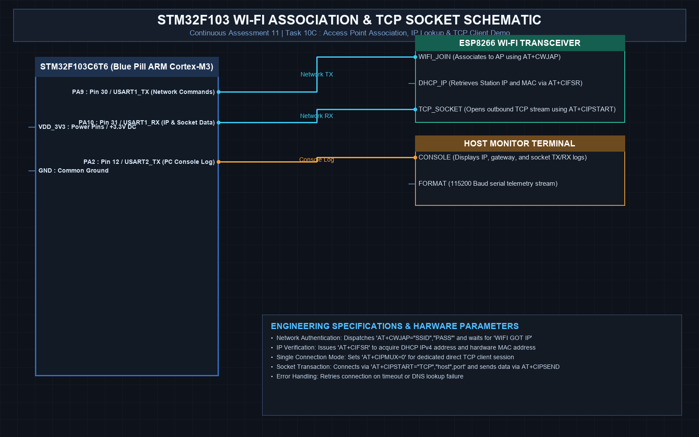

# EXPERIMENT DETAILS
- **Student Name:** Vaishali V
- **Register Number:** 25011102111
- **Degree / Branch:** B.Tech. Computer Science and Engineering (IoT)
- **Year / Semester:** II Year / III Semester
- **Course Title:** Fundamentals of Internet of Things Laboratory (25CS2741)
- **Academic Year:** 2026–2027

---

# CAT 11 - TASK 10C: WI-FI ASSOCIATION & TCP CLIENT SOCKET (STM32F103)

## 1. Circuit Diagram & Hardware Description



### Hardware Description
This experiment connects the STM32F103 / ESP8266 subsystem to an active 2.4 GHz Wi-Fi Access Point, acquires an IPv4 network address via DHCP, and opens an outbound TCP client socket.
- **Microcontroller:** STM32F103C6T6 at 72 MHz.
- **Wi-Fi Transceiver:** Wemos D1 Mini (ESP8266) on USART1 (PA9/PA10).
- **Diagnostics:** USART2 (PA2/PA3) at 115200 baud to host PC.

---

## 2. Core Logic / Pseudocode / Code Base

### Working Principle
The STM32 firmware issues `AT+CWJAP="SSID","PASSWORD"` to join the target wireless network. Once the modem returns `WIFI CONNECTED` and `WIFI GOT IP`, the MCU queries the assigned network configuration using `AT+CIFSR`. Next, `AT+CIPSTART="TCP","<host>",<port>` opens a TCP client stream, and `AT+CIPSEND` dispatches test packets.

### Step-by-Step Pseudocode
```text
BEGIN PROGRAM
    MAIN:
        // Join Wi-Fi Network
        send_at_cmd("AT+CWJAP=\"Lab_IoT_Network\",\"SecuredPass123\"\r\n", 10000)
        
        // Query Station IP and MAC
        send_at_cmd("AT+CIFSR\r\n", 2000)
        
        // Open Outbound TCP Socket
        send_at_cmd("AT+CIPSTART=\"TCP\",\"example.com\",80\r\n", 5000)
        
        // Transmit TCP Test Buffer
        send_at_cmd("AT+CIPSEND=18\r\n", 1000)
        send_at_cmd("GET / HTTP/1.1\r\n\r\n", 3000)
        
        WHILE TRUE DO NOP;
END PROGRAM
```

---

## 3. Expected Output & Inference

### Expected Output
- Host console confirms network join:
  `WIFI CONNECTED`
  `+CIFSR:STAIP,"192.168.1.105"`
  `+CIFSR:STAMAC,"2c:f4:32:89:41:ab"`
  `CONNECT OK`

### Inference
By offloading the complex 802.11 MAC, WPA2 encryption, and TCP/IP stack to the ESP8266, the STM32 microcontroller can focus its real-time compute resources on deterministic physical tasks.
