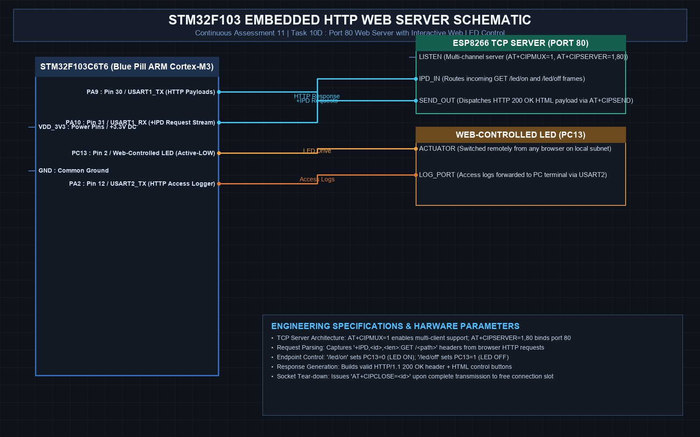

# EXPERIMENT DETAILS
- **Student Name:** Vaishali V
- **Register Number:** 25011102111
- **Degree / Branch:** B.Tech. Computer Science and Engineering (IoT)
- **Year / Semester:** II Year / III Semester
- **Course Title:** Fundamentals of Internet of Things Laboratory (25CS2741)
- **Academic Year:** 2026–2027

---

# CAT 11 - TASK 10D: EMBEDDED HTTP WEB SERVER (STM32F103)

## 1. Circuit Diagram & Hardware Description



### Hardware Description
This experiment deploys a standalone embedded HTTP web server on Port 80 using the STM32F103C6T6 and ESP8266. Users on the local area network can navigate to the STM32's IP address from any web browser and click interactive buttons to toggle the physical on-board PC13 LED.
- **Port 80 TCP Server:** Running in multi-connection mode (`AT+CIPMUX=1` and `AT+CIPSERVER=1,80`).
- **Controlled Load:** On-board PC13 LED (Active-LOW).

---

## 2. Core Logic / Pseudocode / Code Base

### Working Principle
When a browser connects to `http://<IP>/`, the ESP8266 forwards an unsolicited data frame formatted as `+IPD,<link_id>,<length>:GET /<path> HTTP/1.1`. The STM32 parses the requested path:
- If `GET /led/on`, it drives `PC13 = LOW` (LED ON).
- If `GET /led/off`, it drives `PC13 = HIGH` (LED OFF).
It then constructs a valid HTTP/1.1 200 OK response with responsive HTML buttons and dispatches it with `AT+CIPSEND=<id>,<len>`, closing the socket with `AT+CIPCLOSE=<id>`.

### Step-by-Step Pseudocode
```text
BEGIN PROGRAM
    INITIALIZE ESP8266:
        AT+CIPMUX=1
        AT+CIPSERVER=1,80

    MAIN:
        WHILE TRUE DO:
            IF receive_ipd_frame(&link_id, request_buf) THEN:
                IF strstr(request_buf, "GET /led/on") THEN:
                    HAL_GPIO_WritePin(GPIOC, GPIO_PIN_13, GPIO_PIN_RESET) // LED ON
                ELSE IF strstr(request_buf, "GET /led/off") THEN:
                    HAL_GPIO_WritePin(GPIOC, GPIO_PIN_13, GPIO_PIN_SET)   // LED OFF
                END IF

                // Build HTML Page
                html = "HTTP/1.1 200 OK\r\nContent-Type: text/html\r\n\r\n"
                       "<h1>Vaishali's STM32 Web Server</h1>"
                       "<p><a href='/led/on'><button>Turn ON</button></a></p>"
                       "<p><a href='/led/off'><button>Turn OFF</button></a></p>"

                // Send and close socket
                send_http_payload(link_id, html)
                send_at_cmd("AT+CIPCLOSE=" + link_id)
            END IF
        END WHILE
END PROGRAM
```

---

## 3. Expected Output & Inference

### Expected Output
- Navigating to `http://192.168.1.105` displays the control panel. Clicking "Turn ON" lights the on-board LED; clicking "Turn OFF" extinguishes it.

### Inference
Embedded HTTP servers eliminate the need for dedicated host apps, allowing cross-platform browser control over physical devices on local subnets.
