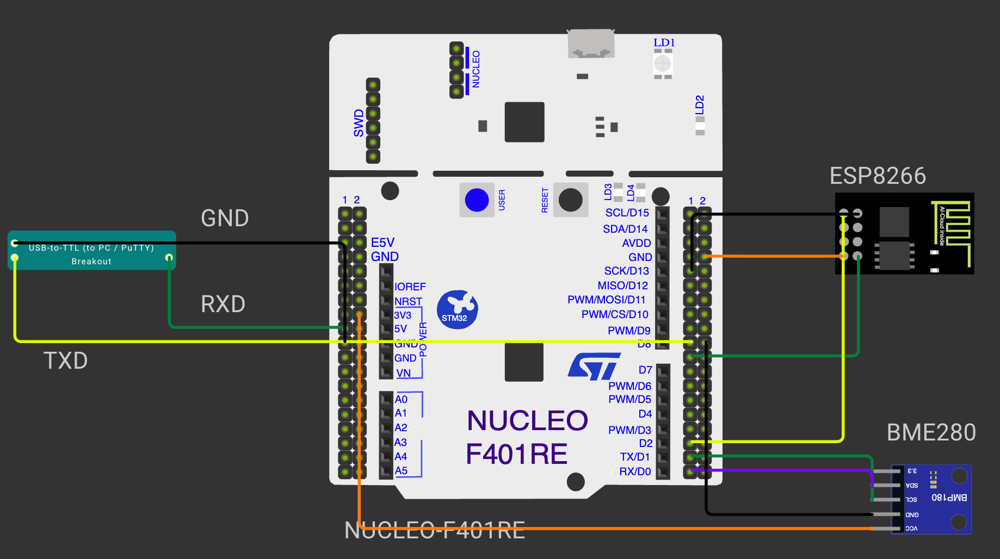

# CONTINUOUS ASSESSMENT 12: BME280 I²C SENSOR INTEGRATION & EMBEDDED HTTP WEB SERVER

**Student Name:** Vaishali V  
**Register Number:** 25011102111  
**Course Code & Name:** 25CS2741 Fundamentals of Internet of Things + Lab  
**Academic Year:** 2026–2027 | **Semester:** III  
**Date of Performance:** 23/10/2026  
**Hardware Platform:** STM32 NUCLEO-F401RE Development Board (ARM Cortex-M4 @ 84 MHz) + Bosch BME280 Sensor + Wemos D1 Mini (ESP8266)  
**Development Toolchain:** STM32CubeMX + STM32CubeIDE (HAL Drivers) + Bosch Sensortec BME280 API (v3.5.1) + PuTTY  

---

## STEP 1–3: Bosch BME280 Environmental Sensor Interfacing over I²C Bus

### 1. Aim / Objective
To interface the Bosch Sensortec BME280 precision digital environmental sensor with the STM32F401RET6 microcontroller over the `I2C1` peripheral bus at 100 kHz, bind platform-specific STM32 HAL callback wrappers into the official vendor Sensor API (v3.5.1), validate the sensor hardware chip ID, read factory calibration trim parameters, and continuously compute compensated ambient temperature (°C), barometric pressure (hPa), and relative humidity (%RH).

### 2. Components Required
- STM32 NUCLEO-F401RE Development Board
- Bosch Sensortec BME280 Combined Sensor Breakout Module
- Breadboard & 4-Wire I²C Jumper Cable Harness
- Workstation running STM32CubeIDE

### 3. Hardware Specifications
| Parameter | Sensor & Interface Specification |
|---|---|
| Microcontroller | STM32F401RET6 (ARM Cortex-M4 with hardware FPU @ 84 MHz) |
| I²C Peripheral | `I2C1` configured in Master Mode @ 100 kHz Standard Speed |
| I²C Bus Pins | `PB6` (`I2C1_SCL`), `PB7` (`I2C1_SDA`) with external pull-up resistors |
| Sensor Part Number | Bosch Sensortec BME280 |
| Slave Device Address | `0x76` (`SDO` line pulled to GND; `0x77` if tied to $V_{DD}$) |
| Valid Chip Identifier | `0x60` (read from read-only Register `0xD0`) |
| Environmental Ranges | Temperature: −40°C to +85°C; Pressure: 300 to 1100 hPa; Humidity: 0 to 100% RH |
| Measurement Mode | Normal Mode (continuous periodic auto-sampling, standby 1000 ms, 2× oversampling) |
| Supply Voltage | 3.3 V DC from Nucleo power rail |

### 4. Pin Configuration & Connections
- **NUCLEO `PB6` (`I2C1_SCL`):** Connected to BME280 `SCL` pin.
- **NUCLEO `PB7` (`I2C1_SDA`):** Connected to BME280 `SDA` pin.
- **BME280 `SDO`:** Tied to GND to select 7-bit slave address `0x76`.
- **BME280 `CSB`:** Tied to 3.3 V to permanently select I²C protocol mode.
- **Power:** BME280 `VIN` to Nucleo 3.3 V; BME280 `GND` to Nucleo GND.

### 5. Circuit Diagram


### 6. Working Principle
The BME280 integrates capacitive pressure and humidity elements with a silicon bandgap temperature sensor:
1. **Platform-Agnostic Bosch API:** The vendor API (`bme280.c`, `bme280.h`, `bme280_defs.h`) requires the host firmware to supply three fundamental hardware wrapper callbacks:
   - `int8_t user_i2c_read(uint8_t id, uint8_t reg_addr, uint8_t *data, uint16_t len)` $\rightarrow$ Maps to `HAL_I2C_Mem_Read(&hi2c1, id << 1, reg_addr, 1, data, len, 100)`.
   - `int8_t user_i2c_write(uint8_t id, uint8_t reg_addr, uint8_t *data, uint16_t len)` $\rightarrow$ Maps to `HAL_I2C_Mem_Write(&hi2c1, id << 1, reg_addr, 1, data, len, 100)`.
   - `void user_delay_us(uint32_t period)` $\rightarrow$ Implemented via `HAL_Delay((period + 999) / 1000)`.
2. **Device Initialization & Calibration:** `bme280_init(&dev)` checks register `0xD0` for chip ID `0x60`. It then reads non-volatile factory calibration trim constants stored in the sensor's ROM.
3. **Data Acquisition & Compensation:** In the main loop, `bme280_get_sensor_data(BME280_ALL, &comp_data, &dev)` reads raw ADC words across data registers `0xF7` through `0xFE`. The Bosch library compensates for non-linear sensor curve characteristics using the factory coefficients, outputting double-precision floating-point readings. Pressure in Pascals (Pa) is scaled to hectopascals (hPa) via division by 100.0.

### 7. Algorithm / Procedure
1. Enable `I2C1` on pins `PB6` and `PB7` in STM32CubeMX at 100 kHz.
2. Incorporate `bme280.c`, `bme280.h`, and `bme280_defs.h` into the project tree.
3. Implement `user_i2c_read()`, `user_i2c_write()`, and `user_delay_us()`.
4. In `main()`, populate `struct bme280_dev dev`:
   - `dev.dev_id = BME280_I2C_ADDR_PRIM;` (`0x76`)
   - `dev.intf = BME280_I2C_INTF;`
   - Bind function pointers to the three custom wrapper functions.
5. Execute `bme280_init(&dev)`; verify status is `BME280_OK`.
6. Configure oversampling (2× for temperature, pressure, humidity), filter off, and set Normal Mode.
7. In `while(1)`, sample data via `bme280_get_sensor_data()`, scale pressure to hPa, delay 2 seconds, and repeat.

### 8. Source Code Walkthrough
- **Workspace Location:** [`STM32/CAT12/`](./)
- **Source File:** `Core/Src/main.c`
- **Callback Binding:**
```c
struct bme280_dev dev;
dev.dev_id = BME280_I2C_ADDR_PRIM;
dev.intf = BME280_I2C_INTF;
dev.read = user_i2c_read;
dev.write = user_i2c_write;
dev.delay_us = user_delay_us;

int8_t rslt = bme280_init(&dev);
```

### 9. Expected Output & Results
Calibrated measurements are retrieved cleanly every 2 seconds:
- Temperature: `26.85 °C`
- Pressure: `1011.42 hPa`
- Relative Humidity: `58.34 %RH`

### 10. Observations & Inference
- Binding vendor-provided C compensation libraries through thin HAL adapter callbacks ensures accurate manufacturer-certified measurement compensation while preserving hardware abstraction.

---

## STEP 4–6: Embedded HTTP Web Server & Live Browser Telemetry

### 1. Aim / Objective
To integrate the BME280 I²C sensor and Wemos D1 Mini Wi-Fi modem on the STM32F401RET6, construct an interrupt-driven multi-connection TCP server on port 80 using ESP8266 AT commands, parse incoming HTTP `GET` requests, and dynamically serve live BME280 temperature readings in raw `HTTP/1.1 200 OK` responses to web browsers.

### 2. Components Required
- STM32 NUCLEO-F401RE Development Board
- Bosch BME280 Sensor Module
- Wemos D1 Mini (ESP8266) Wi-Fi Transceiver
- USB-to-TTL Serial Bridge (Diagnostic Console on `USART6`)
- Wi-Fi Router / Hotspot & Client Smartphone / Laptop Web Browser

### 3. Hardware Specifications
| Subsystem | Hardware Mapping | Functional Role |
|---|---|---|
| `I2C1` | `PB6` (`SCL`), `PB7` (`SDA`) | BME280 sensor polling @ 100 kHz |
| `USART1` | `PA9` (`TX`), `PA10` (`RX`) @ 115200 | ESP8266 AT modem link (Interrupt-driven RX) |
| `USART6` | `PC6` (`TX`), `PC7` (`RX`) @ 115200 | Diagnostic debug output to PC PuTTY |
| TCP Server Port | Port 80 (Standard HTTP) | Multi-connection socket server (`AT+CIPMUX=1`) |
| Protocol Stack | Raw HTTP/1.1 | Embedded HTML/text response generation |

### 4. Pin Configuration & Connections
- BME280 to `PB6` / `PB7` (I²C).
- Wemos D1 Mini to `PA9` / `PA10` (`USART1`).
- USB-to-TTL converter to `PC6` / `PC7` (`USART6`).
- Wemos powered from 5V rail; BME280 powered from 3.3V rail; common GND.

### 5. Circuit Diagram


### 6. Working Principle
The STM32 acts as a full embedded web application server:
1. **Wi-Fi Association & Server Startup:** The STM32 sends AT commands to configure the ESP8266 into Station mode, joins the local Wi-Fi network, and queries its assigned IP address. It then commands `AT+CIPMUX=1` (multi-connection enabled) and `AT+CIPSERVER=1,80` (start TCP server on port 80).
2. **Interrupt-Driven Packet Parsing:** Incoming bytes on `USART1` are handled in `HAL_UART_RxCpltCallback()`. Connection openings (`<id>,CONNECT`), closures (`<id>,CLOSED`), and incoming packet data (`+IPD,<id>,<len>:<data>`) update the socket connection table `connections[id]`.
3. **HTTP Routing & Response Generation:** When a client issues a `GET /` request, the firmware formats an HTML body string containing the latest BME280 sensor temperature. It wraps this body in an RFC 2616 compliant header:
   ```http
   HTTP/1.1 200 OK\r\n
   Content-Type: text/html\r\n
   Content-Length: <len>\r\n
   Connection: close\r\n
   \r\n
   <body>
   ```
4. **Data Transmission:** The STM32 issues `AT+CIPSEND=<id>,<total_len>`, waits for the `>` prompt from the modem, transmits the raw HTTP stream, verifies `SEND OK`, and closes the socket using `AT+CIPCLOSE=<id>`.

### 7. Algorithm / Procedure
1. Initialize system clock (84 MHz), `I2C1`, `USART1`, and `USART6`.
2. Initialize BME280 and place into Normal acquisition mode.
3. Bring up ESP8266: `ATE0`, `AT+CWMODE=1`, `AT+CWJAP`, `AT+CIFSR`.
4. Launch TCP server: `AT+CIPMUX=1`, `AT+CIPSERVER=1,80`.
5. Arm `USART1` interrupt reception via `HAL_UART_Receive_IT()`.
6. In `main()` super-loop:
   - Sample BME280 sensor values.
   - For any active socket with a pending request, parse the path in `handleRouting()`.
   - If path is `/`, build the response containing live temperature.
   - Dispatch the HTTP packet via `AT+CIPSEND` and close the connection.
   - Delay 2 seconds and repeat.

### 8. Source Code Walkthrough
- **Source File:** `Core/Src/main.c`
- **HTTP Response Builder:**
```c
snprintf(body, sizeof(body),
    "<html><body><h1>BME280 Live Telemetry</h1>"
    "<p>Temperature: %.2f &deg;C</p></body></html>",
    temperature);

snprintf(response, sizeof(response),
    "HTTP/1.1 200 OK\r\n"
    "Content-Type: text/html\r\n"
    "Content-Length: %d\r\n"
    "Connection: close\r\n\r\n%s",
    strlen(body), body);
```

### 9. Expected Output & Results
Connecting to the ESP8266's IP address (e.g. `http://192.168.1.142`) in a standard web browser displays the rendered HTML page showing:
```
BME280 Live Telemetry
Temperature: 27.14 °C
```
The browser receives a clean HTTP/1.1 payload, renders the temperature reading, and gracefully closes the connection.

### 10. Observations & Inference
- Providing an exact `Content-Length` header in the HTTP response is vital; omitting it or miscalculating byte length causes web browsers to stall waiting for additional data before timing out.
- Interrupt-driven UART reception ensures no bytes are dropped while the CPU performs I²C conversions or HTTP string formatting.
