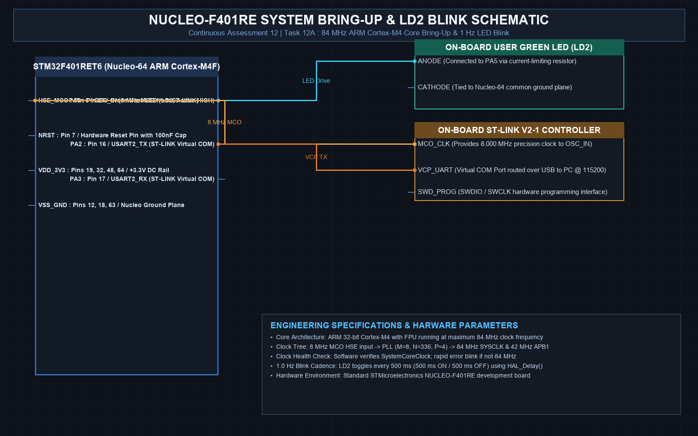

# EXPERIMENT DETAILS
- **Student Name:** Vaishali V
- **Register Number:** 25011102111
- **Degree / Branch:** B.Tech. Computer Science and Engineering (IoT)
- **Year / Semester:** II Year / III Semester
- **Course Title:** Fundamentals of Internet of Things Laboratory (25CS2741)
- **Academic Year:** 2026–2027

---

# CAT 12 - TASK 12A: NUCLEO-F401RE SYSTEM BRING-UP & 1 Hz BLINK

## 1. Circuit Diagram & Hardware Description



### Hardware Description
This experiment marks the transition to the high-performance ARM Cortex-M4F platform on the STMicroelectronics NUCLEO-F401RE development board, configuring the 84 MHz Phase-Locked Loop (PLL) clock tree and validating timing with a 1.0 Hz LED blink.
- **Microcontroller:** STM32F401RET6 (64-pin LQFP) featuring an ARM Cortex-M4 with single-precision hardware Floating Point Unit (FPU), 512 KB Flash, and 96 KB SRAM.
- **Clock Tree:** 8.000 MHz clock source provided by the on-board ST-LINK MCO into HSE, multiplied by PLL to achieve maximum 84 MHz core frequency (`SYSCLK`).
- **Actuator:** On-board green user LED (LD2) connected to pin PA5 in **active-HIGH** push-pull mode (`GPIO_MODE_OUTPUT_PP`).

| Pin | Entity | Configuration | Function |
| :--- | :--- | :--- | :--- |
| PA5 | User Green LED (LD2) | Output Push-Pull | Active-HIGH: Set (1) = ON, Reset (0) = OFF |
| PC13 | User Blue Button (B1) | Input Floating | Active-LOW user button |
| PA2 / PA3 | ST-LINK VCP UART | AF7 (USART2) | 115200 Baud virtual COM port |
| OSC_IN | HSE Clock Input | ST-LINK MCO (8 MHz) | Master clock oscillator reference |

---

## 2. Core Logic / Pseudocode / Code Base

### Working Principle
During initialization, `SystemClock_Config()` configures PLL parameters:
$$f_{{SYSCLK}} = \frac{{f_{{HSE}}}}{M} \times \frac{N}{P} = \frac{{8 \text{{ MHz}}}}{8} \times \frac{{336}}{4} = 84 \text{{ MHz}}$$
The software verifies that `SystemCoreClock` equals 84,000,000 Hz. If valid, the main loop toggles LD2 at 1.0 Hz (500 ms ON / 500 ms OFF) using `HAL_Delay(500)`. If clock verification fails, a rapid 10 Hz error strobe is engaged.

### Step-by-Step Pseudocode
```text
BEGIN PROGRAM
    INITIALIZE HAL (HAL_Init)
    CONFIGURE Clock to 84 MHz via PLL
    INITIALIZE PA5 as Output Push-Pull

    SystemCoreClockUpdate()
    IF SystemCoreClock != 84000000 THEN:
        // Clock failure safety strobe (10 Hz)
        WHILE TRUE DO:
            HAL_GPIO_TogglePin(GPIOA, GPIO_PIN_5)
            HAL_Delay(50)
        END WHILE
    END IF

    MAIN (Normal 1.0 Hz Cadence):
        WHILE TRUE DO:
            HAL_GPIO_WritePin(GPIOA, GPIO_PIN_5, GPIO_PIN_SET)   // LD2 ON
            HAL_Delay(500)
            HAL_GPIO_WritePin(GPIOA, GPIO_PIN_5, GPIO_PIN_RESET) // LD2 OFF
            HAL_Delay(500)
        END WHILE
END PROGRAM
```

---

## 3. Expected Output & Inference

### Expected Output
- Green LED LD2 blinks steadily at 1.000 Hz (500 ms ON / 500 ms OFF).
- Oscilloscope measurement on PA5 confirms a 50% duty cycle 1.0 Hz square wave.

### Inference
Clock tree verification is the foundational step of embedded bring-up; all internal timers, communication peripherals (UART, I2C, SPI), and flash wait-states depend on proper PLL configuration.
