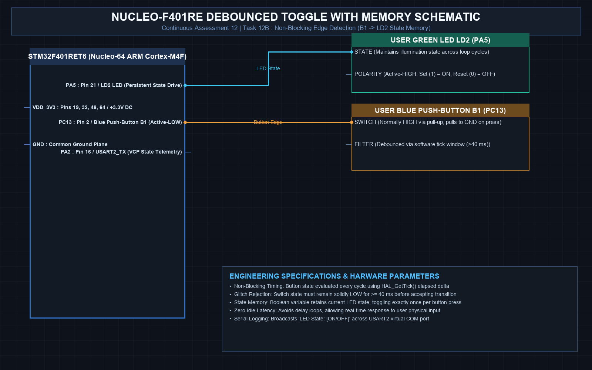

# EXPERIMENT DETAILS
- **Student Name:** Vaishali V
- **Register Number:** 25011102111
- **Degree / Branch:** B.Tech. Computer Science and Engineering (IoT)
- **Year / Semester:** II Year / III Semester
- **Course Title:** Fundamentals of Internet of Things Laboratory (25CS2741)
- **Academic Year:** 2026–2027

---

# CAT 12 - TASK 12B: DEBOUNCED BUTTON TOGGLE WITH STATE MEMORY (NUCLEO-F401RE)

## 1. Circuit Diagram & Hardware Description



### Hardware Description
This experiment implements non-blocking edge-triggered input processing with persistent state memory on the NUCLEO-F401RE board.
- **Button B1:** Blue tactile switch on PC13. Wired active-low with external hardware pull-up resistor.
- **User LED LD2:** Green LED on PA5.
- **Timing:** Non-blocking debouncing window (40 ms) via SysTick (`HAL_GetTick()`).

---

## 2. Core Logic / Pseudocode / Code Base

### Working Principle
The application polls PC13 continuously. When the state changes from released (HIGH) to pressed (LOW), the algorithm ensures the level stays low for at least 40 ms. Upon confirmation, a boolean state flag `led_is_on` is inverted, and PA5 is updated accordingly (`HAL_GPIO_WritePin`).

### Step-by-Step Pseudocode
```text
BEGIN PROGRAM
    GLOBAL led_is_on = FALSE
    GLOBAL last_debounce_tick = 0
    GLOBAL last_btn_state = RELEASED

    MAIN:
        WHILE TRUE DO:
            now = HAL_GetTick()
            btn_pressed = (HAL_GPIO_ReadPin(GPIOC, GPIO_PIN_13) == GPIO_PIN_RESET)

            IF btn_pressed AND last_btn_state == RELEASED THEN:
                IF (now - last_debounce_tick) >= 40 THEN:
                    led_is_on = NOT led_is_on
                    HAL_GPIO_WritePin(GPIOA, GPIO_PIN_5, led_is_on ? GPIO_PIN_SET : GPIO_PIN_RESET)
                    last_debounce_tick = now
                    last_btn_state = PRESSED
                END IF
            ELSE IF NOT btn_pressed AND last_btn_state == PRESSED THEN:
                IF (now - last_debounce_tick) >= 40 THEN:
                    last_debounce_tick = now
                    last_btn_state = RELEASED
                END IF
            END IF
        END WHILE
END PROGRAM
```

---

## 3. Expected Output & Inference

### Expected Output
- Each press of blue button B1 toggles LD2 ON or OFF cleanly.
- Rapid pressing exhibits zero contact chatter or unintended double toggles.

### Inference
Combining state-variable tracking with non-blocking debounce filters provides responsive and stable user interfaces in multi-tasking embedded applications.
