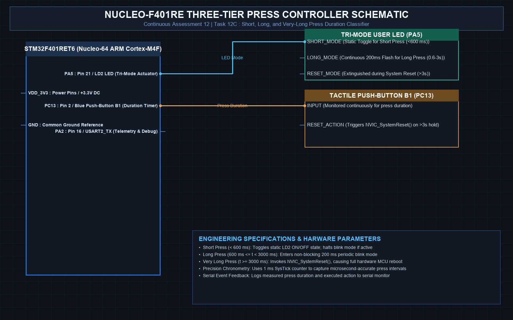

# EXPERIMENT DETAILS
- **Student Name:** Vaishali V
- **Register Number:** 25011102111
- **Degree / Branch:** B.Tech. Computer Science and Engineering (IoT)
- **Year / Semester:** II Year / III Semester
- **Course Title:** Fundamentals of Internet of Things Laboratory (25CS2741)
- **Academic Year:** 2026–2027

---

# CAT 12 - TASK 12C: THREE-TIER PRESS CLASSIFIER & RESET (NUCLEO-F401RE)

## 1. Circuit Diagram & Hardware Description



### Hardware Description
This experiment develops a 3-tier duration classifier on the NUCLEO-F401RE's blue push-button B1 (PC13):
1. **Short Press (< 600 ms):** Toggles static state of green LED LD2 (PA5).
2. **Long Press (600 ms ≤ t < 3000 ms):** Enters continuous non-blocking blink mode (200 ms period).
3. **Very Long Press (t ≥ 3000 ms):** Triggers a complete software system reboot via `NVIC_SystemReset()`.

---

## 2. Core Logic / Pseudocode / Code Base

### Working Principle
When B1 is pressed, the starting timestamp is captured. When released, the elapsed time determines the operational branch. If the button is held for 3000 ms continuously without release, the MCU initiates an immediate hardware reset.

### Step-by-Step Pseudocode
```text
BEGIN PROGRAM
    GLOBAL mode = STATIC_MODE
    GLOBAL press_time = 0, is_holding = FALSE

    MAIN:
        WHILE TRUE DO:
            now = HAL_GetTick()
            btn_down = (HAL_GPIO_ReadPin(GPIOC, GPIO_PIN_13) == GPIO_PIN_RESET)

            IF btn_down AND NOT is_holding THEN:
                press_time = now
                is_holding = TRUE
            ELSE IF btn_down AND is_holding THEN:
                // Check Very Long Press threshold during hold
                IF (now - press_time) >= 3000 THEN:
                    NVIC_SystemReset()           // Trigger hardware reboot
                END IF
            ELSE IF NOT btn_down AND is_holding THEN:
                duration = now - press_time
                is_holding = FALSE
                
                IF duration < 600 THEN:          // Short press
                    mode = STATIC_MODE
                    HAL_GPIO_TogglePin(GPIOA, GPIO_PIN_5)
                ELSE:                            // Long press (0.6s to 3s)
                    mode = BLINK_MODE
                END IF
            END IF

            IF mode == BLINK_MODE AND (now - last_blink >= 100) THEN:
                HAL_GPIO_TogglePin(GPIOA, GPIO_PIN_5)
                last_blink = now
            END IF
        END WHILE
END PROGRAM
```

---

## 3. Expected Output & Inference

### Expected Output
- Tapping B1 turns LD2 ON/OFF.
- Holding for 1 second causes LD2 to flash rapidly.
- Holding for 3 seconds causes all LEDs to cut off and the system reboots cleanly.

### Inference
Software-driven duration discriminators provide emergency reset and multi-level configuration capabilities without adding extra physical buttons.
