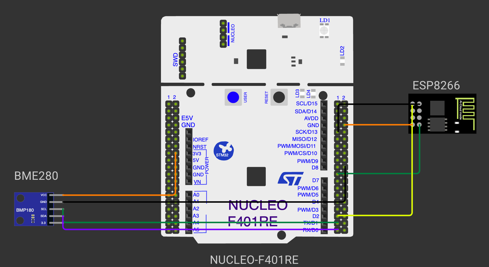

# CONTINUOUS ASSESSMENT 13: CUSTOM ESP8266 MQTT CLIENT & LIVE CLOUD TELEMETRY

**Student Name:** Vaishali V  
**Register Number:** 25011102111  
**Course Code & Name:** 25CS2741 Fundamentals of Internet of Things + Lab  
**Academic Year:** 2026–2027 | **Semester:** III  
**Date of Performance:** 29/10/2026  
**Hardware Platform:** STM32 NUCLEO-F401RE Development Board (ARM Cortex-M4 @ 84 MHz) + Bosch BME280 Sensor + Wemos D1 Mini (ESP8266)  
**Development Toolchain:** STM32CubeMX + STM32CubeIDE (HAL Drivers) + Custom ESP8266 MQTT API (`ESPLib`) + Public MQTT Broker (`broker.emqx.io`)  

---

## STEP 1–3: Custom ESP8266 Driver & Binary MQTT v3.1.1 Protocol Encoding

### 1. Aim / Objective
To design and construct a modular, lightweight embedded C library (`ESPLib.h` and `ESPLib.c`) for the STM32F401RET6 microcontroller that abstracts ESP8266 AT command modem operations, establishes a raw TCP socket connection to a public cloud MQTT broker (`broker.emqx.io:1883`), and constructs and transmits binary MQTT v3.1.1 `CONNECT` control frames.

### 2. Components Required
- STM32 NUCLEO-F401RE Development Board
- Wemos D1 Mini (ESP8266 Wi-Fi Transceiver) running standard Espressif AT firmware
- 2.4 GHz Wi-Fi Internet Access Point
- Public Cloud MQTT Broker (`broker.emqx.io`, TCP port 1883)
- Workstation running STM32CubeIDE & MQTT Explorer / Mosquitto CLI client

### 3. Hardware Specifications
| Parameter | Technical Configuration |
|---|---|
| Host Processor | STM32F401RET6 (32-bit ARM Cortex-M4 @ 84 MHz) |
| Wi-Fi Modem Interface | `USART1` (`PA9` TX, `PA10` RX) @ 115200 Baud, 8-N-1 |
| Cloud MQTT Broker | `broker.emqx.io` (Public EMQX cluster) |
| Network Transport | Raw TCP Socket over IPv4 |
| Target TCP Port | 1883 (Standard unencrypted MQTT) |
| MQTT Protocol Standard | OASIS MQTT Version 3.1.1 (Protocol Level `0x04`) |
| Client Session Attributes | Clean Session enabled, Keep-Alive interval = 500 seconds |

### 4. Pin Configuration & Connections
- **NUCLEO `PA9` (`USART1_TX`):** Connected to Wemos D1 Mini `RX` pin.
- **NUCLEO `PA10` (`USART1_RX`):** Connected to Wemos D1 Mini `TX` pin.
- **Power Supply:** Wemos powered via 5V rail; shared common ground with Nucleo.

### 5. Circuit Diagram


### 6. Working Principle
Rather than relying on high-overhead third-party IoT SDKs, this architecture implements native binary packet serialization on top of bare AT commands:
1. **Network Link Establishment:** `ESP8266_Init()` configures the modem into Station mode, `ESP8266_wifiConnect()` connects to the local access point, and `ESP8266_portConnect("TCP", "broker.emqx.io", "1883")` opens a TCP transport socket.
2. **Binary MQTT `CONNECT` Packet Construction:** An MQTT packet consists of a Fixed Header, Variable Header, and Payload:
   - **Fixed Header Byte 1 (`0x10`):** Packet Type = 1 (`CONNECT`), Flags = `0000`.
   - **Remaining Length:** Total byte count of Variable Header + Payload.
   - **Protocol Name:** UTF-8 encoded string `"MQTT"` (`0x00 0x04 'M' 'Q' 'T' 'T'`).
   - **Protocol Level:** `0x04` (MQTT 3.1.1).
   - **Connect Flags:** `0x02` (Clean Session = 1, Will = 0, Password = 0, Username = 0).
   - **Keep-Alive Interval:** 2-byte integer (`500` seconds $\rightarrow$ `0x01 0xF4`).
   - **Payload:** UTF-8 Client Identifier (e.g. length-prefixed unique ID string).
3. **Transmission:** The packet is sent to the modem via `AT+CIPSEND=<length>`, followed by the binary byte sequence.

$$\text{Fixed Header (0x10)} \mid \text{Remaining Length} \mid \text{Proto "MQTT" (0x04)} \mid \text{Flags (0x02)} \mid \text{Keep-Alive (500s)} \mid \text{Client ID}$$

### 7. Algorithm / Procedure
1. Create `ESPLib.h` and `ESPLib.c` inside `Core/Inc` and `Core/Src`.
2. Define MQTT packet structures: `MQTT_InitTypeDef_t` containing `keepAlive`, `connectFlag`, and `clientID`.
3. Implement `MQTT_connectBroker(&mqttSetting)`:
   - Calculate packet length fields.
   - Assemble byte array in buffer: `[0x10, rem_len, 0x00, 0x04, 'M', 'Q', 'T', 'T', 0x04, flags, ...]`.
   - Issue `AT+CIPSEND` and transmit packet bytes.
4. In `main()`:
   - Initialize system clocks and `USART1`.
   - Initialize ESP8266 modem: `ESP8266_Init(StationMode, huart1)`.
   - Connect Wi-Fi: `ESP8266_wifiConnect(SSID, PASSWORD)`.
   - Open TCP socket: `ESP8266_portConnect("TCP", "broker.emqx.io", "1883")`.
   - Populate `mqttSetting` and call `MQTT_connectBroker(&mqttSetting)`.
5. Flash firmware and observe connection status.

### 8. Source Code Walkthrough
- **Workspace Location:** [`STM32/CAT13/`](./)
- **Library Files:** [`Core/Inc/ESPLib.h`](Core/Inc/ESPLib.h) and [`Core/Src/ESPLib.c`](Core/Src/ESPLib.c)
- **Application File:** `Core/Src/main.c`

### 9. Expected Output & Results
The ESP8266 connects to the access point, establishes the TCP link to `broker.emqx.io:1883`, and transmits the binary `CONNECT` frame. The broker accepts the session and acknowledges with an MQTT `CONNACK` packet (`0x20 0x02 0x00 0x00`).

### 10. Observations & Inference
- Constructing binary MQTT frames directly in memory provides an extremely lightweight footprint, allowing resource-constrained microcontrollers to communicate with enterprise cloud brokers without heavyweight network stacks.

---

## STEP 4–6: Live BME280 Environmental Telemetry Publishing (JSON over MQTT)

### 1. Aim / Objective
To integrate the Bosch BME280 sensor over `I2C1` with the custom MQTT driver, sample compensated temperature, pressure, and humidity once per second, serialize the readings into a compact JSON payload, and publish the telemetry stream to the cloud broker under the topic `stm32/bme280` at QoS 0.

### 2. Components Required
- STM32 NUCLEO-F401RE Development Board
- Bosch BME280 I²C Environmental Sensor Module
- Wemos D1 Mini (ESP8266) Wi-Fi Transceiver
- MQTT Explorer / Desktop Subscriber Client connected to `broker.emqx.io`

### 3. Hardware Specifications
| Subsystem | Specification |
|---|---|
| Environmental Sensor | Bosch BME280 on `I2C1` (`PB6` SCL, `PB7` SDA @ 100 kHz, address `0x76`) |
| Telemetry Topic | `stm32/bme280` |
| Serialization Format | JSON: `{"t":<temp>,"p":<pres>,"h":<hum>}` |
| Quality of Service | QoS 0 (At most once delivery) |
| Publish Cadence | 1.0 Hz (Once every second) |

### 4. Pin Configuration & Connections
- Identical to Cat 12 and Steps 1–3: BME280 on `PB6` / `PB7` (I²C), Wemos on `PA9` / `PA10` (`USART1`).

### 5. Circuit Diagram


### 6. Working Principle
The application implements an end-to-end IoT telemetry pipeline:
1. **Sensor Acquisition:** Every second, `bme280_get_sensor_data(BME280_ALL, &comp_data, &dev)` retrieves compensated physical parameters from the BME280. Pressure is converted from Pa to hPa.
2. **JSON Serialization:** The readings are formatted into a JSON string using `snprintf()`:
   ```json
   {"t":28.4,"p":1008.7,"h":62.3}
   ```
3. **Binary MQTT `PUBLISH` Framing:** Function `MQTT_publishTopic(topic, payload, QoS0)` builds the `PUBLISH` packet:
   - **Fixed Header (`0x30`):** Type = 3 (`PUBLISH`), DUP = 0, QoS = 0, Retain = 0.
   - **Remaining Length:** Length of Topic field + Length of Payload.
   - **Topic Field:** 2-byte MSB/LSB length prefix followed by ASCII characters `"stm32/bme280"`.
   - **Payload:** Raw JSON ASCII bytes.
4. **Cloud Dissemination:** The frame is pushed to the ESP8266 via `AT+CIPSEND`. The EMQX broker distributes the message to all globally subscribed IoT dashboards and clients in real time.

$$\text{BME280 I}^2\text{C Read} \xrightarrow{\text{Compensate}} \text{Format JSON} \xrightarrow{\text{Build MQTT Frame (0x30)}} \text{Transmit via ESP8266} \xrightarrow{\text{TCP}} \text{Cloud Broker}$$

### 7. Algorithm / Procedure
1. Initialize system clocks, `I2C1`, and `USART1`.
2. Connect to Wi-Fi and establish MQTT broker session (`MQTT_connectBroker()`).
3. Initialize BME280 in Normal Mode with 2× oversampling.
4. In the 1-second main loop:
   - Call `bme280_get_sensor_data()` to sample temperature, pressure, and humidity.
   - Scale pressure to hPa (`comp_data.pressure / 100.0f`).
   - Format JSON: `snprintf(buf, sizeof(buf), "{\"t\":%.1f,\"p\":%.1f,\"h\":%.1f}", temp, pres, hum)`.
   - Dispatch `MQTT_publishTopic("stm32/bme280", buf, QoS0)`.
   - Execute `HAL_Delay(1000)`.
5. Subscribe to `stm32/bme280` in MQTT Explorer to inspect live telemetry.

### 8. Source Code Walkthrough
- **Application File:** `Core/Src/main.c`
- **Telemetry Loop:**
```c
bme280_get_sensor_data(BME280_ALL, &comp_data, &dev);
float temperature = comp_data.temperature;
float pressure = comp_data.pressure / 100.0f;
float humidity = comp_data.humidity;

snprintf(buf, sizeof(buf), "{\"t\":%.1f,\"p\":%.1f,\"h\":%.1f}", temperature, pressure, humidity);
MQTT_publishTopic("stm32/bme280", buf, QoS0);
HAL_Delay(1000);
```

### 9. Expected Output & Results
A remote MQTT client (MQTT Explorer / CLI subscriber) subscribed to topic `stm32/bme280` on `broker.emqx.io:1883` receives continuous 1 Hz updates:
```
{"t":28.4,"p":1008.7,"h":62.3}
{"t":28.4,"p":1008.6,"h":62.4}
{"t":28.5,"p":1008.7,"h":62.3}
{"t":28.5,"p":1008.8,"h":62.2}
```
The data stream is well-formed JSON, arriving reliably with sub-second transit latency.

### 10. Observations & Inference
- MQTT's publish/subscribe model enables multi-client data fan-out where one edge node feeds mobile apps, web dashboards, and database loggers simultaneously.
- Structuring telemetry as standardized JSON key-value pairs makes the data immediately consumable by web services, Node-RED, Grafana, and cloud databases.
