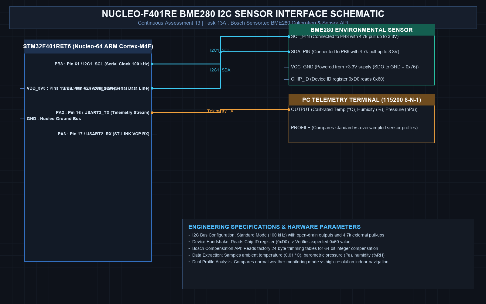

# EXPERIMENT DETAILS
- **Student Name:** Vaishali V
- **Register Number:** 25011102111
- **Degree / Branch:** B.Tech. Computer Science and Engineering (IoT)
- **Year / Semester:** II Year / III Semester
- **Course Title:** Fundamentals of Internet of Things Laboratory (25CS2741)
- **Academic Year:** 2026–2027

---

# CAT 13 - TASK 13A: BME280 I2C DRIVER & SENSOR CALIBRATION (NUCLEO-F401RE)

## 1. Circuit Diagram & Hardware Description



### Hardware Description
This experiment interfaces a Bosch Sensortec BME280 combined temperature, relative humidity, and barometric pressure sensor to the NUCLEO-F401RE over the hardware I2C1 bus.
- **I2C Bus Configuration:**
  - `PB8` -> I2C1_SCL (Standard Mode @ 100 kHz)
  - `PB9` -> I2C1_SDA (Bidirectional Data Line)
  - External 4.7 kΩ pull-up resistors to +3.3V on both bus lines.
- **Sensor Addressing:** SDO grounded sets I2C address to `0x76` (Write: `0xEC`, Read: `0xED`).
- **Telemetry Console:** Calibrated physical measurements output over USART2 (PA2/PA3 @ 115200 baud).

---

## 2. Core Logic / Pseudocode / Code Base

### Working Principle
1. **Device Identification:** Reads Chip ID register `0xD0`; verifies expected value `0x60`.
2. **Factory Calibration Trimming:** Reads 24-byte factory calibration tables stored in NVM.
3. **Data Acquisition:** Triggers forced/normal conversion and reads raw 20-bit ADC registers.
4. **Bosch 64-Bit Compensation Math:** Applies manufacturer compensation polynomial math to convert raw counts into true calibrated physical units: °C (0.01 resolution), %RH (1/1024 % resolution), and hPa.

### Step-by-Step Pseudocode
```text
BEGIN PROGRAM
    INITIALIZE HAL, SystemClock, I2C1 (100 kHz), USART2 (115200)

    // 1. Verify Chip ID
    HAL_I2C_Mem_Read(&hi2c1, 0x76 << 1, 0xD0, 1, &chip_id, 1, 100)
    ASSERT(chip_id == 0x60)

    // 2. Read Factory Trimming Parameters
    read_calibration_data()

    MAIN:
        WHILE TRUE DO:
            // 3. Read raw ADC data registers (0xF7 to 0xFE)
            HAL_I2C_Mem_Read(&hi2c1, 0x76 << 1, 0xF7, 1, raw_bytes, 8, 100)
            
            // 4. Calculate compensated physical values
            temp_degC = bme280_compensate_temperature(raw_T)
            humidity  = bme280_compensate_humidity(raw_H)
            pressure  = bme280_compensate_pressure(raw_P)

            // 5. Format and broadcast telemetry over serial
            printf("T: %.2f C | H: %.2f %% | P: %.2f hPa\r\n", temp_degC, humidity, pressure)
            HAL_Delay(1000)
        END WHILE
END PROGRAM
```

---

## 3. Expected Output & Inference

### Expected Output
- PuTTY serial console displays live, calibrated environmental telemetry once per second:
  `[BME280] Temperature: 24.85 C | Humidity: 58.42 % | Pressure: 1013.25 hPa`

### Inference
Environmental MEMS sensors require factory calibration compensation to cancel out fabrication variances, packaging stresses, and thermal offsets.
