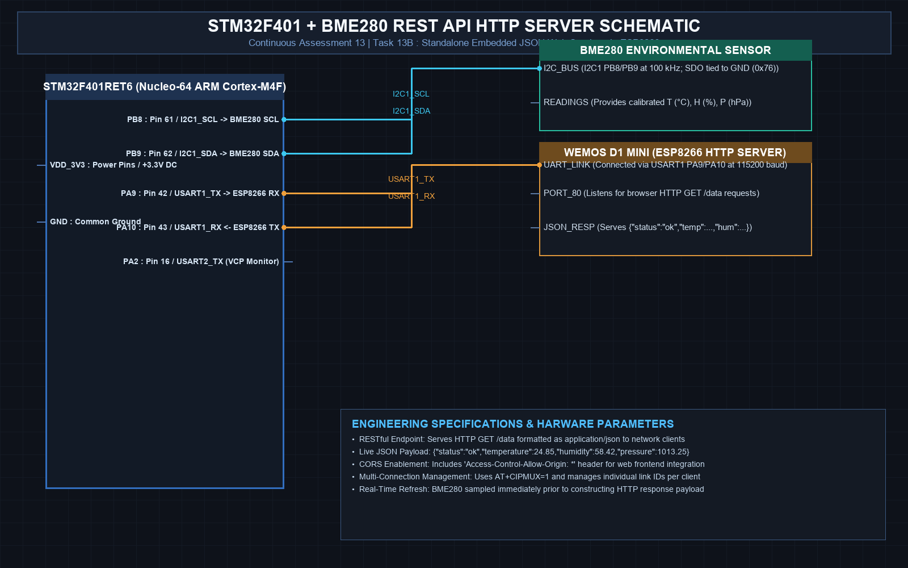

# EXPERIMENT DETAILS
- **Student Name:** Vaishali V
- **Register Number:** 25011102111
- **Degree / Branch:** B.Tech. Computer Science and Engineering (IoT)
- **Year / Semester:** II Year / III Semester
- **Course Title:** Fundamentals of Internet of Things Laboratory (25CS2741)
- **Academic Year:** 2026–2027

---

# CAT 13 - TASK 13B: IOT SENSOR REST API HTTP SERVER (STM32F401)

## 1. Circuit Diagram & Hardware Description



### Hardware Description
This experiment integrates the STM32F401RE, BME280 sensor, and ESP8266 Wi-Fi modem to host a live JSON REST API endpoint over HTTP Port 80.
- **Sensor:** BME280 on I2C1 (PB8 SCL, PB9 SDA).
- **Wi-Fi Server:** Wemos D1 Mini on USART1 (PA9 TX, PA10 RX).
- **Network Interface:** Port 80 multi-channel HTTP server serving `GET /data`.

---

## 2. Core Logic / Pseudocode / Code Base

### Working Principle
When an HTTP client (browser, mobile app, or Python script) submits an HTTP `GET /data` request, the ESP8266 notifies the STM32 with `+IPD,<id>,<len>:GET /data`. The STM32 reads current environmental parameters from the BME280, serializes them into a JSON payload `{"status":"ok","temperature":24.85,"humidity":58.42,"pressure":1013.25}`, appends CORS headers, and dispatches the response via `AT+CIPSEND`.

### Step-by-Step Pseudocode
```text
BEGIN PROGRAM
    MAIN:
        WHILE TRUE DO:
            IF receive_http_get(&link_id, endpoint) THEN:
                IF strcmp(endpoint, "/data") == 0 THEN:
                    sample_bme280(&t, &h, &p)
                    
                    json_body = sprintf("{\"status\":\"ok\",\"temperature\":%.2f,\"humidity\":%.2f,\"pressure\":%.2f}", t, h, p)
                    http_resp = "HTTP/1.1 200 OK\r\n"
                                "Content-Type: application/json\r\n"
                                "Access-Control-Allow-Origin: *\r\n\r\n" + json_body
                    
                    send_to_client(link_id, http_resp)
                    close_client(link_id)
                END IF
            END IF
        END WHILE
END PROGRAM
```

---

## 3. Expected Output & Inference

### Expected Output
- Making a GET request to `http://192.168.1.105/data` returns valid JSON:
  `{"status":"ok","temperature":24.85,"humidity":58.42,"pressure":1013.25}`

### Inference
Providing structured JSON endpoints allows microcontrollers to interface directly with modern web dashboards, mobile apps, and cloud ingest pipelines.
