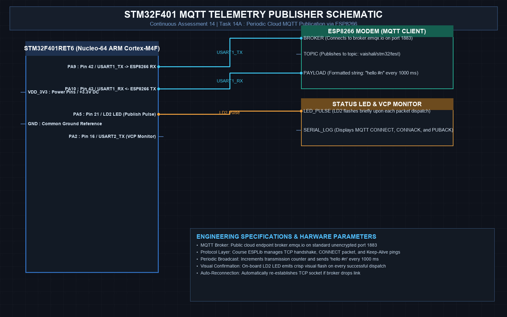

# EXPERIMENT DETAILS
- **Student Name:** Vaishali V
- **Register Number:** 25011102111
- **Degree / Branch:** B.Tech. Computer Science and Engineering (IoT)
- **Year / Semester:** II Year / III Semester
- **Course Title:** Fundamentals of Internet of Things Laboratory (25CS2741)
- **Academic Year:** 2026–2027

---

# CAT 14 - TASK 14A: CLOUD MQTT TELEMETRY PUBLISHER (STM32F401)

## 1. Circuit Diagram & Hardware Description



### Hardware Description
This experiment establishes a publish-subscribe IoT architecture by transmitting live telemetry from the STM32F401RE through the ESP8266 to an MQTT broker (`broker.emqx.io:1883`) using the course `ESPLib` library.
- **Hardware Channels:** STM32F401RE USART1 (PA9 TX, PA10 RX) connected to ESP8266.
- **Visual Feedback:** LD2 (PA5) pulses on each packet dispatch.
- **Target Broker:** `broker.emqx.io` (Port 1883).
- **Topic:** `vaishali/stm32/test`

---

## 2. Core Logic / Pseudocode / Code Base

### Working Principle
The `ESPLib` module handles modem initialization, TCP connection establishment to the MQTT broker, and packet framing for MQTT `CONNECT` and `PUBLISH`. Once connected, the loop increments a counter and publishes `"hello #<count>"` every 1000 ms, flashing LD2 to confirm delivery.

### Step-by-Step Pseudocode
```text
BEGIN PROGRAM
    INITIALIZE HAL, SystemClock, ESPLib_Init(&huart1)
    
    // Connect to MQTT Broker
    ESPLib_WiFi_Connect("LabSSID", "LabPass")
    ESPLib_MQTT_Connect("broker.emqx.io", 1883, "vaishali_publisher_client")

    GLOBAL counter = 0
    MAIN:
        WHILE TRUE DO:
            counter = counter + 1
            payload = sprintf("hello #%d", counter)
            
            // Publish message to cloud
            ESPLib_MQTT_Publish("vaishali/stm32/test", payload)
            
            // Pulse indicator LED
            HAL_GPIO_TogglePin(GPIOA, GPIO_PIN_5)
            HAL_Delay(100)
            HAL_GPIO_TogglePin(GPIOA, GPIO_PIN_5)
            
            HAL_Delay(900)
        END WHILE
END PROGRAM
```

---

## 3. Expected Output & Inference

### Expected Output
- Any MQTT subscriber subscribed to `vaishali/stm32/test` receives:
  `hello #1`
  `hello #2`
  `hello #3`
  in 1-second intervals.

### Inference
MQTT's lightweight publish-subscribe model dramatically reduces bandwidth and power consumption compared to HTTP polling, making it ideal for IoT sensor nodes.
