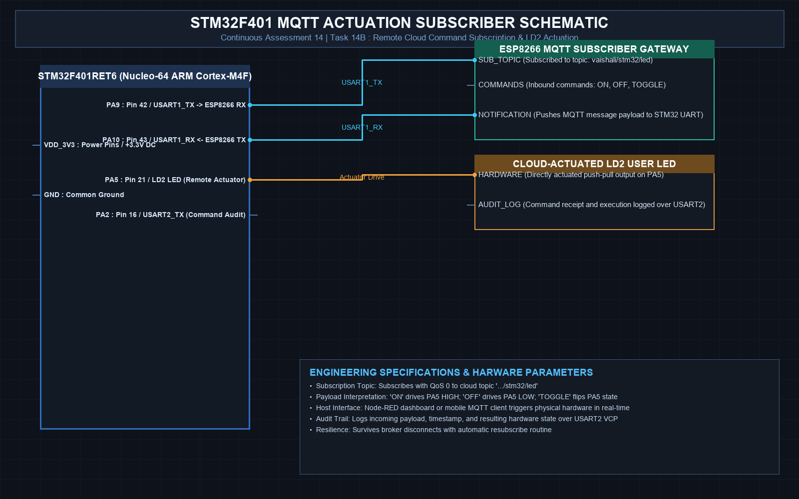

# EXPERIMENT DETAILS
- **Student Name:** Vaishali V
- **Register Number:** 25011102111
- **Degree / Branch:** B.Tech. Computer Science and Engineering (IoT)
- **Year / Semester:** II Year / III Semester
- **Course Title:** Fundamentals of Internet of Things Laboratory (25CS2741)
- **Academic Year:** 2026–2027

---

# CAT 14 - TASK 14B: MQTT REMOTE ACTUATION SUBSCRIBER (STM32F401)

## 1. Circuit Diagram & Hardware Description



### Hardware Description
This experiment demonstrates remote cloud actuation. The STM32F401RE subscribes to an MQTT topic on `broker.emqx.io` and switches the physical on-board user LED (LD2 on PA5) based on received commands.
- **Topic Subscribed:** `vaishali/stm32/led`
- **Supported Commands:** `ON`, `OFF`, `TOGGLE`

---

## 2. Core Logic / Pseudocode / Code Base

### Working Principle
The firmware subscribes to `vaishali/stm32/led` with QoS 0. When an external client publishes a message, the broker forwards it to the ESP8266, which alerts the STM32. The payload parser evaluates the message string:
- `"ON"` -> `HAL_GPIO_WritePin(GPIOA, GPIO_PIN_5, GPIO_PIN_SET)`
- `"OFF"` -> `HAL_GPIO_WritePin(GPIOA, GPIO_PIN_5, GPIO_PIN_RESET)`
- `"TOGGLE"` -> `HAL_GPIO_TogglePin(GPIOA, GPIO_PIN_5)`
The command and resulting state are audited over USART2.

### Step-by-Step Pseudocode
```text
BEGIN PROGRAM
    INITIALIZE ESPLib, Connect to Broker
    ESPLib_MQTT_Subscribe("vaishali/stm32/led")

    MAIN:
        WHILE TRUE DO:
            IF ESPLib_MQTT_CheckIncoming(&topic, &msg) THEN:
                IF strcmp(msg, "ON") == 0 THEN:
                    HAL_GPIO_WritePin(GPIOA, GPIO_PIN_5, GPIO_PIN_SET)
                ELSE IF strcmp(msg, "OFF") == 0 THEN:
                    HAL_GPIO_WritePin(GPIOA, GPIO_PIN_5, GPIO_PIN_RESET)
                ELSE IF strcmp(msg, "TOGGLE") == 0 THEN:
                    HAL_GPIO_TogglePin(GPIOA, GPIO_PIN_5)
                END IF
                printf("Executed Remote Command: %s\r\n", msg)
            END IF
        END WHILE
END PROGRAM
```

---

## 3. Expected Output & Inference

### Expected Output
- Publishing `ON` from MQTTX or a phone app instantly lights the green LD2 LED.
- Publishing `OFF` extinguishes it; publishing `TOGGLE` flips its state.

### Inference
Bi-directional MQTT capabilities allow microcontrollers behind NAT firewalls to receive real-time commands from anywhere in the world without requiring public IP addresses or port forwarding.
