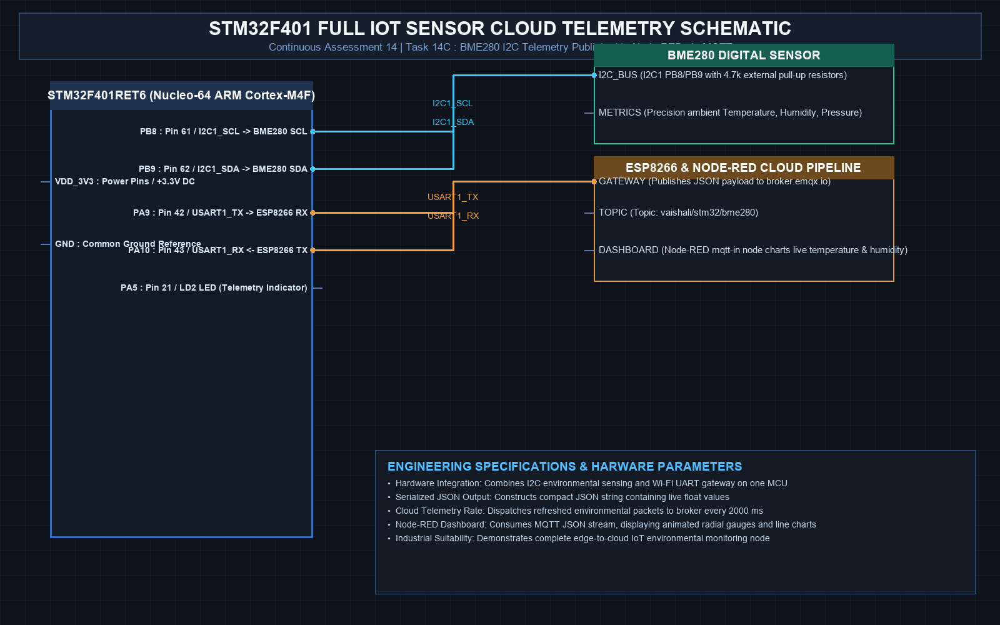

# EXPERIMENT DETAILS
- **Student Name:** Vaishali V
- **Register Number:** 25011102111
- **Degree / Branch:** B.Tech. Computer Science and Engineering (IoT)
- **Year / Semester:** II Year / III Semester
- **Course Title:** Fundamentals of Internet of Things Laboratory (25CS2741)
- **Academic Year:** 2026–2027

---

# CAT 14 - TASK 14C: CLOUD SENSOR TELEMETRY & NODE-RED DASHBOARD (STM32F401)

## 1. Circuit Diagram & Hardware Description



### Hardware Description
This experiment creates an end-to-end industrial IoT telemetry pipeline. The STM32F401RE reads calibrated ambient measurements from a BME280 sensor over I2C1 and publishes JSON payloads over MQTT to `broker.emqx.io`. A remote Node-RED dashboard subscribes to the stream and visualizes live temperature, humidity, and barometric pressure charts.
- **Sensor:** BME280 (I2C1 PB8/PB9).
- **Cloud Gateway:** ESP8266 (USART1 PA9/PA10).
- **Target Topic:** `vaishali/stm32/bme280`

---

## 2. Core Logic / Pseudocode / Code Base

### Working Principle
Every 2000 ms, the STM32 triggers a BME280 measurement conversion, reads raw ADC registers, applies 64-bit calibration polynomial math, formats a compact JSON string `{"temperature":24.85,"humidity":58.42,"pressure":1013.25}`, and dispatches it to the cloud broker via `ESPLib_MQTT_Publish()`.

### Step-by-Step Pseudocode
```text
BEGIN PROGRAM
    INITIALIZE I2C1, USART1, USART2, BME280, ESPLib
    ESPLib_MQTT_Connect("broker.emqx.io", 1883, "vaishali_bme_node")

    MAIN:
        WHILE TRUE DO:
            sample_bme280(&temp, &hum, &press)
            
            payload = sprintf("{\"temperature\":%.2f,\"humidity\":%.2f,\"pressure\":%.2f}", temp, hum, press)
            ESPLib_MQTT_Publish("vaishali/stm32/bme280", payload)
            
            HAL_GPIO_TogglePin(GPIOA, GPIO_PIN_5) // LD2 indicator pulse
            HAL_Delay(2000)
        END WHILE
END PROGRAM
```

---

## 3. Expected Output & Inference

### Expected Output
- Live telemetry is broadcast to `vaishali/stm32/bme280` every 2 seconds.
- The Node-RED dashboard charts live environmental fluctuations in real-time with responsive gauges and trend curves.

### Inference
Standardized JSON over MQTT enables seamless interoperability between heterogeneous embedded edge devices and cloud visualization platforms.
