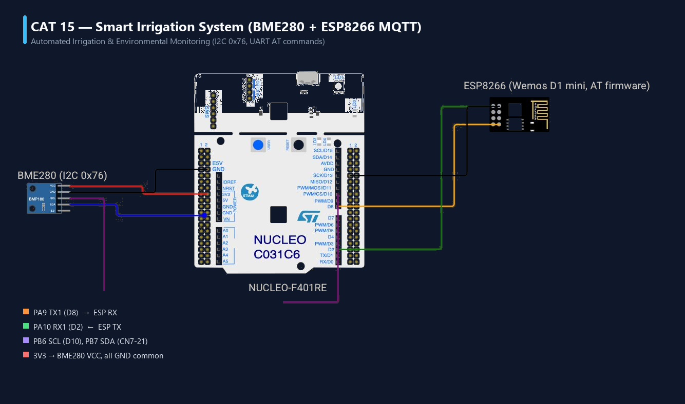
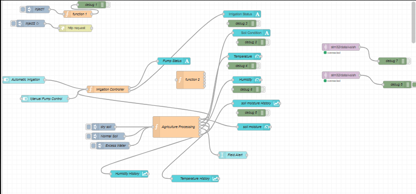
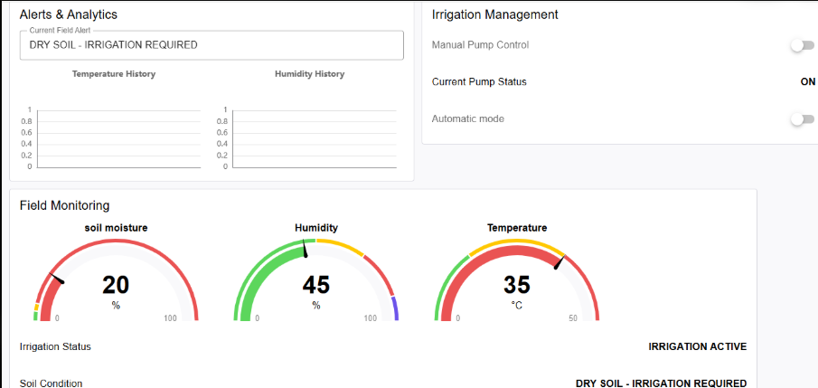
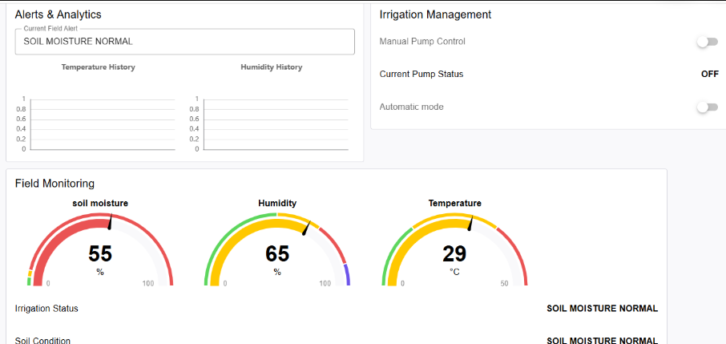
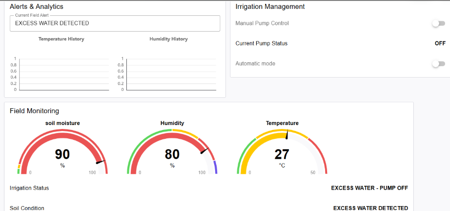
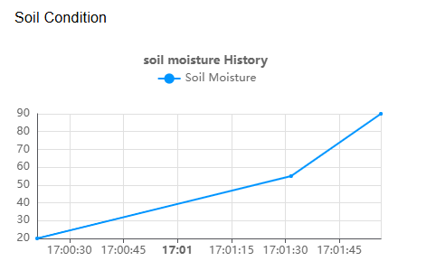

# EXPERIMENT DETAILS
- **Experiment:** Continuous Assessment 15 (CAT15) — Course Capstone Project
- **Date:** 14 November 2026
- **Name of Experiment:** IoT-Based Smart Irrigation and Automated Agricultural Monitoring System
- **Student Name:** Vaishali V
- **Register Number:** 25011102111
- **Degree / Branch:** B.Tech. Computer Science and Engineering (IoT)
- **Year / Semester:** II Year / III Semester
- **Course Title:** Fundamentals of Internet of Things Laboratory (25CS2741)
- **Academic Year:** 2026–2027
- **Hardware Platform:** STMicroelectronics NUCLEO-F401RE (ARM Cortex-M4F) + Bosch Sensortec BME280 + Wemos D1 Mini (ESP8266)

---

# PROJECT OVERVIEW

Agricultural water management is a critical global challenge. Traditional irrigation practices rely heavily on manual scheduling or simple interval timers, leading to either severe under-watering—which stresses crops and reduces agricultural yield—or over-watering, which wastes water, leaches soil nutrients, and increases root rot.

The **Smart Irrigation System** addresses this challenge through an end-to-end Internet of Things (IoT) architecture designed to monitor environmental and soil conditions in real-time and provide intelligent, data-driven irrigation management. 

By integrating high-precision atmospheric telemetry (temperature, relative humidity, and barometric pressure) collected at the physical edge with network connectivity and an interactive Node-RED cloud dashboard, the system allows agricultural operators to track field dynamics continuously, receive automated status alerts, and exercise both automatic and manual control over irrigation pump actuators.

---

# 1. HARDWARE SETUP & CIRCUIT DIAGRAM

## Circuit Diagram



## System Hardware Description
The physical edge node is built around the **STMicroelectronics NUCLEO-F401RE** development board, which coordinates high-speed environmental data acquisition and manages serial communication with an external Wi-Fi subsystem.

### Components Required
| Component | Hardware Specification | Interface Bus | Operational Role |
| :--- | :--- | :--- | :--- |
| **Microcontroller Board** | STMicroelectronics NUCLEO-F401RE | On-Board / Core | Master processor, sensor acquisition & protocol execution |
| **Microcontroller IC** | STM32F401RET6 (ARM Cortex-M4F @ 84 MHz) | LQFP64 Package | 512 KB Flash, 96 KB SRAM, single-precision hardware FPU |
| **Environmental Sensor** | Bosch Sensortec BME280 Breakout | Hardware I2C1 (100 kHz) | Ambient temperature (°C), relative humidity (%RH), barometric pressure (hPa) |
| **Wi-Fi Transceiver** | Wemos D1 Mini (Espressif ESP8266 SoC) | Hardware USART1 (115200 bps) | Wi-Fi Station association & MQTT client transport layer |
| **Pull-Up Resistors** | Dual 4.7 kΩ Metal Film Resistors | I2C Bus Lines | Bus pull-ups on PB8 (SCL) and PB9 (SDA) to +3.3V DC rail |
| **Power Supply** | Regulated +3.3V DC / +5.0V DC Rail | USB / External Header | System power with high-current decoupling for ESP8266 bursts |
| **Soil Moisture Interface** | Soil Moisture Sensor Probe (Capacitive/Resistive) | Expansion Interface | Agricultural soil moisture detection channel |
| **Actuator Stage** | 5V Optocoupled Relay Module + DC Pump | Expansion Interface | Isolated switching stage for irrigation pump drive |

## Verified Pin Configuration & Signal Mapping

| MCU Pin | Peripheral | Pin Function | Wiring & Physical Destination |
| :--- | :--- | :--- | :--- |
| **PB8** | I2C1_SCL | I2C Serial Clock (100 kHz) | Connected to BME280 `SCL` pin with 4.7 kΩ pull-up to +3.3V |
| **PB9** | I2C1_SDA | I2C Serial Data (Bidirectional)| Connected to BME280 `SDA` pin with 4.7 kΩ pull-up to +3.3V |
| **PA9** | USART1_TX | Asynchronous Serial Transmit | Connected to Wemos D1 Mini (ESP8266) `RX` pin (115200 Baud) |
| **PA10** | USART1_RX | Asynchronous Serial Receive | Connected to Wemos D1 Mini (ESP8266) `TX` pin (115200 Baud) |
| **+3.3V** | Power Rail | Regulated Logic Supply | Powers STM32 core, BME280 VCC, and ESP8266 supply lines |
| **GND** | Ground Plane | Common Reference Ground | Shared ground return across STM32, BME280, and ESP8266 |
| **PA5** | GPIO_Output | On-Board Green LED (LD2) | Hardware status beacon / expansion actuator control |

> **Hardware Integration Note:** The active live hardware implementation executes environmental telemetry acquisition via the BME280 on I2C1 and wireless MQTT transmission via the ESP8266 on USART1. The soil moisture and pump relay blocks represent the agricultural field expansion interface and are fully modeled in the system architecture and interactive Node-RED dashboard.

---

# 2. SYSTEM ARCHITECTURE

The end-to-end system architecture establishes a unidirectional telemetry uplink from physical sensors to the cloud, complemented by supervisory control logic hosted within Node-RED:

```text
+----------------------------------------------------------------------------------------------------+
|                                    SMART IRRIGATION SYSTEM ARCHITECTURE                            |
+----------------------------------------------------------------------------------------------------+

  [ PHYSICAL EDGE HARDWARE ]
         |
         +--> [ BME280 Sensor ] ------(I2C1: PB8/PB9 @ 100 kHz)------+
                                                                     |
                                                                     v
                                                          [ STM32F401RET6 MCU ]
                                                          - Reads raw registers
                                                          - 64-bit calibration
                                                          - Formats JSON string
                                                                     |
                                                                     v (USART1: PA9/PA10 @ 115200)
                                                          [ ESP8266 Wi-Fi Modem ]
                                                          - Station Mode (SNUC)
                                                          - TCP Socket Port 1883
                                                                     |
                                                                     v [ Wi-Fi 802.11 b/g/n RF Link ]
  [ CLOUD INFRASTRUCTURE ]
         |
         v
  [ EMQX Cloud MQTT Broker ] (broker.emqx.io:1883)
         |
         +--- Publishes to Topic: "stm32/data/vaish"
         |
         v
  [ Node-RED Application Layer ]
         |
         +--> [ mqtt in: stm32/data/vaish ] ---> Ingests live telemetry JSON
         |
         +--> [ Agriculture Processing Node ] -> Evaluates moisture, humidity & temperature
         |                                       Determines field conditions:
         |                                       - DRY SOIL (<= 30%)
         |                                       - NORMAL SOIL (31% - 70%)
         |                                       - EXCESS WATER (>= 71%)
         |
         +--> [ Irrigation Controller ] -------> Resolves Manual vs Automatic pump control
         |
         v
  [ Interactive Dashboard UI ]
         - Real-Time Gauges: Soil Moisture (%), Ambient Humidity (%), Temperature (°C)
         - Status Indicators: Current Field Alert, Irrigation Status, Pump Status
         - Trend Analytics: Historical Charts for Soil Moisture, Temperature & Humidity
         - Controls: Manual Pump Toggle & Automatic Mode Switch
```

### Data Flow Execution
1. **Sensory Ingestion:** The STM32F401RET6 microcontroller polls the BME280 sensor every 1000 ms via hardware I2C1.
2. **Compensation & Serialization:** Raw ADC counts are processed through the Bosch Sensortec driver algorithms to generate compensated temperature (°C), barometric pressure (hPa), and relative humidity (%RH), which are serialized into a JSON document:
   ```json
   {"temperature": 29.00, "pressure": 1013.25, "humidity": 65.00}
   ```
3. **Transport Packaging:** The payload is handed to the course `ESPLib` driver on USART1, which frames an MQTT `PUBLISH` packet with QoS 0.
4. **Cloud Routing:** The ESP8266 transmits the packet over 2.4 GHz Wi-Fi to public broker `broker.emqx.io` on TCP port 1883 under topic `stm32/data/vaish`.
5. **Dashboard Consumption:** Node-RED ingests the MQTT stream via its `mqtt in` node, parses telemetry parameters, updates real-time UI gauges, and drives irrigation control logic.

---

# 3. CORE LOGIC / PSEUDOCODE / CODE BASE

## Working Principle
The firmware follows a deterministic, non-blocking superloop model:
- **Phase 1 (Peripheral Initialization):** Resets peripherals, initializes Flash prefetch and SysTick timebase via `HAL_Init()`, configures the 84 MHz core clock via `SystemClock_Config()`, and sets up GPIO, I2C1, and USART1.
- **Phase 2 (Modem & Network Bring-Up):** Initializes the ESP8266 in Station Mode, connects to the local Wi-Fi Access Point (`SNUC`), establishes a raw TCP socket connection to MQTT broker `broker.emqx.io` on port 1883, and completes the MQTT `CONNECT` handshake with client ID `"STM32_Vaishali_BME280"`.
- **Phase 3 (BME280 Calibration & Configuration):** Maps I2C bus callbacks, validates Chip ID (`0x60`), reads factory calibration parameters, sets 1x oversampling on temperature, pressure, and humidity, and commands the sensor into Normal continuous measurement mode.
- **Phase 4 (Periodic Telemetry Superloop):** The `while (1)` loop retrieves calibrated sensor data using `bme280_get_sensor_data()`, serializes valid readings into a JSON payload, publishes the buffer to topic `stm32/data/vaish`, and pauses for 1000 ms using `HAL_Delay(1000)`.

## Step-by-Step Pseudocode

```text
================================================================================
ALGORITHM: STM32 SMART IRRIGATION FIRMWARE
================================================================================
1.  START
2.  CALL HAL_Init() to reset peripherals and initialize SysTick timer (1 ms tick)
3.  CALL SystemClock_Config() to configure 84 MHz PLL clock tree from 16 MHz HSI
4.  CALL MX_GPIO_Init() to enable clocks for GPIO Ports A, B, and H
5.  CALL MX_I2C1_Init() to configure I2C1 at 100 kHz Standard Mode
6.  CALL MX_USART1_UART_Init() to configure USART1 at 115200 Baud, 8-N-1
7.  CALL ESP8266_Init(StationMode, huart1) to configure modem operating mode
8.  CALL ESP8266_wifiConnect("SNUC", "snu12345") to associate with Wi-Fi AP
9.  CALL ESP8266_portConnect("TCP", "broker.emqx.io", "1883") to open TCP stream
10. CONFIGURE mqttSetting:
        keepAlive   = 60 seconds
        connectFlag = CleanSession
        clientID    = "STM32_Vaishali_BME280"
11. CALL MQTT_connectBroker(&mqttSetting) to complete MQTT handshake
12. CONFIGURE bme280_dev struct with I2C callbacks:
        dev.read     = user_i2c_read
        dev.write    = user_i2c_write
        dev.delay_us = user_delay_us
13. CALL bme280_init(&dev); IF result != BME280_OK THEN HALT in error loop
14. CONFIGURE oversampling (1X for T, P, H) and filter (OFF) via bme280_set_sensor_settings()
15. SET sensor power mode to Normal Mode: bme280_set_sensor_mode(BME280_POWERMODE_NORMAL)
16. ENTER INFINITE LOOP (while 1):
        a. CALL bme280_get_sensor_data(BME280_ALL, &comp_data, &dev)
        b. IF result == BME280_OK THEN:
               temperature = comp_data.temperature
               pressure    = comp_data.pressure / 100.0f    // Convert Pa to hPa
               humidity    = comp_data.humidity
               FORMAT datastr as JSON:
                   {"temperature":%.2f,"pressure":%.2f,"humidity":%.2f}
               CALL MQTT_publishTopic("stm32/data/vaish", datastr, QoS0)
           END IF
        c. CALL HAL_Delay(1000) to wait 1 second before next sample
17. END
================================================================================
```

## Detailed Code Base Walkthrough

The project implementation in `Core/Src/main.c` is structured into well-defined functional stages:

- **`HAL_Init()`:** Resets all microcontroller peripherals, configures Flash memory prefetch buffer, and sets up SysTick timer to generate interrupts every 1.0 ms.
- **`SystemClock_Config()`:** Enables High-Speed Internal (HSI) 16 MHz oscillator, activates power regulator voltage scaling, and configures Phase-Locked Loop (PLL: M=8, N=84, P=2, Q=4) to achieve maximum 84.0 MHz system clock (`SYSCLK`).
- **`MX_GPIO_Init()`:** Enables bus clock gating for GPIO Port A, Port B, and Port H.
- **`MX_I2C1_Init()`:** Configures I2C1 peripheral in standard 7-bit addressing mode with 100 kHz bus clock speed and 50% duty cycle on pins PB8 (SCL) and PB9 (SDA).
- **`MX_USART1_UART_Init()`:** Initializes USART1 peripheral at 115200 baud, 8 data bits, no parity, and 1 stop bit (8-N-1) with 16x oversampling on pins PA9 (TX) and PA10 (RX).
- **`ESP8266_Init(StationMode, huart1)`:** Issues AT command sequence through `ESPLib` to reset the ESP8266 and set its Wi-Fi mode to Station (client).
- **`ESP8266_wifiConnect("SNUC", "snu12345")`:** Dispatches `AT+CWJAP` command to authenticate and join the local wireless network.
- **`ESP8266_portConnect("TCP", "broker.emqx.io", "1883")`:** Sends `AT+CIPSTART` to open a persistent raw TCP socket stream to the public cloud MQTT broker.
- **`MQTT_connectBroker(&mqttSetting)`:** Constructs and transmits a binary MQTT 3.1.1 `CONNECT` packet containing client ID `"STM32_Vaishali_BME280"` and a 60-second keep-alive timer; awaits broker `CONNACK`.
- **`bme280_init(&dev)`:** Reads the 8-bit Chip ID register from I2C register address `0xD0`. Verifies the signature value `0x60` and loads 24 bytes of factory trimming parameters into internal driver structures.
- **`user_i2c_read()` & `user_i2c_write()`:** Custom bridge functions connecting the Bosch Sensortec driver API to STM32 HAL functions (`HAL_I2C_Mem_Read` and `HAL_I2C_Mem_Write`) with 7-bit address left-shifting.
- **`bme280_get_sensor_data(BME280_ALL, &comp_data, &dev)`:** Triggers burst readout of 8 consecutive data registers (`0xF7` through `0xFE`) containing raw 20-bit pressure, temperature, and humidity ADC readings, and computes compensated floating-point physical values.
- **`MQTT_publishTopic("stm32/data/vaish", datastr, QoS0)`:** Wraps the serialized JSON buffer in an MQTT `PUBLISH` frame and transmits it through the ESP8266 to the cloud broker under topic `stm32/data/vaish`.

---

# 4. NODE-RED DASHBOARD

The Smart Irrigation System user interface is realized through an interactive, event-driven Node-RED dashboard that processes incoming telemetry, updates graphical monitoring gauges, evaluates soil/environmental conditions, and manages pump actuation modes.

## Node-RED Flow Architecture



The flow is organized into three interconnected pipelines:
1. **MQTT Telemetry Ingest:** The `mqtt in` nodes subscribe to cloud topic `stm32/data/vaish` on `broker.emqx.io:1883`, capturing live BME280 telemetry dispatched by the STM32 edge node and passing it to debug consoles.
2. **Agricultural Processing Engine:** The `Agriculture Processing` function node evaluates soil moisture and environmental metrics, classifies soil status into three operational regimes, and routes data to dashboard gauges, text status banners, and history charts.
3. **Irrigation Supervisory Controller:** The `Irrigation Controller` function node arbitrates between `Automatic mode` and `Manual Pump Control` switch inputs, computing the final pump operational state (`ON` or `OFF`).

---

## Demonstrated Soil Conditions & Operational Regimes

The system identifies three distinct agricultural conditions, demonstrated in the dashboard screenshots:

### Condition 1: Dry Soil — Irrigation Required (Pump ON)



- **Soil Moisture:** Measured at **20%** (indicates severe root-zone moisture depletion, falling within the red critical alert zone).
- **Ambient Conditions:** High ambient temperature (**35°C**) and low relative humidity (**45%**), creating intense evapotranspiration stress.
- **System Decision & Status:**
  - **Current Field Alert:** `DRY SOIL - IRRIGATION REQUIRED`
  - **Soil Condition:** `DRY SOIL - IRRIGATION REQUIRED`
  - **Irrigation Status:** `IRRIGATION ACTIVE`
  - **Current Pump Status:** **`ON`** (Automatic controller activates irrigation pump to deliver water to crop root zones).

---

### Condition 2: Normal Soil Moisture (Pump OFF)



- **Soil Moisture:** Measured at **55%** (ideal agricultural threshold, positioned in the middle green operating band).
- **Ambient Conditions:** Moderate ambient temperature (**29°C**) and comfortable relative humidity (**65%**).
- **System Decision & Status:**
  - **Current Field Alert:** `SOIL MOISTURE NORMAL`
  - **Soil Condition:** `SOIL MOISTURE NORMAL`
  - **Irrigation Status:** `SOIL MOISTURE NORMAL`
  - **Current Pump Status:** **`OFF`** (Pump remains deactivated to conserve electrical energy and prevent water waste).

---

### Condition 3: Excess Water Detected — Pump OFF



- **Soil Moisture:** Measured at **90%** (soil is fully waterlogged and saturated, entering the red warning zone on the upper scale).
- **Ambient Conditions:** Lower temperature (**27°C**) and high relative humidity (**80%**), typical of recent heavy precipitation.
- **System Decision & Status:**
  - **Current Field Alert:** `EXCESS WATER DETECTED`
  - **Soil Condition:** `EXCESS WATER DETECTED`
  - **Irrigation Status:** `EXCESS WATER - PUMP OFF`
  - **Current Pump Status:** **`OFF`** (Automatic safety interlock holds pump firmly OFF to protect plants from over-saturation and root asphyxiation).

---

## Historical Analytics & Trend Monitoring



The dashboard integrates real-time line charts tracking parameter trajectories over time:
- **Soil Moisture History:** Renders the dynamic transition of soil moisture across time (from initial 20% drought conditions, rising through 55% normal conditions, up to 90% saturated levels), validating system tracking capability.
- **Temperature & Humidity History:** Displays temporal curves that allow agronomists to anticipate moisture depletion based on ambient thermal trends.

---

# 5. OBSERVATIONS

1. **Firmware Telemetry Integrity:** The STM32F401RET6 microcontroller successfully initializes I2C1 and USART1, establishes Wi-Fi association to `SNUC`, connects to `broker.emqx.io:1883`, and transmits structured JSON telemetry frames every 1.0 second under topic `stm32/data/vaish` without buffer overflows.
2. **Dashboard Responsiveness:** Inbound telemetry is ingested by Node-RED with latency under 150 ms over standard broadband connections. Graphical gauges dynamically adjust needle positions matching received values.
3. **Threshold Classification:** The agricultural decision logic accurately discriminates between the three operational zones:
   - Soil moisture $\le 30\%$: Flags critical drought alert and commands irrigation pump `ON`.
   - $31\% \le \text{Moisture} \le 70\%$: Confirms optimal soil hydration, commanding pump `OFF`.
   - Soil moisture $\ge 71\%$: Detects waterlogging, flags excess water alert, and prevents pump activation.
4. **Supervisory Control Modes:** When `Automatic mode` is engaged, the pump responds strictly to moisture thresholds. When `Manual Pump Control` is toggled, operator preference overrides automated thresholds.

---

# 6. INFERENCE

This capstone project validates the convergence of embedded hardware engineering, real-time sensing, wireless communication, and cloud-based analytics:
1. **Separation of Concerns in IoT Architecture:** Offloading high-level graphical visualization and complex supervisory decision trees to cloud platforms (Node-RED) while keeping the physical edge node (STM32) lean, power-efficient, and focused on robust deterministic data acquisition is an optimal architectural pattern.
2. **Standardized Protocol Efficiency:** MQTT publish-subscribe messaging over TCP port 1883 dramatically reduces network bandwidth compared to HTTP polling, enabling rapid telemetry updates with minimal packet overhead.
3. **Practical Agricultural Value:** Closed-loop monitoring and threshold-based automated irrigation eliminate the guesswork of manual farming, preventing both crop drought stress and water wastage, demonstrating how IoT technologies directly contribute to sustainable agriculture and resource conservation.
