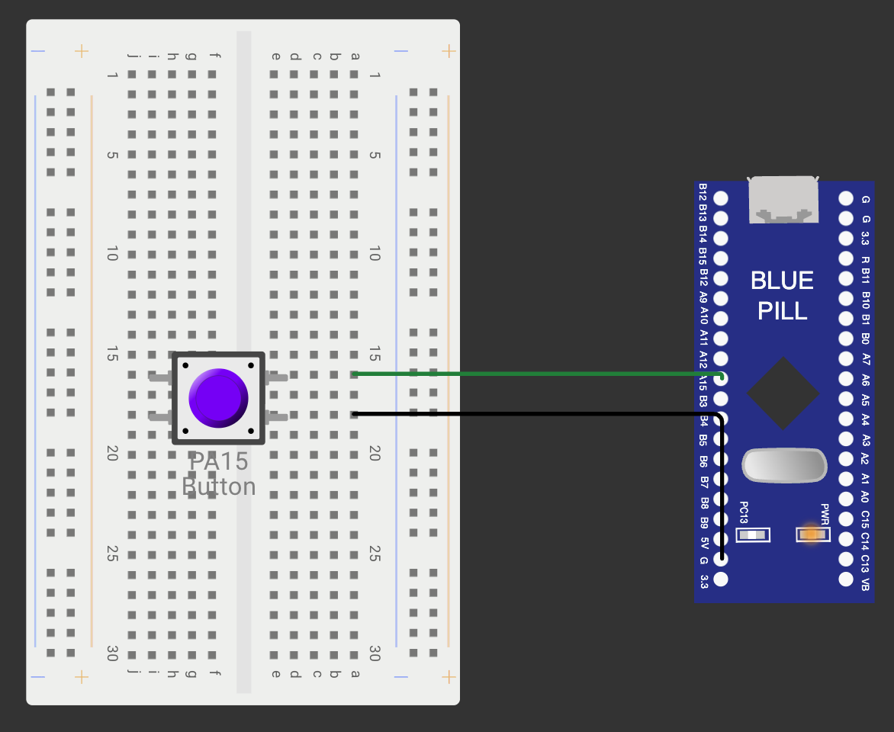

# CONTINUOUS ASSESSMENT 8: STM32 GPIO BRING-UP & EVENT-DRIVEN SWITCH CONTROL

**Student Name:** Vaishali V  
**Register Number:** 25011102111  
**Course Code & Name:** 25CS2741 Fundamentals of Internet of Things + Lab  
**Academic Year:** 2026–2027 | **Semester:** III  
**Date of Performance:** 24/09/2026  
**Hardware Platform:** STM32 "Blue Pill" Development Board (STM32F103C6T6A, ARM Cortex-M3 @ 72 MHz)  
**Development Toolchain:** STM32CubeMX + STM32CubeIDE (HAL Drivers) + External Tactile Switch  

---

## TASK 8A: Fundamental GPIO Input/Output Configuration

### 1. Aim / Objective
To configure general-purpose digital I/O pins on the STM32F103C6T6A microcontroller using STM32CubeMX and the STM32 Hardware Abstraction Layer (HAL), setting up pin `PC13` as a push-pull output for the onboard active-low LED and pin `PA15` as a digital input with an internal pull-up resistor to directly mirror tactile button states onto the LED.

### 2. Components Required
- STM32 "Blue Pill" Development Board (STM32F103C6T6A)
- ST-LINK V2 In-Circuit Debugger / Programmer (SWD Interface)
- Tactile Push-Button Switch
- Breadboard & Male-to-Female Jumper Wires
- Workstation running STM32CubeIDE & STM32CubeMX

### 3. Hardware Specifications
| Parameter | Technical Specification |
|---|---|
| Microcontroller | STM32F103C6T6A (Medium-density ARM Cortex-M3) |
| Operating Frequency | 72 MHz (8 MHz external HSE crystal multiplied via internal PLL) |
| Core Architecture | 32-bit ARM Cortex-M3 (Harvard architecture, Thumb-2 ISA) |
| User Indicator LED | Onboard active-low LED wired to `PC13` (General-Purpose Push-Pull) |
| Digital Input Switch | Tactile push-button between `PA15` and GND |
| Pin Multiplexing Note | `PA15` defaults to JTAG `JTDI` at reset; Serial Wire Debug (SWD) mode is selected in CubeMX to release `PA15` for GPIO |
| Operating Voltage | 3.3 V DC regulated rail ($V_{DD}$) |

### 4. Pin Configuration & Connections
- **`PC13` (Port C Pin 13):** Configured as GPIO Output, Push-Pull, No pull-up/pull-down, Low output speed. Drives the cathode of the onboard active-low LED.
- **`PA15` (Port A Pin 15):** Configured as GPIO Input with internal pull-up resistor enabled (`GPIO_PULLUP`).
- **Tactile Button:** One terminal connected to `PA15`; opposite terminal tied to GND.
- **ST-LINK V2 Programmer:** SWDIO $\rightarrow$ `PA13`, SWCLK $\rightarrow$ `PA14`, 3.3V $\rightarrow$ `3.3V`, GND $\rightarrow$ `GND`.

### 5. Circuit Diagram


### 6. Working Principle
The STM32 GPIO subsystem features configurable output drivers and internal pull-up/pull-down networks:
1. **Output Operation on `PC13`:** In push-pull configuration, writing a logic 0 (`GPIO_PIN_RESET`) turns on the internal N-channel MOSFET, pulling `PC13` to ground and completing the circuit to illuminate the active-low LED. Writing a logic 1 (`GPIO_PIN_SET`) pulls `PC13` to 3.3 V, turning the LED off.
2. **Input Biasing on `PA15`:** The internal pull-up resistor pulls the floating input to 3.3 V (logic 1) when the switch is open. Pressing the tactile button shorts `PA15` directly to GND, pulling the input to logic 0.
3. **State Mirroring:** In the foreground `while(1)` super-loop, `HAL_GPIO_ReadPin(GPIOA, GPIO_PIN_15)` polls the button level. When logic 0 is read, `HAL_GPIO_WritePin(GPIOC, GPIO_PIN_13, GPIO_PIN_RESET)` illuminates the LED; when logic 1 is read, `GPIO_PIN_SET` extinguishes it.

### 7. Algorithm / Procedure
1. Create a new STM32 project in STM32CubeIDE targeting `STM32F103C6Tx`.
2. In CubeMX Pinout view, set `SYS -> Debug` to **Serial Wire** (freeing `PA15` from JTAG).
3. Configure `PC13` as `GPIO_Output` and `PA15` as `GPIO_Input` with Pull-up.
4. Set HSE clock to 8 MHz and configure PLL multipliers in the Clock Tree to achieve 72 MHz system clock (`SYSCLK`).
5. Generate code and open `main.c`.
6. Inside the `/* USER CODE BEGIN WHILE */` loop:
   - Check if `HAL_GPIO_ReadPin(GPIOA, GPIO_PIN_15) == GPIO_PIN_RESET`.
   - If TRUE, call `HAL_GPIO_WritePin(GPIOC, GPIO_PIN_13, GPIO_PIN_RESET)` (LED ON).
   - If FALSE, call `HAL_GPIO_WritePin(GPIOC, GPIO_PIN_13, GPIO_PIN_SET)` (LED OFF).
7. Build the project and flash onto the Blue Pill via ST-LINK.

### 8. Source Code Walkthrough
- **Project Folder:** [`TASK_8A_GPIO_Input_Output`](TASK_8A_GPIO_Input_Output/)
- **Source File:** `Core/Src/main.c`
```c
/* USER CODE BEGIN WHILE */
while (1)
{
    /* USER CODE END WHILE */

    /* USER CODE BEGIN 3 */
    if (HAL_GPIO_ReadPin(GPIOA, GPIO_PIN_15) == GPIO_PIN_RESET)
    {
        HAL_GPIO_WritePin(GPIOC, GPIO_PIN_13, GPIO_PIN_RESET); // LED ON
    }
    else
    {
        HAL_GPIO_WritePin(GPIOC, GPIO_PIN_13, GPIO_PIN_SET);   // LED OFF
    }
}
/* USER CODE END 3 */
```

### 9. Expected Output & Results
Holding down the tactile push-button causes the onboard green LED on `PC13` to stay illuminated continuously. Releasing the button instantly extinguishes the LED.

### 10. Observations & Inference
- Disabling the full JTAG debug port in favor of 2-wire Serial Wire Debug (SWD) is mandatory when repurposing pins `PA15`, `PB3`, or `PB4` for general GPIO tasks.
- Directly mirroring pin levels provides instantaneous response but provides no latching or event detection.

---

## TASK 8B: Event-Driven Push-Button Detection & Non-Blocking Software Debouncing

### 1. Aim / Objective
To implement transition-based edge detection and non-blocking millisecond software debouncing using `HAL_GetTick()`, toggling the state of the `PC13` LED cleanly once per button press-and-release cycle while filtering out contact bounce noise.

### 2. Components Required
- STM32 Blue Pill Board (STM32F103C6T6A)
- ST-LINK V2 Debugger & Push-Button Switch
- STM32CubeIDE

### 3. Hardware Specifications
- Hardware wiring identical to Task 8A (`PC13` LED, `PA15` pull-up switch).
- Minimum debounce threshold: 30 ms.

### 4. Pin Configuration & Connections
- Identical to Task 8A.

### 5. Circuit Diagram


### 6. Working Principle
Mechanical switches bounce between open and closed for 5–25 ms upon actuation, causing multiple rapid transitions. Rather than stalling the processor with blocking delays (`HAL_Delay()`), this task uses system timestamps:
1. **Falling Edge Transition (`1 → 0`):** When `PA15` transitions from HIGH to LOW, the current millisecond timestamp is saved into `press_t = HAL_GetTick()`.
2. **Rising Edge Transition (`0 → 1`):** When the button is released, the elapsed hold time is calculated as $\Delta t = \text{HAL\_GetTick}() - \text{press\_t}$.
3. **Threshold Filtering & Latching:** If $\Delta t \ge 30\text{ ms}$, the event is accepted as a valid press and `HAL_GPIO_TogglePin(GPIOC, GPIO_PIN_13)` flips the LED state. Spurious spikes shorter than 30 ms are discarded.

### 7. Algorithm / Procedure
1. Declare state tracking variables: `uint8_t prev = 1;` and `uint32_t press_t = 0;`.
2. In the `while(1)` super-loop:
   - Read current pin state: `curr = HAL_GPIO_ReadPin(GPIOA, GPIO_PIN_15)`.
   - Sample current time: `now = HAL_GetTick()`.
   - If `prev == 1 && curr == 0` (falling edge), set `press_t = now`.
   - If `prev == 0 && curr == 1` (rising edge):
     - If `now - press_t >= 30`, toggle LED via `HAL_GPIO_TogglePin(GPIOC, GPIO_PIN_13)`.
   - Update `prev = curr`.
3. Build and program the firmware.

### 8. Source Code Walkthrough
- **Project Folder:** [`TASK_8B_Event_Based_Control`](TASK_8B_Event_Based_Control/)
- **Source File:** `Core/Src/main.c`
```c
/* USER CODE BEGIN 2 */
uint8_t prev = 1;
uint32_t press_t = 0;
/* USER CODE END 2 */

/* USER CODE BEGIN WHILE */
while (1)
{
    /* USER CODE END WHILE */

    /* USER CODE BEGIN 3 */
    uint8_t curr = HAL_GPIO_ReadPin(GPIOA, GPIO_PIN_15);
    uint32_t now = HAL_GetTick();

    if (prev == 1 && curr == 0)
    {
        press_t = now;
    }
    else if (prev == 0 && curr == 1)
    {
        if ((now - press_t) >= 30)
        {
            HAL_GPIO_TogglePin(GPIOC, GPIO_PIN_13);
        }
    }
    prev = curr;
}
/* USER CODE END 3 */
```

### 9. Expected Output & Results
Each distinct press-and-release of the push-button toggles the LED state:
$$\text{LED OFF} \xrightarrow{\text{press}} \text{LED ON} \xrightarrow{\text{press}} \text{LED OFF}$$
The state latches stably after release, and mechanical contact bounce is completely eliminated.

### 10. Observations & Inference
- Measuring press duration upon the rising edge ensures that bounce spikes during initial contact closure do not trigger multiple toggles.
- Relying on `HAL_GetTick()` leaves CPU execution completely unblocked.

---

## TASK 8C: Press Duration Discrimination (Short Press vs. Long Press)

### 1. Aim / Objective
To classify user button interactions based on actuation duration using non-blocking timestamp comparisons, toggling the static LED on a short tap (< 1 s) and engaging a 200 ms continuous blinking mode upon a long press (≥ 1 s).

### 2. Components Required
- STM32 Blue Pill Board (STM32F103C6T6A)
- ST-LINK V2 Debugger & Tactile Switch
- STM32CubeIDE

### 3. Hardware Specifications
| Event | Duration Criterion | Triggered System Behavior |
|---|---|---|
| Transient Bounce | $\Delta t < 30\text{ ms}$ | Ignored (filtered noise) |
| Short Press | $30\text{ ms} \le \Delta t < 1000\text{ ms}$ | Toggle static LED (or exit blink mode if blinking) |
| Long Press | $\Delta t \ge 1000\text{ ms}$ | Toggle continuous 200 ms blinking mode |
| Periodic Blink Timer | Every 200 ms via `HAL_GetTick()` | Non-blocking LED state inversion |

### 4. Pin Configuration & Connections
- Identical to Task 8A and Task 8B.

### 5. Circuit Diagram


### 6. Working Principle
The firmware separates time measurement from the visual animation engine:
1. **Hold Duration Calculation:** When the switch transitions from LOW to HIGH, $\text{duration} = \text{now} - \text{press\_t}$ is evaluated.
2. **Long-Press Mode Toggle:** If $\text{duration} \ge 1000\text{ ms}$, flag `blink` is inverted (`blink = !blink`).
3. **Short-Press Action:** If $30\text{ ms} \le \text{duration} < 1000\text{ ms}$:
   - If `blink == 0`, the static LED is toggled once.
   - If `blink == 1`, blinking is disengaged (`blink = 0`).
4. **Non-Blocking Periodic Blinker:** When `blink == 1`, an independent timecheck `now - blink_t >= 200` toggles `PC13` every 200 ms and updates `blink_t = now`.

### 7. Algorithm / Procedure
1. Initialize variables: `prev = 1`, `press_t = 0`, `blink = 0`, `blink_t = 0`.
2. In the `while(1)` loop:
   - Check rising edge: compute `duration = now - press_t`.
   - If `duration >= 1000`: toggle `blink = !blink`.
   - Else if `duration >= 30`: toggle LED or clear `blink`.
   - If `blink == 1` and `now - blink_t >= 200`: toggle `PC13` and set `blink_t = now`.
   - Update `prev = curr`.
3. Flash and verify system operation.

### 8. Source Code Walkthrough
- **Project Folder:** [`TASK_8C_Short_Press_vs_Long_Press`](TASK_8C_Short_Press_vs_Long_Press/)
- **Source File:** `Core/Src/main.c`
```c
/* USER CODE BEGIN 2 */
uint8_t prev = 1;
uint32_t press_t = 0;
uint8_t blink = 0;
uint32_t blink_t = 0;
/* USER CODE END 2 */

/* USER CODE BEGIN WHILE */
while (1)
{
    /* USER CODE END WHILE */

    /* USER CODE BEGIN 3 */
    uint8_t curr = HAL_GPIO_ReadPin(GPIOA, GPIO_PIN_15);
    uint32_t now = HAL_GetTick();

    if (prev == 1 && curr == 0)
    {
        press_t = now;
    }
    else if (prev == 0 && curr == 1)
    {
        uint32_t duration = now - press_t;
        if (duration >= 1000)
        {
            blink = !blink;
        }
        else if (duration >= 30)
        {
            if (blink)
                blink = 0;
            else
                HAL_GPIO_TogglePin(GPIOC, GPIO_PIN_13);
        }
    }
    prev = curr;

    if (blink && (now - blink_t >= 200))
    {
        blink_t = now;
        HAL_GPIO_TogglePin(GPIOC, GPIO_PIN_13);
    }
}
/* USER CODE END 3 */
```

### 9. Expected Output & Results
- Quick tap (< 1 s): Inverts the static LED state (ON $\leftrightarrow$ OFF).
- Sustained press (≥ 1 s): Engages continuous 200 ms blinking on `PC13`.
- Subsequent tap during blinking: Stops blinking and leaves the LED in its current state.
- Subsequent long hold: Toggles the blinking mode state cleanly.

### 10. Observations & Inference
- Using `HAL_GetTick()` provides a cooperative multitasking architecture that supports simultaneous button monitoring and periodic LED blinking without RTOS complexity.
