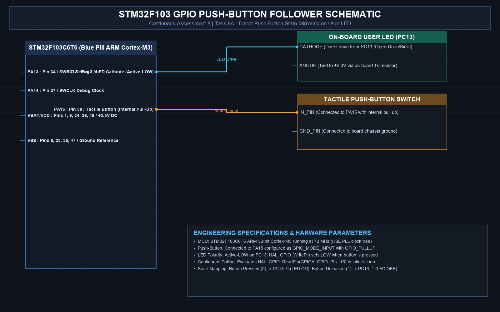

# EXPERIMENT DETAILS
- **Student Name:** Vaishali V
- **Register Number:** 25011102111
- **Degree / Branch:** B.Tech. Computer Science and Engineering (IoT)
- **Year / Semester:** II Year / III Semester
- **Course Title:** Fundamentals of Internet of Things Laboratory (25CS2741)
- **Academic Year:** 2026–2027

---

# CAT 8 - TASK 8A: GPIO PUSH-BUTTON FOLLOWER (STM32F103)

## 1. Circuit Diagram & Hardware Description



### Hardware Description
This experiment introduces the ARM Cortex-M3 architecture on the STM32F103C6T6 (Blue Pill) development board, demonstrating direct digital input polling and digital output driving using the STM32 Hardware Abstraction Layer (HAL).
- **Core Processing Unit:** STM32F103C6T6 featuring a 32-bit ARM Cortex-M3 core operating at 72 MHz, 32 KB of Flash program memory, and 10 KB of SRAM.
- **Input Peripheral:** External tactile push-button switch connected to pin PA15. PA15 is configured with an internal pull-up resistor (`GPIO_PULLUP`). When open, PA15 floats to +3.3V logic HIGH; pressing the button pulls PA15 directly to GND (logic LOW).
- **Output Peripheral:** On-board user LED wired to pin PC13. The LED anode is tied to +3.3V through an on-board 1 kΩ resistor, making PC13 an **active-LOW** sinking output (`GPIO_MODE_OUTPUT_PP`). Driving PC13 LOW illuminates the LED.

| Pin | Hardware Entity | Mode / Direction | Signal Function |
| :--- | :--- | :--- | :--- |
| PA15 | Tactile Push-Button | Input with Internal Pull-Up | Reads button state (0 = Pressed, 1 = Released) |
| PC13 | On-Board Green LED | Output Push-Pull (Active-LOW) | Driven LOW (0) to turn ON LED, HIGH (1) for OFF |
| 3.3V | VDD Power Rails | Power Supply | System +3.3V DC logic bus |
| GND | VSS Ground Pins | Ground Reference | Common system return rail |

---

## 2. Core Logic / Pseudocode / Code Base

### Working Principle
The system continuously evaluates the logic level of PA15 using `HAL_GPIO_ReadPin()`. A helper function `is_button_pressed()` evaluates whether PA15 equals `GPIO_PIN_RESET`. If pressed, `HAL_GPIO_WritePin()` pulls PC13 to `GPIO_PIN_RESET`, illuminating the diode. When released, PC13 is driven to `GPIO_PIN_SET`, cutting off the LED.

### Step-by-Step Pseudocode
```text
BEGIN PROGRAM
    INITIALIZE HAL Library (HAL_Init)
    CONFIGURE System Clocks (72 MHz HSE PLL)
    INITIALIZE GPIO Port A and Port C:
        PA15: Mode = INPUT, Pull = PULLUP
        PC13: Mode = OUTPUT_PP, Pull = NOPULL, Speed = LOW

    FUNCTION is_button_pressed():
        RETURN (HAL_GPIO_ReadPin(GPIOA, GPIO_PIN_15) == GPIO_PIN_RESET)
    END FUNCTION

    MAIN:
        WHILE TRUE DO:
            IF is_button_pressed() THEN:
                HAL_GPIO_WritePin(GPIOC, GPIO_PIN_13, GPIO_PIN_RESET) // LED ON
            ELSE:
                HAL_GPIO_WritePin(GPIOC, GPIO_PIN_13, GPIO_PIN_SET)   // LED OFF
            END IF
        END WHILE
END PROGRAM
```

### Source Code Walkthrough
- `MX_GPIO_Init()`: Configures peripheral clocks for `__HAL_RCC_GPIOC_CLK_ENABLE()` and `__HAL_RCC_GPIOA_CLK_ENABLE()`.
- The main `while (1)` loop executes at high speed, polling PA15 continuously and mirroring the button state onto PC13 with sub-microsecond latency.

---

## 3. Expected Output & Inference

### Expected Output
- While the button on PA15 is held pressed, the PC13 LED remains continuously illuminated.
- Releasing the switch immediately extinguishes the LED.

### Inference
Direct GPIO polling provides instantaneous response for basic controls. However, mechanical contact bouncing can generate electrical glitches during transitions, illustrating the requirement for software debouncing in event-driven systems.
