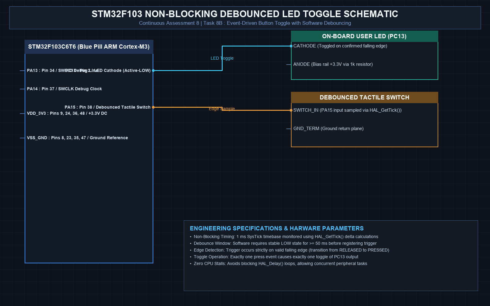

# EXPERIMENT DETAILS
- **Student Name:** Vaishali V
- **Register Number:** 25011102111
- **Degree / Branch:** B.Tech. Computer Science and Engineering (IoT)
- **Year / Semester:** II Year / III Semester
- **Course Title:** Fundamentals of Internet of Things Laboratory (25CS2741)
- **Academic Year:** 2026–2027

---

# CAT 8 - TASK 8B: EVENT-DRIVEN TOGGLE WITH SOFTWARE DEBOUNCING (STM32F103)

## 1. Circuit Diagram & Hardware Description



### Hardware Description
This experiment advances digital input handling on the STM32F103C6T6 by implementing a non-blocking software debounce filter. Each physical press of the button toggles the state of the on-board PC13 LED exactly once, regardless of contact bounce duration or how long the button is held.
- **Microcontroller:** STM32F103C6T6 running at 72 MHz.
- **Input Line:** PA15 configured with `GPIO_PULLUP`.
- **Output Line:** PC13 push-pull active-low LED.
- **Timing Engine:** Cortex-M3 SysTick timer providing a continuous millisecond tick through `HAL_GetTick()`.

---

## 2. Core Logic / Pseudocode / Code Base

### Working Principle
Mechanical switches bounce between 0 and 1 for 10–30 ms when closing. To prevent multiple false toggles, this design uses non-blocking delta timing with `HAL_GetTick()`. When a falling edge is detected (`current == LOW` and `previous == HIGH`), the algorithm verifies that at least 50 ms has passed since the last transition before accepting the press. It then flips the state of PC13 and updates the button history.

### Step-by-Step Pseudocode
```text
BEGIN PROGRAM
    INITIALIZE HAL, SystemClock, GPIO (PA15 Pull-Up, PC13 Output)
    
    GLOBAL last_debounce_time = 0
    GLOBAL last_btn_state = RELEASED
    GLOBAL led_state = 0
    CONST DEBOUNCE_DELAY = 50 ms

    MAIN:
        WHILE TRUE DO:
            current_raw = HAL_GPIO_ReadPin(GPIOA, GPIO_PIN_15)
            now = HAL_GetTick()

            // Edge detection on button press (transition to LOW)
            IF current_raw == GPIO_PIN_RESET AND last_btn_state == RELEASED THEN:
                IF (now - last_debounce_time) > DEBOUNCE_DELAY THEN:
                    HAL_GPIO_TogglePin(GPIOC, GPIO_PIN_13)   // Toggle LED
                    last_debounce_time = now
                    last_btn_state = PRESSED
                END IF
            ELSE IF current_raw == GPIO_PIN_SET AND last_btn_state == PRESSED THEN:
                IF (now - last_debounce_time) > DEBOUNCE_DELAY THEN:
                    last_debounce_time = now
                    last_btn_state = RELEASED
                END IF
            END IF
        END WHILE
END PROGRAM
```

### Source Code Walkthrough
- `HAL_GetTick()` returns elapsed milliseconds since system initialization.
- The state variable `last_btn_state` enforces strict single-event firing per actuation cycle.
- Zero `HAL_Delay()` calls are made, leaving CPU execution bandwidth 100% available for other concurrent tasks.

---

## 3. Expected Output & Inference

### Expected Output
- Starting in the OFF state, pressing the button switches the LED ON solidly.
- Pressing again switches the LED OFF.
- Rapid successive presses toggle the state cleanly without missed or double triggers.

### Inference
Non-blocking debounce algorithms using millisecond tick differentials provide high stability and responsiveness without wasting CPU cycles in busy-wait delay routines.
