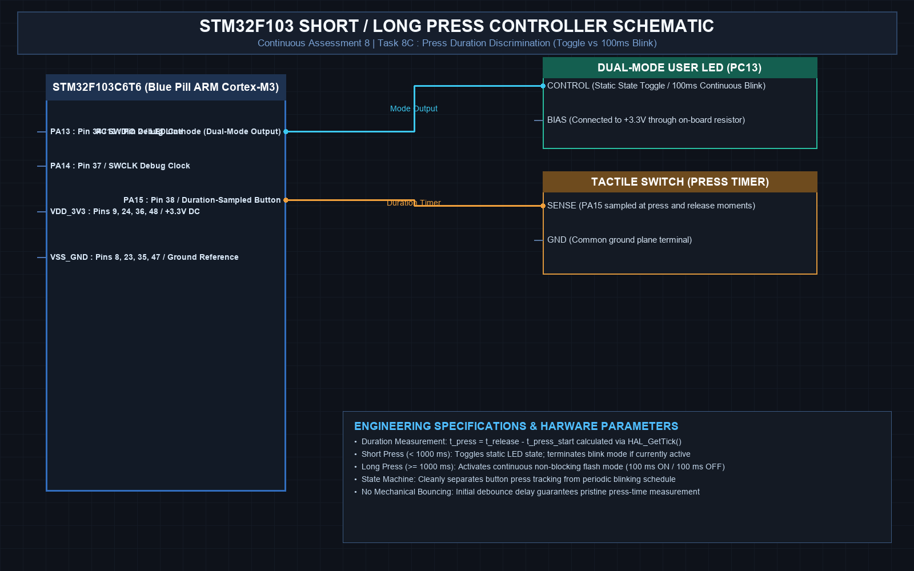

# EXPERIMENT DETAILS
- **Student Name:** Vaishali V
- **Register Number:** 25011102111
- **Degree / Branch:** B.Tech. Computer Science and Engineering (IoT)
- **Year / Semester:** II Year / III Semester
- **Course Title:** Fundamentals of Internet of Things Laboratory (25CS2741)
- **Academic Year:** 2026–2027

---

# CAT 8 - TASK 8C: SHORT VS LONG PRESS DISCRIMINATION (STM32F103)

## 1. Circuit Diagram & Hardware Description



### Hardware Description
This experiment implements a dual-mode human-machine interface on the STM32F103C6T6 microcontroller. Press duration on PA15 determines system behavior:
- **Short Press (< 1000 ms):** Toggles static LED state (or terminates blink mode if active).
- **Long Press (≥ 1000 ms):** Activates continuous non-blocking blinking mode (100 ms period / 5 Hz).
- **Hardware Setup:** STM32F103 Blue Pill, PA15 tactile button (pull-up), PC13 active-low user LED.

---

## 2. Core Logic / Pseudocode / Code Base

### Working Principle
When PA15 is pressed, timestamp `press_start_time = HAL_GetTick()` is recorded. While held, an indicator or counter runs. When the button is released, duration `press_duration = HAL_GetTick() - press_start_time` is calculated:
1. If `press_duration < 1000 ms`, the press is classified as **SHORT**: if blinking, blinking stops; otherwise, the LED toggles.
2. If `press_duration ≥ 1000 ms`, the press is classified as **LONG**: `blinking_active = 1` is latched.
A non-blocking timer in the main loop executes `HAL_GPIO_TogglePin()` every 100 ms whenever `blinking_active == 1`.

### Step-by-Step Pseudocode
```text
BEGIN PROGRAM
    GLOBAL blinking_mode = FALSE
    GLOBAL last_blink_time = 0
    GLOBAL press_start = 0
    GLOBAL is_pressed = FALSE

    MAIN:
        WHILE TRUE DO:
            now = HAL_GetTick()
            btn_down = (HAL_GPIO_ReadPin(GPIOA, GPIO_PIN_15) == GPIO_PIN_RESET)

            // Detect button press start
            IF btn_down AND NOT is_pressed THEN:
                press_start = now
                is_pressed = TRUE
            // Detect button release
            ELSE IF NOT btn_down AND is_pressed THEN:
                duration = now - press_start
                is_pressed = FALSE
                
                IF duration < 1000 THEN:             // Short press
                    IF blinking_mode THEN:
                        blinking_mode = FALSE        // Stop blinking
                        HAL_GPIO_WritePin(GPIOC, GPIO_PIN_13, GPIO_PIN_SET)
                    ELSE:
                        HAL_GPIO_TogglePin(GPIOC, GPIO_PIN_13) // Toggle static
                    END IF
                ELSE:                                // Long press
                    blinking_mode = TRUE             // Enter blink mode
                END IF
            END IF

            // Non-blocking blink scheduler
            IF blinking_mode AND (now - last_blink_time >= 100) THEN:
                HAL_GPIO_TogglePin(GPIOC, GPIO_PIN_13)
                last_blink_time = now
            END IF
        END WHILE
END PROGRAM
```

---

## 3. Expected Output & Inference

### Expected Output
- A quick tap (< 1 s) turns the LED ON or OFF.
- Holding the switch for over 1 second triggers high-speed blinking (100 ms cadence).
- A subsequent short tap terminates blinking and restores static control.

### Inference
Time-domain classification enables multiplexing multiple control modalities onto a single physical switch, significantly reducing hardware BOM costs in consumer and industrial products.
