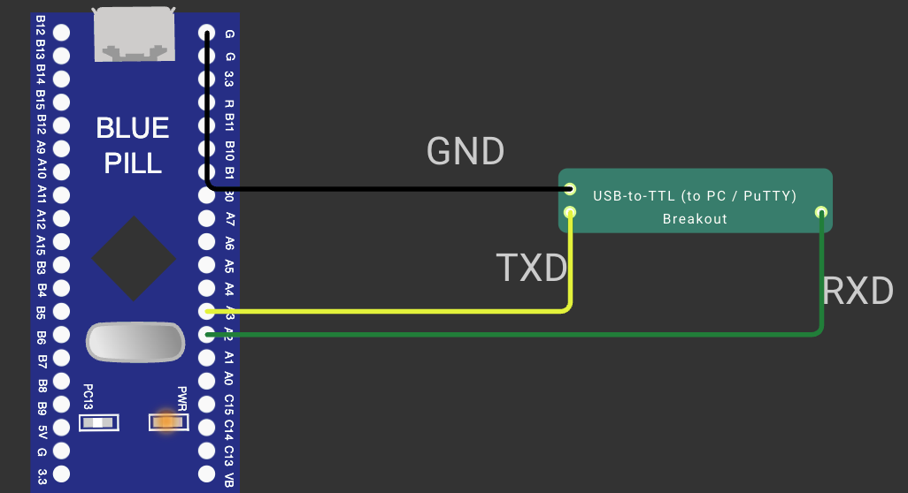

# CONTINUOUS ASSESSMENT 9: SERIAL UART INTERFACE & COMMAND-LINE LED CONTROL

**Student Name:** Vaishali V  
**Register Number:** 25011102111  
**Course Code & Name:** 25CS2741 Fundamentals of Internet of Things + Lab  
**Academic Year:** 2026–2027 | **Semester:** III  
**Date of Performance:** 01/10/2026  
**Hardware Platform:** STM32 "Blue Pill" Development Board (STM32F103C6T6A, ARM Cortex-M3 @ 72 MHz)  
**Development Toolchain:** STM32CubeMX + STM32CubeIDE (HAL Drivers) + USB-to-TTL Serial Bridge + PuTTY  

---

## TASK 9A: Polled UART Communication & Heartbeat Beacon Transmission

### 1. Aim / Objective
To configure hardware peripheral `USART2` on the STM32F103C6T6A microcontroller for asynchronous serial communication at 115200 baud (8-N-1) using the STM32 HAL drivers, implementing a timeout-driven loop that echoes received characters back to the host terminal while emitting a periodic heartbeat beacon character (`'A'`) every second during idle periods.

### 2. Components Required
- STM32 "Blue Pill" Board (STM32F103C6T6A)
- ST-LINK V2 Debugger
- USB-to-TTL Serial Bridge (3.3V Logic Level: CP2102 / CH340 / FTDI)
- Host PC running PuTTY Serial Terminal (115200 baud, 8 data bits, no parity, 1 stop bit)
- Jumper Wires & Common Ground Link

### 3. Hardware Specifications
| Parameter | Technical Configuration |
|---|---|
| Microcontroller | STM32F103C6T6A (72 MHz System Core Clock) |
| UART Peripheral | `USART2` (connected via APB1 peripheral bus @ 36 MHz) |
| UART Pins | `PA2` (`USART2_TX`), `PA3` (`USART2_RX`) |
| Baud Rate | 115200 Baud |
| Framing Format | 8 Data Bits, No Parity, 1 Stop Bit (`115200-8-N-1`), No Hardware Flow Control |
| Polling Timeout | 1000 ms per `HAL_UART_Receive()` call |
| Idle Beacon Output | Character `'A'` transmitted on every 1 s timeout |

### 4. Pin Configuration & Connections
- **STM32 `PA2` (`USART2_TX`):** Connected to USB-to-TTL Bridge `RX` pin.
- **STM32 `PA3` (`USART2_RX`):** Connected to USB-to-TTL Bridge `TX` pin.
- **System Ground:** Blue Pill `GND` tied directly to USB-to-TTL Bridge `GND`.
- **ST-LINK SWD:** Connected to `PA13` (SWDIO) and `PA14` (SWCLK).

### 5. Circuit Diagram


### 6. Working Principle
The STM32 HAL provides synchronous blocking calls with configurable timeouts:
1. **Timeout-Bounded Reception:** `HAL_UART_Receive(&huart2, &ch, 1, 1000)` polls the USART Receive Data Register (`DR`) for up to 1000 ms.
2. **Character Loopback:** If a byte is received before 1000 ms elapses (function returns `HAL_OK`), the MCU immediately invokes `HAL_UART_Transmit(&huart2, &ch, 1, HAL_MAX_DELAY)` to echo the character back to the PuTTY console.
3. **Heartbeat Beacon:** If no byte arrives within 1000 ms, the function returns `HAL_TIMEOUT`. The firmware catches this timeout condition and transmits the character `'A'`. Thus, an untouched terminal displays one `'A'` per second as a continuous operational heartbeat.

$$\text{Call Receive (1000 ms)} \longrightarrow \begin{cases} \text{Character Arrives} & \xrightarrow{\text{Echo Character}} \text{Transmit Received Byte} \\ \text{Timeout Expires} & \xrightarrow{\text{Heartbeat}} \text{Transmit 'A'} \end{cases}$$

### 7. Algorithm / Procedure
1. In STM32CubeMX, enable `USART2` in Asynchronous mode on pins `PA2` and `PA3`.
2. Set Baud Rate to `115200`, Word Length to `8 Bits`, Parity to `None`, Stop Bits to `1`.
3. Generate project files and open `Core/Src/main.c`.
4. In `main()`, declare buffers: `uint8_t ch;` and `uint8_t txChar = 'A';`.
5. Inside the `while(1)` super-loop:
   - Call `HAL_UART_Receive(&huart2, &ch, 1, 1000)`.
   - If return status is `HAL_OK`, call `HAL_UART_Transmit(&huart2, &ch, 1, HAL_MAX_DELAY)` to echo `ch`.
   - If return status is `HAL_TIMEOUT` (or other), call `HAL_UART_Transmit(&huart2, &txChar, 1, HAL_MAX_DELAY)` to send `'A'`.
6. Compile in STM32CubeIDE, flash the microcontroller, and open PuTTY on the active serial port at 115200 baud.

### 8. Source Code Walkthrough
- **Project Folder:** [`TASK_9A_Basic_UART_Communication`](TASK_9A_Basic_UART_Communication/)
- **Source File:** `Core/Src/main.c`
```c
/* USER CODE BEGIN 2 */
uint8_t ch;
uint8_t txChar = 'A';
/* USER CODE END 2 */

/* USER CODE BEGIN WHILE */
while (1)
{
    /* USER CODE END WHILE */

    /* USER CODE BEGIN 3 */
    if (HAL_UART_Receive(&huart2, &ch, 1, 1000) == HAL_OK)
    {
        HAL_UART_Transmit(&huart2, &ch, 1, HAL_MAX_DELAY);
    }
    else
    {
        HAL_UART_Transmit(&huart2, &txChar, 1, HAL_MAX_DELAY);
    }
}
/* USER CODE END 3 */
```

### 9. Expected Output & Results
- When no keys are pressed: The PuTTY terminal prints `A` every second (`AAAA...`).
- When typing: Keystrokes appear on the terminal in real time, interspersed with heartbeat beacons during typing pauses.

### 10. Observations & Inference
- The HAL timeout parameter allows a single blocking function call to serve both as a data receiver and a periodic timer.
- 115200 baud provides rapid data transfer suitable for interactive serial shells.

---

## TASK 9B: String-Based Application Logic & Serial Command Parsing

### 1. Aim / Objective
To design and implement a serial command interpreter on the STM32F103C6T6A microcontroller that buffers incoming UART characters into lines, detects line-feed / carriage-return delimiters, parses supported command strings (`"LED ON"`, `"LED OFF"`, `"LED TOGGLE"`), and performs the corresponding GPIO operations on the onboard `PC13` LED.

### 2. Components Required
- STM32 Blue Pill Board (STM32F103C6T6A)
- ST-LINK V2 Debugger
- USB-to-TTL Serial Bridge connected to PC running PuTTY
- Onboard Active-Low User LED on `PC13`

### 3. Hardware Specifications
| Subsystem | Configuration |
|---|---|
| UART Peripheral | `USART2` on `PA2` (`TX`) and `PA3` (`RX`) @ 115200-8-N-1 |
| LED GPIO | `PC13` (Push-Pull Output, active-low) |
| Line Buffer Size | 128 Bytes (`uint8_t buf[128]`) |
| Delimiters | Carriage Return (`\r` / `0x0D`) or Line Feed (`\n` / `0x0A`) |

### 4. Pin Configuration & Connections
- `PA2` $\rightarrow$ Serial Bridge `RX`; `PA3` $\leftarrow$ Serial Bridge `TX`.
- `PC13` $\rightarrow$ Onboard LED cathode.
- Shared common GND reference.

### 5. Circuit Diagram


### 6. Working Principle
Interactive command-line shells require accumulating individual characters until a line completion delimiter is received:
1. **Character Assembly:** Incoming characters from `USART2` are echoed to PuTTY and appended to `buf[lastInd]`.
2. **Delimiter Detection:** When `\r` or `\n` is encountered, `buf[lastInd]` is replaced with a null terminator `'\0'`, converting the raw buffer into a valid C-string.
3. **Command Dispatch:** The string is evaluated using `strcmp()`:
   - `"LED ON"`: Drives `PC13` LOW via `HAL_GPIO_WritePin()` (LED illuminates).
   - `"LED OFF"`: Drives `PC13` HIGH via `HAL_GPIO_WritePin()` (LED extinguishes).
   - `"LED TOGGLE"`: Inverts `PC13` state via `HAL_GPIO_TogglePin()`.
   - Unknown commands are ignored.
4. **Buffer Reset:** `lastInd` is reset to 0 to await the subsequent command line.

| Serial Command String | Executed Hardware Action | Resulting `PC13` State |
|---|---|---|
| `LED ON` | Turn On Active-Low LED | `GPIO_PIN_RESET` (0 V) |
| `LED OFF` | Turn Off Active-Low LED | `GPIO_PIN_SET` (3.3 V) |
| `LED TOGGLE` | Invert Current LED State | Inverted |

### 7. Algorithm / Procedure
1. Configure `USART2` for 115200-8-N-1 and `PC13` as push-pull output.
2. Initialize `PC13` HIGH (LED OFF) at boot.
3. Declare `char buf[128]; uint8_t ch; uint8_t lastInd = 0;`.
4. In `while(1)`:
   - Call `HAL_UART_Receive(&huart2, &ch, 1, HAL_MAX_DELAY)`.
   - Echo `ch` back to terminal via `HAL_UART_Transmit()`.
   - If `ch == '\r' || ch == '\n'`:
     - If `lastInd > 0`:
       - Append `buf[lastInd] = '\0'`.
       - If `strcmp(buf, "LED ON") == 0`: set `PC13` to `RESET`.
       - If `strcmp(buf, "LED OFF") == 0`: set `PC13` to `SET`.
       - If `strcmp(buf, "LED TOGGLE") == 0`: toggle `PC13`.
       - Reset `lastInd = 0`.
   - Else if `lastInd < sizeof(buf) - 1`:
     - Store `buf[lastInd++] = ch`.
5. Flash firmware and test through PuTTY.

### 8. Source Code Walkthrough
- **Project Folder:** [`TASK_9B_String_Based_Application_Logic`](TASK_9B_String_Based_Application_Logic/)
- **Source File:** `Core/Src/main.c`
```c
/* USER CODE BEGIN 2 */
uint8_t ch;
char buf[128];
uint8_t lastInd = 0;
HAL_GPIO_WritePin(GPIOC, GPIO_PIN_13, GPIO_PIN_SET); // LED OFF initially
/* USER CODE END 2 */

/* USER CODE BEGIN WHILE */
while (1)
{
    /* USER CODE END WHILE */

    /* USER CODE BEGIN 3 */
    if (HAL_UART_Receive(&huart2, &ch, 1, HAL_MAX_DELAY) == HAL_OK)
    {
        HAL_UART_Transmit(&huart2, &ch, 1, HAL_MAX_DELAY); // Local echo

        if (ch == '\r' || ch == '\n')
        {
            if (lastInd > 0)
            {
                buf[lastInd] = '\0';
                if (strcmp(buf, "LED ON") == 0)
                {
                    HAL_GPIO_WritePin(GPIOC, GPIO_PIN_13, GPIO_PIN_RESET);
                }
                else if (strcmp(buf, "LED OFF") == 0)
                {
                    HAL_GPIO_WritePin(GPIOC, GPIO_PIN_13, GPIO_PIN_SET);
                }
                else if (strcmp(buf, "LED TOGGLE") == 0)
                {
                    HAL_GPIO_TogglePin(GPIOC, GPIO_PIN_13);
                }
                lastInd = 0;
            }
        }
        else if (lastInd < sizeof(buf) - 1)
        {
            buf[lastInd++] = (char)ch;
        }
    }
}
/* USER CODE END 3 */
```

### 9. Expected Output & Results
In PuTTY, typing commands followed by pressing Enter produces immediate hardware responses:
```
LED ON       --> PC13 LED illuminates
LED OFF      --> PC13 LED extinguishes
LED TOGGLE   --> PC13 LED flips state
```

### 10. Observations & Inference
- Character buffering combined with string comparison enables intuitive human-to-machine textual control over embedded peripherals.
- Protecting the buffer against index overflows (`lastInd < sizeof(buf) - 1`) prevents memory corruption from oversized input strings.
