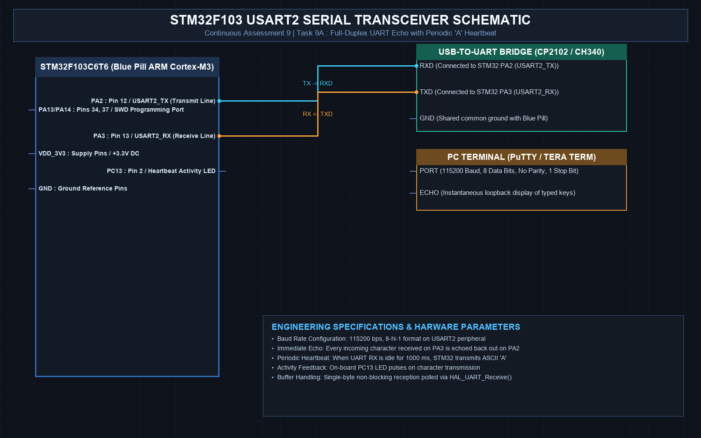

# EXPERIMENT DETAILS
- **Student Name:** Vaishali V
- **Register Number:** 25011102111
- **Degree / Branch:** B.Tech. Computer Science and Engineering (IoT)
- **Year / Semester:** II Year / III Semester
- **Course Title:** Fundamentals of Internet of Things Laboratory (25CS2741)
- **Academic Year:** 2026–2027

---

# CAT 9 - TASK 9A: USART2 ASYNCHRONOUS TRANSCEIVER & HEARTBEAT (STM32F103)

## 1. Circuit Diagram & Hardware Description



### Hardware Description
This experiment configures the USART2 hardware peripheral on the STM32F103C6T6 microcontroller to establish full-duplex serial communication with a host PC.
- **Serial Channel:** USART2 peripheral running at 115200 Baud, 8 Data Bits, No Parity, 1 Stop Bit (8-N-1).
- **Physical Pins:**
  - `PA2` -> USART2_TX (Alternate Function Push-Pull)
  - `PA3` -> USART2_RX (Input Floating)
- **Host Bridge:** External CP2102 or CH340 USB-to-UART bridge connecting PA2/PA3 to the computer.
- **Heartbeat & Echo:** Every character typed on the host terminal is immediately echoed back. If the line remains idle for 1000 ms, the MCU autonomously transmits ASCII character `'A'`.

---

## 2. Core Logic / Pseudocode / Code Base

### Working Principle
USART2 is initialized via `MX_USART2_UART_Init()` with a 115200 baud timebase derived from APB1 (36 MHz clock). In the main loop, `HAL_UART_Receive(&huart2, &rx_byte, 1, 10)` polls for incoming characters with a non-blocking 10 ms timeout. When a byte arrives, it is immediately retransmitted via `HAL_UART_Transmit(&huart2, &rx_byte, 1, 10)`. An elapsed-time check tracks idle periods; if 1000 ms passes without incoming data, character `'A'` is transmitted.

### Step-by-Step Pseudocode
```text
BEGIN PROGRAM
    INITIALIZE HAL, SystemClock, GPIO, USART2 (115200-8-N-1)
    GLOBAL last_rx_time = 0

    MAIN:
        last_rx_time = HAL_GetTick()
        WHILE TRUE DO:
            // Non-blocking check for incoming character
            status = HAL_UART_Receive(&huart2, &rx_byte, 1, 10)
            now = HAL_GetTick()

            IF status == HAL_OK THEN:
                // Echo received character
                HAL_UART_Transmit(&huart2, &rx_byte, 1, 50)
                last_rx_time = now
            ELSE:
                // Check idle timeout
                IF (now - last_rx_time) >= 1000 THEN:
                    beacon = 'A'
                    HAL_UART_Transmit(&huart2, &beacon, 1, 50)
                    last_rx_time = now
                END IF
            END IF
        END WHILE
END PROGRAM
```

---

## 3. Expected Output & Inference

### Expected Output
- While idle, the terminal prints an `'A'` character every second: `AAAAAAAAAA...`
- Typing characters (e.g., `Hello STM32`) displays them immediately on the terminal window.

### Inference
Non-blocking UART reception with short timeouts enables a microcontroller to interleave communications handling with periodic background housekeeping tasks.
