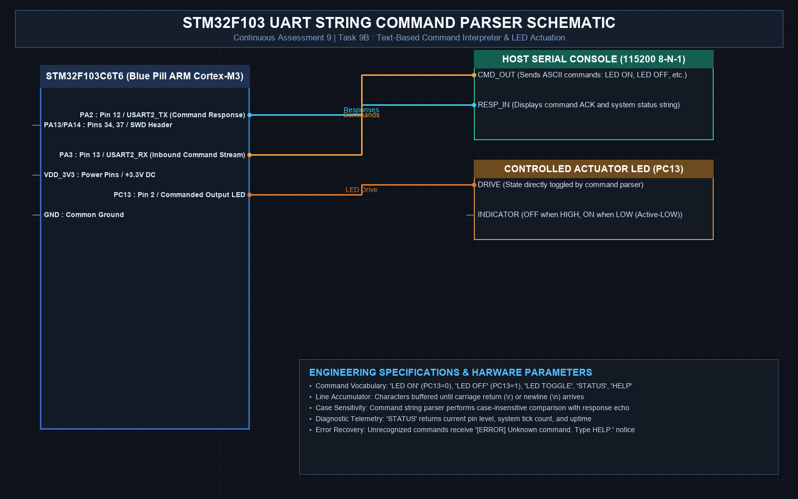

# EXPERIMENT DETAILS
- **Student Name:** Vaishali V
- **Register Number:** 25011102111
- **Degree / Branch:** B.Tech. Computer Science and Engineering (IoT)
- **Year / Semester:** II Year / III Semester
- **Course Title:** Fundamentals of Internet of Things Laboratory (25CS2741)
- **Academic Year:** 2026–2027

---

# CAT 9 - TASK 9B: UART ASCII COMMAND INTERPRETER (STM32F103)

## 1. Circuit Diagram & Hardware Description



### Hardware Description
This experiment develops a complete text-based command shell on the STM32F103C6T6 over USART2. Incoming ASCII strings from a host PC are buffered, parsed, and executed to control hardware actuators.
- **Port:** USART2 (PA2 TX, PA3 RX) at 115200 baud (8-N-1).
- **Actuator:** On-board user LED on PC13.
- **Supported Commands:**
  - `LED ON` -> Pulls PC13 LOW (illuminates LED).
  - `LED OFF` -> Drives PC13 HIGH (extinguishes LED).
  - `LED TOGGLE` -> Inverts PC13 state.
  - `STATUS` -> Returns current LED state and system uptime.
  - `HELP` -> Prints command reference menu.

---

## 2. Core Logic / Pseudocode / Code Base

### Working Principle
Characters received over USART2 are accumulated into an internal line buffer `rx_buffer[]` until a carriage return (`
`) or newline (`
`) delimiter is detected. The buffer is then null-terminated and compared against known command tokens using `strcmp()`. Formatted response messages are dispatched back to the terminal.

### Step-by-Step Pseudocode
```text
BEGIN PROGRAM
    GLOBAL rx_buf[64], buf_idx = 0

    FUNCTION process_command(cmd):
        IF strcmp(cmd, "LED ON") == 0 THEN:
            HAL_GPIO_WritePin(GPIOC, GPIO_PIN_13, GPIO_PIN_RESET)
            uart_print("OK: LED is turned ON\r\n")
        ELSE IF strcmp(cmd, "LED OFF") == 0 THEN:
            HAL_GPIO_WritePin(GPIOC, GPIO_PIN_13, GPIO_PIN_SET)
            uart_print("OK: LED is turned OFF\r\n")
        ELSE IF strcmp(cmd, "LED TOGGLE") == 0 THEN:
            HAL_GPIO_TogglePin(GPIOC, GPIO_PIN_13)
            uart_print("OK: LED toggled\r\n")
        ELSE IF strcmp(cmd, "STATUS") == 0 THEN:
            uart_print("STATUS: System Active | Uptime: ")
            print_uint(HAL_GetTick())
            uart_print(" ms\r\n")
        ELSE IF strcmp(cmd, "HELP") == 0 THEN:
            uart_print("Commands: LED ON, LED OFF, LED TOGGLE, STATUS, HELP\r\n")
        ELSE:
            uart_print("ERROR: Unknown command. Type HELP.\r\n")
        END IF
    END FUNCTION

    MAIN:
        WHILE TRUE DO:
            IF HAL_UART_Receive(&huart2, &c, 1, 10) == HAL_OK THEN:
                IF c == '\r' OR c == '\n' THEN:
                    IF buf_idx > 0 THEN:
                        rx_buf[buf_idx] = '\0'
                        process_command(rx_buf)
                        buf_idx = 0
                    END IF
                ELSE IF buf_idx < 63 THEN:
                    rx_buf[buf_idx] = c
                    buf_idx = buf_idx + 1
                END IF
            END IF
        END WHILE
END PROGRAM
```

---

## 3. Expected Output & Inference

### Expected Output
- Typing `LED ON` turns ON the PC13 LED and outputs `OK: LED is turned ON`.
- Typing `STATUS` prints system telemetry including milliseconds since boot.
- Invalid commands return helpful error diagnostics.

### Inference
Command-line interpreters (CLIs) provide a standardized, human-readable interface for configuring, testing, and debugging embedded firmware in field deployments.
